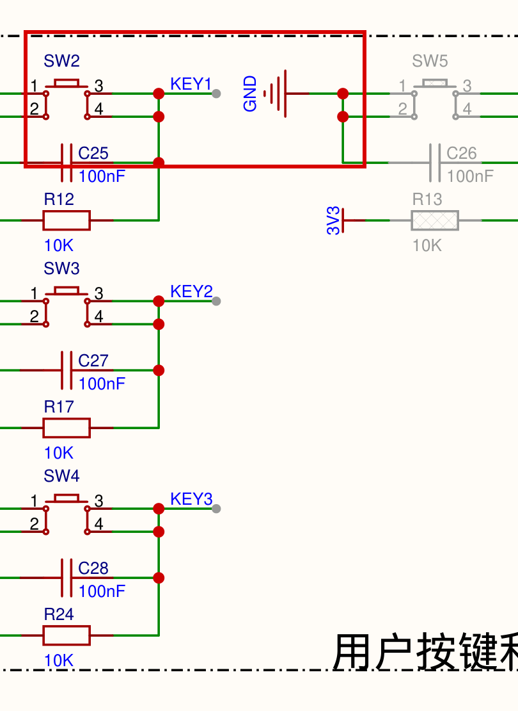

# F407 外设通关教程（寄存器版 + HAL 版）

> **分工**：资料/截图/讲解 AI 备好，代码你手敲（practice 分支），卡壳 15 分钟再看 main 分支参考答案。
> **两版关系**：每个节点寄存器版和 HAL 版思路一样，共用的知识放本章前部，差异各自小节。
> **任务清单**：节点一 点灯 ✅ / 节点二 按键 / 节点三 串口 / 节点四 I2C / 节点五 SPI / 节点六 屏幕 / 节点七 LVGL / 节点八 ADC / 节点九 DAC

---

## 开始之前 · 接线与烧录（全节点通用，只讲这一次）

### 接线

| 接什么 | 怎么接 |
|---|---|
| DC 电源（必须） | 电源座插适配器（7~24V），**ON 开关拨到 ON** |
| ST-Link | `SWDIO→SWD`、`SWCLK→SCK`、`GND→GND` 三根（右缘 5 针排针，3V3/RST 不用接） |
| USB-C | 插 **USB>TTL** 口（串口日志用；OTG 口随意） |

自检：设备管理器出现 CH340 串口号 = 板子通电；`STM32_Programmer_CLI.exe -c port=SWD mode=UR` 看到 `Device ID : 0x413` = ST-Link 全通。

### 烧录（Keil 方式）

**铁律四步：改代码 → Ctrl+S → F7（重新编译）→ LOAD（下载）**。LOAD 不会自动编译，不 F7 烧的是旧固件。

首次配置（每个工程各配一次，魔术棒 = ALT+F7）：
1. **Debug** 页：选 **ST-Link Debugger** → Settings 看到 ST-Link 序列号 + IDCODE，Port = SW
2. **Flash Download** 页：算法 **STM32F4xx Flash 512KB** + **勾选 "Reset and Run"** ←★ 烧完不复位 = 全无反应

命令行等价（`-rst` = Reset and Run）：
```bash
cd C:/Users/26476/Desktop/F407-Lab/reg/f407-reg-lab/MDK-ARM
"C:/Program Files/STMicroelectronics/STM32Cube/STM32CubeProgrammer/bin/STM32_Programmer_CLI.exe" -c port=SWD mode=UR -w Objects/f407-reg-lab.hex -v -rst
```

**提交**：现象确认后 `git add -A && git commit -m "节点号. 内容" && git push`。

---

# 节点一 · 点亮 LED 灯 ✅

## 1. 看图找灯


**怎么读**：原理图第 3 页。电流方向：PD10 → LED → 4.7K → GND，所以 **PD10 输出高电平灯亮**。
⚠️ 与 F103 板相反。位号 LED3 ≠ 网络名 LED1，别混。


**怎么读**：第 7 页：**LED1 = PD10**（红）、LED2 = PD11（绿）、LED3 = PD12（蓝）。

## 2. 原理

**四步流程**：确定引脚 → 开时钟 → 配输出 → 亮灭交替。F1 → F4 的变化：

| 步骤 | F103 | F407 |
|---|---|---|
| 开 GPIO 时钟 | `RCC->APB2ENR` | `RCC->AHB1ENR`（换域了） |
| 配输入/输出 | CRL/CRH 每脚 4 位 | **没了**，用 MODER/OTYPER/OSPEEDR/PUPDR 四个寄存器 |
| 输出电平 | BSRR / BRR / ODR | **只有 BSRR**（BRR 没了） |

### 2.1 开时钟


**怎么读**：RM0090 中文版第 244 页，**bit3 = GPIODEN**，写 1 给 GPIOD 供电。（表头在第 243 页。）

### 2.2 配输出


**怎么读**：第 283 页 `GPIOx_MODER`——**每脚 2 位**：00 输入 / 01 输出 / 10 复用 / 11 模拟。
PD10 占 **bit[21:20]**（脚号×2=起始位；21 高位格、20 低位格）。
`1<<20` 写入 01=输出；`1<<21` 会写成 10=复用——错一位就是另一种模式，编译器不报错。
复位默认全 0 = 输入（**只听不说，忘了配灯永远不亮**——我们真踩过）。
（OTYPER 第 283 页、OSPEEDR/PUPDR 第 284 页，复位默认=推挽低速无拉，本节点不用写。）

### 2.3 亮与灭


**怎么读**：第 286 页 `GPIOx_BSRR`——低 16 位 BSx 写 1 = 高；高 16 位 BRx 写 1 = 低；写 0 无效。
`BS10`（bit10）= 亮，`BR10`（bit26）= 灭。一次写完不读旧值 = **原子操作**。
`|=` 是读-改-写，初始化用没风险；主循环翻电平用 BSRR。

### 2.4 延时


**怎么读**：第 217 页时钟树 + 第 219 页原话——复位默认 **HSI 16MHz**。
1ms = 16000 个时钟（直连 HCLK）或 2000 个（HCLK÷8，CTRL 不置 bit2），两种都行，参数配套即可。
时钟先不配 PLL——时钟节点再上 168MHz（必须实证晶振 8MHz、显式 `HSE_VALUE=8000000`）。

## 3. 寄存器版

| 寄存器 | 地址 | 干什么 |
|---|---|---|
| `RCC->AHB1ENR` | 0x40023830 | `\|= 1<<3` 开 GPIOD |
| `GPIOD->MODER` | 0x40020C00 | 先 `&= ~(3<<20)` 再 `\|= (1<<20)` |
| `GPIOD->BSRR` | 0x40020C18 | 亮 `1<<10`，灭 `1<<26` |

```c
int main(void)
{
    SystemCoreClockUpdate();

    RCC->AHB1ENR |= RCC_AHB1ENR_GPIODEN;        /* 开时钟 */

    GPIOD->MODER &= ~(3UL << 20);               /* 清 [21:20] */
    GPIOD->MODER |=  (1UL << 20);               /* 输出 */

    GPIOD->BSRR = GPIO_BSRR_BR10;               /* 上电先灭 */

    while (1)
    {
        GPIOD->BSRR = GPIO_BSRR_BR10;           /* 灭 */
        delay_ms(500);
        GPIOD->BSRR = GPIO_BSRR_BS10;           /* 亮 */
        delay_ms(500);
    }
}
```

`delay_ms` 用 SysTick（原理同 F103，LOAD 填 16000−1 直连或 2000−1 走 ÷8，配套就行）。
**扩展**：双灯照公式——PD11 用 `3<<22`/`1<<22`/`BS11`/`BR11`。

**验收**：0 错 0 警（≈700~800B）→ 红灯 500ms 闪、上电先灭。

## 4. HAL 版

| 你写的 | 它替你写的 |
|---|---|
| `__HAL_RCC_GPIOD_CLK_ENABLE()` | `AHB1ENR \|= 1<<3` |
| `HAL_GPIO_Init(GPIOD, &...)` | MODER/OTYPER/OSPEEDR/PUPDR 四连写 |
| `HAL_GPIO_WritePin(...SET/RESET)` | BSRR 置位/清零 |
| `HAL_Delay(500)` | SysTick 1ms 中断累计 uwTick 查差值 |

```c
int main(void)
{
  GPIO_InitTypeDef GPIO_InitStruct = {0};

  HAL_Init();                     /* SysTick 1ms 心跳 */

  __HAL_RCC_GPIOD_CLK_ENABLE();

  GPIO_InitStruct.Pin   = GPIO_PIN_10;          /* PD10 */
  GPIO_InitStruct.Mode  = GPIO_MODE_OUTPUT_PP;  /* 推挽输出 */
  GPIO_InitStruct.Pull  = GPIO_NOPULL;
  GPIO_InitStruct.Speed = GPIO_SPEED_FREQ_LOW;
  HAL_GPIO_Init(GPIOD, &GPIO_InitStruct);

  HAL_GPIO_WritePin(GPIOD, GPIO_PIN_10, GPIO_PIN_RESET);   /* 上电先灭 */

  while (1)
  {
    HAL_GPIO_WritePin(GPIOD, GPIO_PIN_10, GPIO_PIN_RESET);  /* 灭 */
    HAL_Delay(500);
    HAL_GPIO_WritePin(GPIOD, GPIO_PIN_10, GPIO_PIN_SET);    /* 亮 */
    HAL_Delay(500);
  }
}
```

**时钟不用写**：复位默认 HSI 16MHz。F103 板那份 `HSI/2×16=64MHz` 在 F4 编译不过（`RCC_HSE_PREDIV_DIV1` 等是 F1 专属宏），整个删掉。

**验收**：0 错 0 警（≈3.2KB）→ 现象与寄存器版一致。

## 5. 翻车实录

| 现象 | 真因 | 解法 |
|---|---|---|
| 编译 0 错，灯不亮 | 没配 MODER，还是输入模式 | 补"先清后写"两行 |
| 改了代码，烧完还是老现象 | LOAD 不自动编译，烧的旧 hex | **先 F7 再 LOAD** |
| 烧录成功，灯全灭 | 烧完停在暂停态 | 勾 Reset and Run / 命令带 -rst |
| 报 `has no field "BRR"` | F103 的 BRR 在 F4 上不存在 | 清零用 `GPIO_BSRR_BR10` |
| HAL 报 `RCC_HSE_PREDIV_DIV1` 未定义 | F1 专属宏 | 删 SystemClock_Config |
| 绿灯很暗 | 绿光压降 ≈3.0V（红 ≈2.0V），电流只有 1/4 | 正常物理现象 |
| 写成 PC13/GPIOC | F103 板 LED 在 PC13，肌肉记忆 | 以本板原理图为准 |

---

# 节点二 · 按键控制 LED

## 1. 看图找键



**怎么读**：原理图第 3 页（红框=一个按键的完整电路）：左脚接 GND，右脚经 **10K 上拉到 3V3**，
引出网络 KEY1。所以**松开=高电平，按下=低电平（低有效）**。C25 是硬件消抖辅助（软件消抖还是要做）。


**怎么读**：第 7 页：**KEY1 = PD13、KEY2 = PD14、KEY3 = PD15**。本节点用 KEY1 + LED1。

## 2. 原理

和节点一比只多一件事：**读引脚电平**。

| 步骤 | 要点 |
|---|---|
| 开时钟 | 同节点一（AHB1ENR bit3） |
| PD13 配输入 | MODER **[27:26]** = 00（13×2=26）；板上已有 10K 上拉，**PUPDR 不用配** |
| 读电平 | **GPIOx_IDR**（输入数据寄存器）读 bit13：**0=按下，1=松开** |


**怎么读**：第 284 页 `GPIOx_PUPDR`——每脚 2 位：00 无上下拉 / 01 上拉 / 10 下拉。板上焊了上拉，芯片保持 00 即可。


**怎么读**：第 285 页 `GPIOx_IDR`——每脚 1 位，**只读**，bit 号=脚号。
**IDR vs ODR**：ODR 是"你让它输出什么"，IDR 是"引脚现在真实电平"。读按键永远用 IDR。

**消抖（版本 B 才需要）**：机械按键按下会弹跳 5~20ms。软件消抖 = 检测到按下后**等 20ms 再看一眼**，还是按下才算；然后**等松手**，防长按算多次。

## 3. 寄存器版

### 版本 A：按住亮、松开灭

```c
#include "stm32f4xx.h"

int main(void)
{
    SystemCoreClockUpdate();

    RCC->AHB1ENR |= RCC_AHB1ENR_GPIODEN;   /* 开 GPIOD 时钟 */

    GPIOD->MODER &= ~(3UL << 26);          /* PD13 输入：清 [27:26] 成 00（输入不用写1） */
    GPIOD->MODER &= ~(3UL << 20);          /* PD10 输出：先清 */
    GPIOD->MODER |=  (1UL << 20);          /* 再写 01 */

    GPIOD->BSRR = GPIO_BSRR_BR10;          /* 上电先灭 */

    while (1)
    {
        if (GPIOD->IDR & GPIO_IDR_ID13)    /* bit13：1=松开 */
            GPIOD->BSRR = GPIO_BSRR_BR10;  /* 灭 */
        else                               /* 0=按下 */
            GPIOD->BSRR = GPIO_BSRR_BS10;  /* 亮 */
    }
}
```

### 版本 B：按一下翻转一次（A 通关后再做）

三招：**消抖 20ms → 翻转 → 等松手**。`while(1)` 换成（`delay_ms` 从 `chapters/ch1_led.c` 搬，文件里加 `uint32_t led = 0;`）：

```c
    uint32_t led = 0;

    while (1)
    {
        if ((GPIOD->IDR & GPIO_IDR_ID13) == 0)      /* 检测到按下 */
        {
            delay_ms(20);                           /* 消抖 */
            if ((GPIOD->IDR & GPIO_IDR_ID13) == 0)  /* 还是按下 = 真按 */
            {
                led = !led;
                if (led)
                    GPIOD->BSRR = GPIO_BSRR_BS10;
                else
                    GPIOD->BSRR = GPIO_BSRR_BR10;
                while ((GPIOD->IDR & GPIO_IDR_ID13) == 0) { }  /* 等松手 */
            }
        }
    }
```

## 4. 验收

| 版本 | 现象 | 通关标准 |
|---|---|---|
| A | 按住 KEY1 → 红灯亮；松开 → 灭 | 跟手，无延迟感 |
| B | 每按一下翻转一次 | 长按只算一次；连按每次都响应 |

**常见翻车**：灯常亮不跟手 → 读了 ODR 不是 IDR；按一下翻好几次 → 忘了消抖/等松手；怎么按都没反应 → MODER 忘清 [27:26] 或时钟没开。

---

# 节点三 · 串口（待写）

# 节点四 · I2C（待写）

# 节点五 · SPI（待写）

# 节点六 · 屏幕（待写）

# 节点七 · LVGL（待写）

# 节点八 · ADC（待写）

# 节点九 · DAC（待写）
