# 	F407 外设通关教程（寄存器版 + HAL 版）

> **分工**：资料/截图/讲解 AI 备好，代码你手敲（practice 分支），卡壳 15 分钟再看 main 分支参考答案。
> **两版关系**：每个节点寄存器版和 HAL 版思路一样，共用的知识放本章前部，差异各自小节。
> **任务清单**：节点一 点灯 ✅ / 节点二 按键 ✅ / 节点三 串口 ✅ / 节点四 I2C ✅ / 节点五 SPI ✅ / 节点六 屏幕 ✅ / 节点七 LVGL ✅ / 节点八 ADC ✅ / 节点九 DAC ✅/ 节点六 屏幕 ✅ / 节点七 LVGL ✅ / 节点八 ADC ✅ / 节点九 DAC ✅ / 节点八 ADC / 节点九 DAC

---

## 开始之前 · 接线与烧录（全节点通用，只讲这一次）

### 接线

| 接什么 | 怎么接 |
|---|---|
| DC 电源（必须） | 电源座插适配器（7~24V），**ON 开关拨到 ON** |
| ST-Link | `SWDIO→SWD`、`SWCLK→SCK`、`GND→GND` 三根（右缘 5 针排针，3V3/RST 不用接） |
| USB-C | 插 **USB>TTL** 口（串口日志用；OTG 口随意） |

自检：设备管理器出现 CH340 串口号 = 板子通电；`STM32_Programmer_CLI.exe -c port=SWD mode=UR` 看到 `Device ID : 0x413` = ST-Link 全通。

### 烧录（Keil 方式）

**铁律四步：改代码 → Ctrl+S → F7（重新编译）→ LOAD（下载）**。LOAD 不会自动编译，不 F7 烧的是旧固件。

首次配置（每个工程各配一次，魔术棒 = ALT+F7）：
1. **Debug** 页：选 **ST-Link Debugger** → Settings 看到 ST-Link 序列号 + IDCODE，Port = SW
2. **Flash Download** 页：算法 **STM32F4xx Flash 512KB** + **勾选 "Reset and Run"** ←★ 烧完不复位 = 全无反应

命令行等价（`-rst` = Reset and Run）：
```bash
cd C:/Users/26476/Desktop/F407-Lab/reg/f407-reg-lab/MDK-ARM
"C:/Program Files/STMicroelectronics/STM32Cube/STM32CubeProgrammer/bin/STM32_Programmer_CLI.exe" -c port=SWD mode=UR -w Objects/f407-reg-lab.hex -v -rst
```

**提交**：现象确认后 `git add -A && git commit -m "节点号. 内容" && git push`。

---

# 资料获取方法论（每个节点都靠这五类资料）

> 这一节回答"AI 的每一步信息是从哪查到的"。你以后自己做新项目，照这个顺序找，不会卡。

## 五类资料，各管什么

| 资料类型 | 具体文件 | 管什么 | 在哪找 |
|---|---|---|---|
| **① 原理图** | `F407VET6(1).pdf`（导师给的 7 页） | 引脚号、电路接法、有效电平 | 导师给（本项目在 `F407-Lab/`） |
| **② 芯片寄存器手册** | `RM0090`（1741 页） | 每个寄存器的位定义、地址、时序 | ST 官网搜 "RM0090" 下载 |
| **③ 内核手册** | `PM0214`（262 页） | NVIC、SysTick、内核异常 | ST 官网搜 "PM0214" |
| **④ 头文件** | `stm32f407xx.h`、`stm32f4xx_hal_xxx.h` | 宏的真实名字、结构体成员、函数签名 | **就在工程里**，Keil 里 F12 跳转 |
| **⑤ 器件手册/开源驱动** | AT24C02/W25Q16/ST7789 数据手册、LVGL 源码 | 芯片命令集、开源库用法 | 厂商官网 / GitHub / Gitee |

## 每个节点实际查了什么（真实路径）

| 节点 | 查了什么 | 具体位置 |
|---|---|---|
| 一 点灯 | LED 电路、引脚号 | 原理图页 3（LED 电路）、页 7（引脚表） |
| | 时钟使能位、MODER、BSRR | RM0090 p243-244（AHB1ENR）、p283（MODER）、p286（BSRR） |
| | 宏名是否真实存在 | `stm32f407xx.h`（grep `GPIO_BSRR_BR10`）——**这一步抓出过 BRR 不存在的错** |
| 二 按键 | 按键电路（上拉/有效电平） | 原理图页 3（10K 上拉电路） |
| | IDR 位表、PUPDR | RM0090 p285（IDR）、p284（PUPDR） |
| 三 串口 | CH340 接线 | 原理图页 3（USB转串口）、页 7（CH340_TX→PA9） |
| | BRR 公式、CR1、SR | RM0090 p973（BRR）、p1006（CR1）、p1003（SR） |
| | **中断号 37** | RM0090 **p375 Table 62 向量表**（只能查表，不能算） |
| | NVIC_ISER 机制 | **PM0214 p210**（NVIC 是 ARM 的，RM0090 里没有！） |
| | HAL 函数签名 | `stm32f4xx_hal_uart.h` 行 718/745/748/773 |
| 四 I2C | AT24C02 地址（A0-A2 接地） | 原理图页 4（A0/A1/A2 接 GND）、页 7（SCL/SDA→PB10/11） |
| | CR1/CR2/CCR/TRISE/SR1 | RM0090 p857/858/865/866/863 |
| | EEPROM 写周期 | AT24C02 datasheet（5ms）+ **实测验证** |
| 五 SPI | W25Q16 接线 | 原理图页 4（U7）、页 7（FLA_*→PA4-7） |
| | SPI_CR1/SPI_SR | RM0090 p912（CR1）、p915（SR） |
| | W25Q16 命令集（0x9F/0x06/0x20/0x02/0x03） | W25Q16 datasheet + 开源驱动 |
| 六 屏幕 | LCD 座 14 针定义 | 原理图页 4（U9）、页 7（LCD_*→PB3/PB5/…） |
| | ST7789 命令（0x3A/0x36/0x20/0x2A/0x2C） | 开源驱动惯例 + **实测**（手册需原厂申请） |
| 七 LVGL | LVGL 源码 | GitHub release v8.3.11 / Gitee 镜像 |
| | 移植三要素 | docs.lvgl.io "Porting" 章节 |

## 查资料的三条铁律（踩过的坑换来的）

1. **手册页码不靠记忆，靠搜索**：我每次都用脚本在 PDF 里搜关键词定位页码，再渲染成截图。
   目录推的页码可能是错的（IDR 目录说 284，实际 285）。
2. **宏名以头文件为准，不以手册为准**：手册叫 `GPIOx_AFRH`，代码里是 `AFR[1]`；
   F103 有 `BRR`，F407 头文件里根本没有（只剩兼容别名）。
3. **查不到就标"未获取"**：ST7789 手册需要注册，本章就如实写"参数来源=开源驱动+实测"，
   绝不假装有手册依据。

---

# 节点一 · 点亮 LED 灯 ✅

## 1. 看图找灯

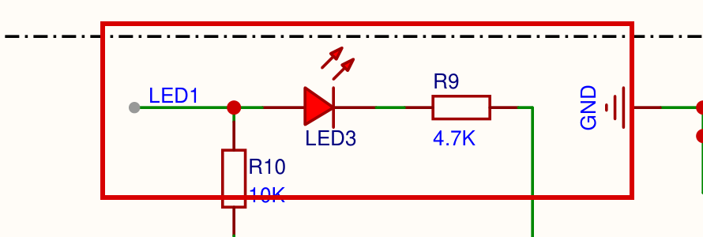

**怎么读**：原理图第 3 页。电流方向：PD10 → LED → 4.7K → GND，所以 **PD10 输出高电平灯亮**。
⚠️ 与 F103 板相反。位号 LED3 ≠ 网络名 LED1，别混。

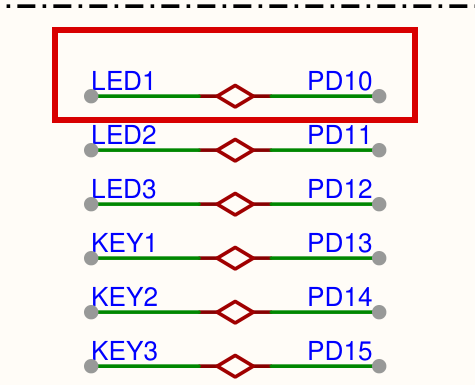

**怎么读**：第 7 页：**LED1 = PD10**（红）、LED2 = PD11（绿）、LED3 = PD12（蓝）。

## 2. 原理

**四步流程**：确定引脚 → 开时钟 → 配输出 → 亮灭交替。F1 → F4 的变化：

| 步骤 | F103 | F407 |
|---|---|---|
| 开 GPIO 时钟 | `RCC->APB2ENR` | `RCC->AHB1ENR`（换域了） |
| 配输入/输出 | CRL/CRH 每脚 4 位 | **没了**，用 MODER/OTYPER/OSPEEDR/PUPDR 四个寄存器 |
| 输出电平 | BSRR / BRR / ODR | **只有 BSRR**（BRR 没了） |

### 2.1 开时钟

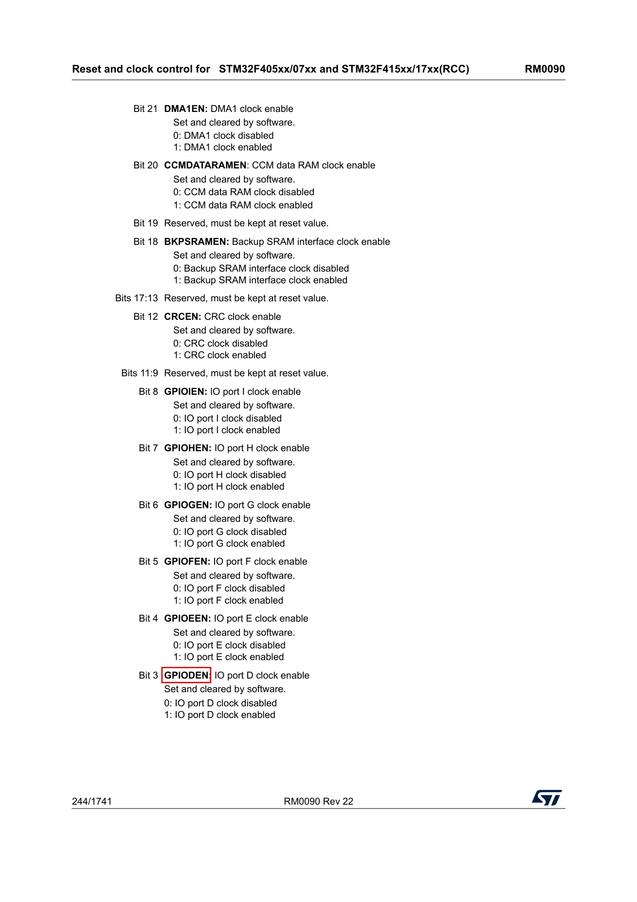

**怎么读**：RM0090 中文版第 244 页，**bit3 = GPIODEN**，写 1 给 GPIOD 供电。（表头在第 243 页。）

### 2.2 配输出

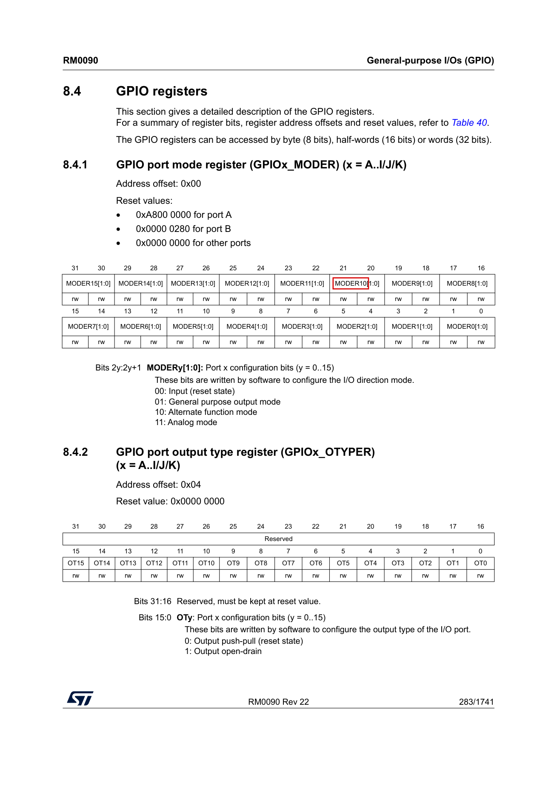

**怎么读**：第 283 页 `GPIOx_MODER`——**每脚 2 位**：00 输入 / 01 输出 / 10 复用 / 11 模拟。
PD10 占 **bit[21:20]**（脚号×2=起始位；21 高位格、20 低位格）。
`1<<20` 写入 01=输出；`1<<21` 会写成 10=复用——错一位就是另一种模式，编译器不报错。
复位默认全 0 = 输入（**只听不说，忘了配灯永远不亮**——我们真踩过）。
（OTYPER 第 283 页、OSPEEDR/PUPDR 第 284 页，复位默认=推挽低速无拉，本节点不用写。）

### 2.3 亮与灭

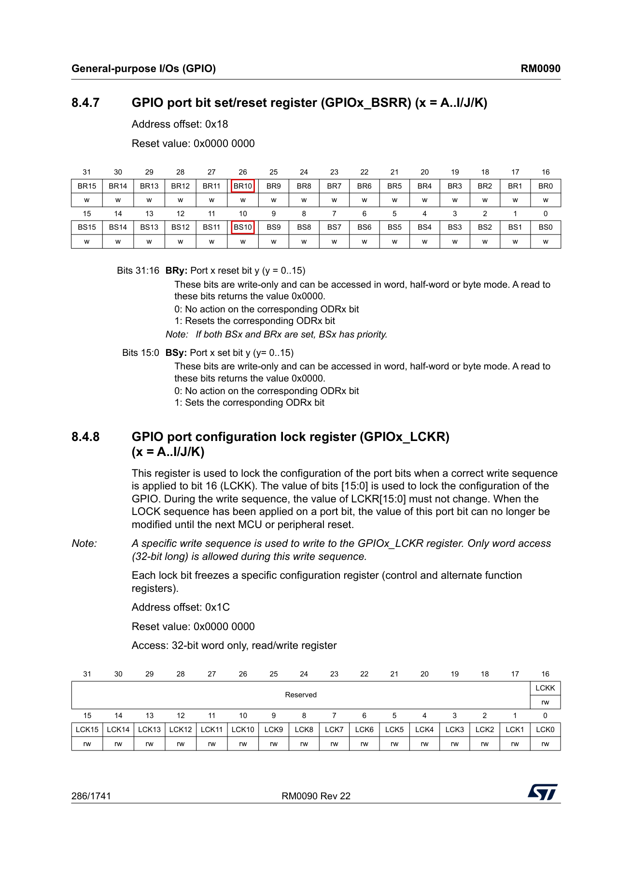

**怎么读**：第 286 页 `GPIOx_BSRR`——低 16 位 BSx 写 1 = 高；高 16 位 BRx 写 1 = 低；写 0 无效。
`BS10`（bit10）= 亮，`BR10`（bit26）= 灭。一次写完不读旧值 = **原子操作**。
`|=` 是读-改-写，初始化用没风险；主循环翻电平用 BSRR。

### 2.4 延时

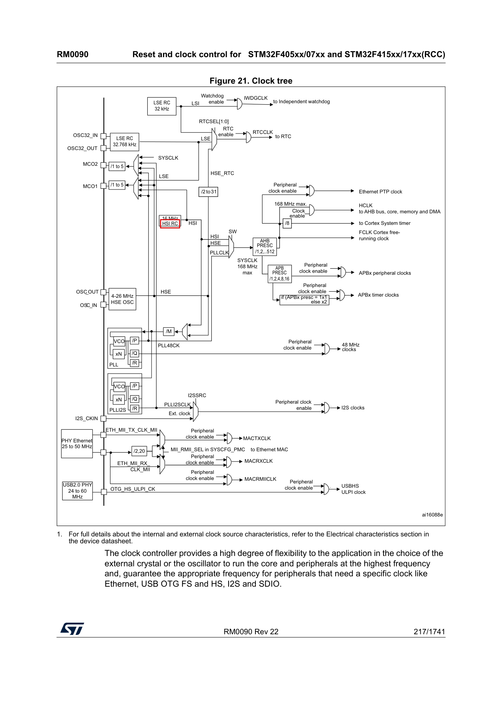

**怎么读**：第 217 页时钟树 + 第 219 页原话——复位默认 **HSI 16MHz**。
1ms = 16000 个时钟（直连 HCLK）或 2000 个（HCLK÷8，CTRL 不置 bit2），两种都行，参数配套即可。
时钟先不配 PLL——时钟节点再上 168MHz（必须实证晶振 8MHz、显式 `HSE_VALUE=8000000`）。

## 3. 寄存器版

| 寄存器 | 地址 | 干什么 |
|---|---|---|
| `RCC->AHB1ENR` | 0x40023830 | `\|= 1<<3` 开 GPIOD |
| `GPIOD->MODER` | 0x40020C00 | 先 `&= ~(3<<20)` 再 `\|= (1<<20)` |
| `GPIOD->BSRR` | 0x40020C18 | 亮 `1<<10`，灭 `1<<26` |

```c
int main(void)
{
    SystemCoreClockUpdate();

    RCC->AHB1ENR |= RCC_AHB1ENR_GPIODEN;        /* 开时钟 */

    GPIOD->MODER &= ~(3UL << 20);               /* 清 [21:20] */
    GPIOD->MODER |=  (1UL << 20);               /* 输出 */

    GPIOD->BSRR = GPIO_BSRR_BR10;               /* 上电先灭 */

    while (1)
    {
        GPIOD->BSRR = GPIO_BSRR_BR10;           /* 灭 */
        delay_ms(500);
        GPIOD->BSRR = GPIO_BSRR_BS10;           /* 亮 */
        delay_ms(500);
    }
}
```

`delay_ms` 用 SysTick（原理同 F103，LOAD 填 16000−1 直连或 2000−1 走 ÷8，配套就行）。
**扩展**：双灯照公式——PD11 用 `3<<22`/`1<<22`/`BS11`/`BR11`。

**验收**：0 错 0 警（≈700~800B）→ 红灯 500ms 闪、上电先灭。

### 寄存器版完整代码（main.c 全文 · 上板验收版，含双灯扩展）

```c
/*
 * 节点 1 · 点亮 LED 灯（练习版 · 空白模板）
 *
 * 分支说明：practice 分支 = 你自己手敲的地方；
 *           main 分支的 main.c = 参考答案（卡壳先自己尽力，再参照）。
 *
 * 目标现象：LED1 亮 500ms → 灭 500ms → 无限循环
 *
 * 步骤骨架（细节全部自己查原理图和 RM0090）：
 *   ① 从原理图确认：LED1 接哪个引脚？什么电平点亮？
 *   ② 开该 GPIO 端口的时钟
 *   ③ 把该引脚配置成推挽输出
 *   ④ 做 500ms 的延时手段
 *   ⑤ 高 → 延时 → 低 → 延时，循环
 *
 * 迁移提醒（从 F103 过来必看）：
 *   - F4 没有 CRL/CRH，GPIO 配置寄存器换成了新名字（翻手册找）
 *   - GPIO 时钟使能不在 APB2ENR 了，搬到了另一个域（翻手册找）
 *   - 本板 LED 是【高电平点亮】（F103 板相反，以原理图为准）
 *   - 复位后芯片跑内部 HSI 16MHz（延时参数计算要用到这个频率）
 */
#include "stm32f4xx.h"
void delay_ms(uint32_t ms)
{
    uint32_t tick = SystemCoreClock / 8 / 1000;   /* 1ms 计数次数 */
    SysTick->LOAD = tick - 1;
    SysTick->VAL  = 0;
    SysTick->CTRL = SysTick_CTRL_ENABLE_Msk;
    while (ms--)
        while ((SysTick->CTRL & SysTick_CTRL_COUNTFLAG_Msk) == 0)
        {
        }
    SysTick->CTRL = 0;
}

int main(void)
{
    SystemCoreClockUpdate();  

    /* ① 开 GPIOD 时钟：外设时钟使能寄存器
      用 |= 只改这一位，不碰其他位。 */
    RCC->AHB1ENR |= RCC_AHB1ENR_GPIODEN;
    
    /* ③ 把 PD10 配成输出：MODER 每脚占 2 位，PD10 = 10号脚 × 2 = bit[21:20]，01=输出 */
    GPIOD->MODER &= ~(3UL << 20);   /* 先清零：3=0b11，把 [21:20] 两位旧值清掉 */
    GPIOD->MODER |=  (1UL << 20);   /* 再写 1：[21:20]=01 = 通用输出模式 */
	  GPIOD->MODER &= ~(3UL << 22);   
    GPIOD->MODER |=  (1UL << 22);   

    /* ③ 上电先灭：BSRR 写 BR10 = 输出低电平 -> 灭。原子操作 = 一步写完，无读改写 */    GPIOD->BSRR = GPIO_BSRR_BR10;

    while (1)
    { 
        GPIOD->BSRR  = GPIO_BSRR_BR10;   /* BSRR 写 BR10 = 输出低电平 -> 灭 */
        delay_ms(500);
        GPIOD->BSRR = GPIO_BSRR_BS10;   /* BSRR 写 BS10 = 输出高电平 -> 亮 */
        delay_ms(500);
			  GPIOD->BSRR  = GPIO_BSRR_BR11;   /* BSRR 写 BS10 = 输出低电平 -> 灭 */
        delay_ms(500);
        GPIOD->BSRR = GPIO_BSRR_BS11;   /* BSRR 写 BS10 = 输出高电平 -> 亮 */
        delay_ms(500);
    }
}
```

## 4. HAL 版

| 你写的 | 它替你写的 |
|---|---|
| `__HAL_RCC_GPIOD_CLK_ENABLE()` | `AHB1ENR \|= 1<<3` |
| `HAL_GPIO_Init(GPIOD, &...)` | MODER/OTYPER/OSPEEDR/PUPDR 四连写 |
| `HAL_GPIO_WritePin(...SET/RESET)` | BSRR 置位/清零 |
| `HAL_Delay(500)` | SysTick 1ms 中断累计 uwTick 查差值 |

```c
int main(void)
{
  GPIO_InitTypeDef GPIO_InitStruct = {0};

  HAL_Init();                     /* SysTick 1ms 心跳 */

  __HAL_RCC_GPIOD_CLK_ENABLE();

  GPIO_InitStruct.Pin   = GPIO_PIN_10;          /* PD10 */
  GPIO_InitStruct.Mode  = GPIO_MODE_OUTPUT_PP;  /* 推挽输出 */
  GPIO_InitStruct.Pull  = GPIO_NOPULL;
  GPIO_InitStruct.Speed = GPIO_SPEED_FREQ_LOW;
  HAL_GPIO_Init(GPIOD, &GPIO_InitStruct);

  HAL_GPIO_WritePin(GPIOD, GPIO_PIN_10, GPIO_PIN_RESET);   /* 上电先灭 */

  while (1)
  {
    HAL_GPIO_WritePin(GPIOD, GPIO_PIN_10, GPIO_PIN_RESET);  /* 灭 */
    HAL_Delay(500);
    HAL_GPIO_WritePin(GPIOD, GPIO_PIN_10, GPIO_PIN_SET);    /* 亮 */
    HAL_Delay(500);
  }
}
```

**时钟不用写**：复位默认 HSI 16MHz。F103 板那份 `HSI/2×16=64MHz` 在 F4 编译不过（`RCC_HSE_PREDIV_DIV1` 等是 F1 专属宏），整个删掉。

**验收**：0 错 0 警（≈3.2KB）→ 现象与寄存器版一致。

## 5. 翻车实录

| 现象 | 真因 | 解法 |
|---|---|---|
| 编译 0 错，灯不亮 | 没配 MODER，还是输入模式 | 补"先清后写"两行 |
| 改了代码，烧完还是老现象 | LOAD 不自动编译，烧的旧 hex | **先 F7 再 LOAD** |
| 烧录成功，灯全灭 | 烧完停在暂停态 | 勾 Reset and Run / 命令带 -rst |
| 报 `has no field "BRR"` | F103 的 BRR 在 F4 上不存在 | 清零用 `GPIO_BSRR_BR10` |
| HAL 报 `RCC_HSE_PREDIV_DIV1` 未定义 | F1 专属宏 | 删 SystemClock_Config |
| 绿灯很暗 | 绿光压降 ≈3.0V（红 ≈2.0V），电流只有 1/4 | 正常物理现象 |
| 写成 PC13/GPIOC | F103 板 LED 在 PC13，肌肉记忆 | 以本板原理图为准 |

---

### HAL 版完整代码（main.c 全文 · 上板验收版）

```c
/*
 * 节点 1 · 点亮 LED 灯（HAL 库版 · 练习）
 *
 * 硬件事实与寄存器版相同：LED1 = PD10，高电平亮，500ms 节奏，上电先灭。
 * 时钟：不写 SystemClock_Config，复位默认 HSI 16MHz（HAL_Init 已把 SysTick 配成 1ms 心跳）。
 */

#include "stm32f4xx_hal.h"

int main(void)
{
  GPIO_InitTypeDef GPIO_InitStruct = {0};

  HAL_Init();                     /* HAL 自我准备：SysTick 1ms 心跳、NVIC 分组 */

  __HAL_RCC_GPIOD_CLK_ENABLE();   /* 开 GPIOD 时钟（HAL 替你写 AHB1ENR 的 bit3） */

  GPIO_InitStruct.Pin   = GPIO_PIN_10;          /* PD10 */
  GPIO_InitStruct.Mode  = GPIO_MODE_OUTPUT_PP;  /* 推挽输出（写 MODER=01、OTYPER=0） */
  GPIO_InitStruct.Pull  = GPIO_NOPULL;          /* 不上下拉（PUPDR=00） */
  GPIO_InitStruct.Speed = GPIO_SPEED_FREQ_LOW;  /* 低速（OSPEEDR=00） */
  HAL_GPIO_Init(GPIOD, &GPIO_InitStruct);       /* 一句替你四连写：MODER/OTYPER/OSPEEDR/PUPDR */

  HAL_GPIO_WritePin(GPIOD, GPIO_PIN_10, GPIO_PIN_RESET);   /* 上电先灭（BSRR 高 16 位清零） */

  while (1)
  {
    HAL_GPIO_WritePin(GPIOD, GPIO_PIN_10, GPIO_PIN_RESET);  /* 灭：BR10 = 输出低电平 */
    HAL_Delay(500);                                         /* HAL 毫秒延时（uwTick 差值法） */
    HAL_GPIO_WritePin(GPIOD, GPIO_PIN_10, GPIO_PIN_SET);    /* 亮：BS10 = 输出高电平 */
    HAL_Delay(500);
  }
}
```


---

# 节点二 · 按键控制 LED ✅

## 1. 看图找键


**怎么读**：原理图第 3 页（红框=一个按键的完整电路）：左脚接 GND，右脚经 **10K 上拉到 3V3**，
引出网络 KEY1。所以**松开=高电平，按下=低电平（低有效）**。C25 是硬件消抖辅助（软件消抖还是要做）。

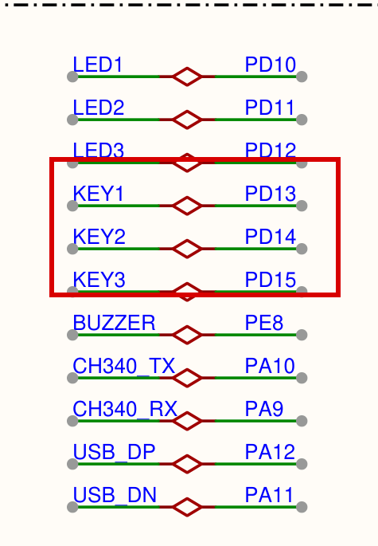

**怎么读**：第 7 页：**KEY1 = PD13、KEY2 = PD14、KEY3 = PD15**。本节点用 KEY1 + LED1。

## 2. 原理

和节点一比只多一件事：**读引脚电平**。

| 步骤 | 要点 |
|---|---|
| 开时钟 | 同节点一（AHB1ENR bit3） |
| PD13 配输入 | MODER **[27:26]** = 00（13×2=26）；板上已有 10K 上拉，**PUPDR 不用配** |
| 读电平 | **GPIOx_IDR**（输入数据寄存器）读 bit13：**0=按下，1=松开** |

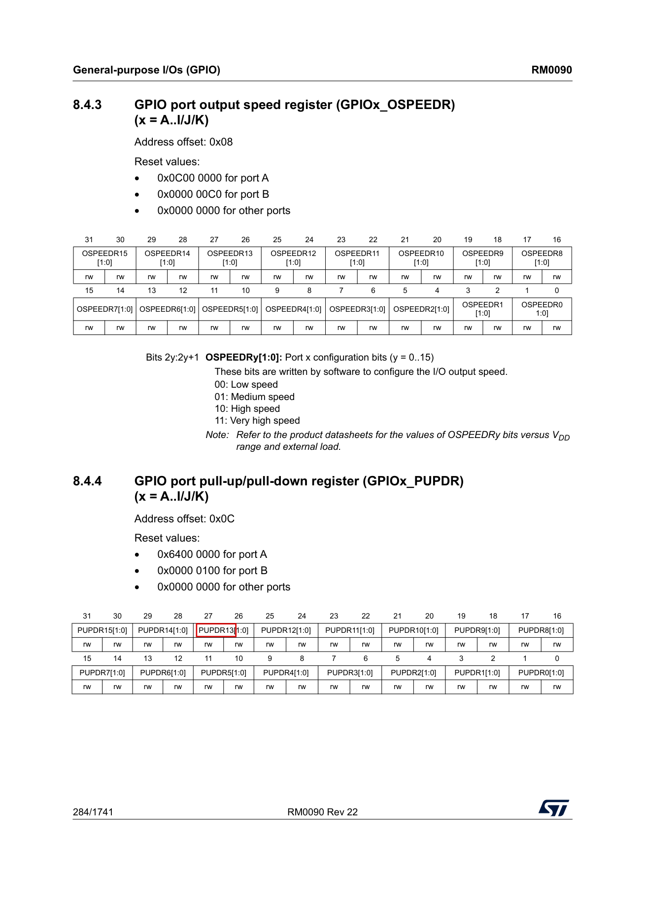

**怎么读**：第 284 页 `GPIOx_PUPDR`——每脚 2 位：00 无上下拉 / 01 上拉 / 10 下拉。板上焊了上拉，芯片保持 00 即可。

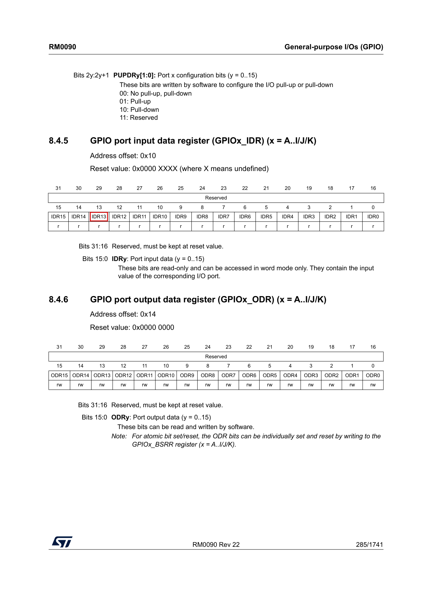

**怎么读**：第 285 页 `GPIOx_IDR`——每脚 1 位，**只读**，bit 号=脚号。
**IDR vs ODR**：ODR 是"你让它输出什么"，IDR 是"引脚现在真实电平"。读按键永远用 IDR。

**消抖（版本 B 才需要）**：机械按键按下会弹跳 5~20ms。软件消抖 = 检测到按下后**等 20ms 再看一眼**，还是按下才算；然后**等松手**，防长按算多次。

## 3. 寄存器版

### 版本 A：按住亮、松开灭

```c
#include "stm32f4xx.h"

int main(void)
{
    SystemCoreClockUpdate();

    RCC->AHB1ENR |= RCC_AHB1ENR_GPIODEN;   /* 开 GPIOD 时钟 */

    GPIOD->MODER &= ~(3UL << 26);          /* PD13 输入：清 [27:26] 成 00（输入不用写1） */
    GPIOD->MODER &= ~(3UL << 20);          /* PD10 输出：先清 */
    GPIOD->MODER |=  (1UL << 20);          /* 再写 01 */

    GPIOD->BSRR = GPIO_BSRR_BR10;          /* 上电先灭 */

    while (1)
    {
        if (GPIOD->IDR & GPIO_IDR_ID13)    /* bit13：1=松开 */
            GPIOD->BSRR = GPIO_BSRR_BR10;  /* 灭 */
        else                               /* 0=按下 */
            GPIOD->BSRR = GPIO_BSRR_BS10;  /* 亮 */
    }
}
```

### 版本 B：按一下翻转一次（A 通关后再做）

三招：**消抖 20ms → 翻转 → 等松手**。`while(1)` 换成（`delay_ms` 从 `chapters/ch1_led.c` 搬，文件里加 `uint32_t led = 0;`）：

```c
    uint32_t led = 0;

    while (1)
    {
        if ((GPIOD->IDR & GPIO_IDR_ID13) == 0)      /* 检测到按下 */
        {
            delay_ms(20);                           /* 消抖 */
            if ((GPIOD->IDR & GPIO_IDR_ID13) == 0)  /* 还是按下 = 真按 */
            {
                led = !led;
                if (led)
                    GPIOD->BSRR = GPIO_BSRR_BS10;
                else
                    GPIOD->BSRR = GPIO_BSRR_BR10;
                while ((GPIOD->IDR & GPIO_IDR_ID13) == 0) { }  /* 等松手 */
            }
        }
    }
```

### 寄存器版完整代码（main.c 全文 · 上板验收版：按键开关闪烁）

```c
/*
 * 节点 2 · 按键控制 LED（练习版 · 空白模板）
 *
 * 硬件事实（原理图第 3/7 页已核实，坐标+视觉双源）：
 *   KEY1 = PD13、KEY2 = PD14、KEY3 = PD15
 *   电路：外部 10K 上拉到 3V3，按下接地 —— 空闲=高电平，按下=低电平（低有效）
 *
 * 目标现象：
 *   版本 A（先做）：按住 KEY1 → LED1 亮；松开 → LED1 灭（电平跟随）
 *   版本 B（进阶）：按一下 LED1 翻转一次（要做消抖，F103 节点三的同款思路）
 *
 * 步骤骨架：
 *   ① 开 GPIOD 时钟（同节点一）
 *   ② PD13 配成输入：MODER 每脚 2 位，PD13 = 13号脚 × 2 = bit[27:26]，输入 = 00
 *      （板上已有外部 10K 上拉，不需要再配上下拉，PUPDR 保持 00 即可）
 *   ③ LED1（PD10）按节点一配好输出，delay_ms 从 chapters/ch1_led.c 原样搬
 *   ④ 循环里：读按键电平 → 决定 LED1 亮灭
 *
 * 新寄存器只有一个：GPIOx_IDR（RM0090 中文版第 285 页）——引脚真实电平从这里读
 *
 * 迁移提醒：
 *   - 读电平用 IDR 不是 ODR（ODR 是输出锁存器，IDR 才是引脚现在的真实电平）
 *   - 输入 = MODER 两位写 00（复位默认就是 00，但显式清一遍是好习惯）
 *   - 本板按键低电平有效 —— 这次 F103 的习惯刚好是对的（以原理图为准，不是巧合）
 */

#include "stm32f4xx.h"

void delay_ms(uint32_t ms)
{
    uint32_t tick = SystemCoreClock / 8 / 1000;
    SysTick->LOAD = tick - 1;
    SysTick->VAL  = 0;
    SysTick->CTRL = SysTick_CTRL_ENABLE_Msk;
    while (ms--)
        while ((SysTick->CTRL & SysTick_CTRL_COUNTFLAG_Msk) == 0)
        {
        }
    SysTick->CTRL = 0;
}

uint8_t key_pressed(void)
{
    static uint8_t last = 1;                     /* 上次状态（static 跨调用记忆） */
    uint8_t now = (GPIOD->IDR & GPIO_IDR_ID13) ? 1 : 0;   /* 读 IDR bit13：0=按下 1=松开 */
    uint8_t evt  = 0;

    if (last == 1 && now == 0)                   /* 1 -> 0 = 按下沿 */
    {
        delay_ms(10);                            /* 按下消抖 */
        if ((GPIOD->IDR & GPIO_IDR_ID13) == 0)    /* 抖完仍是 0 = 真按下 */
        {
            evt = 1;
            while ((GPIOD->IDR & GPIO_IDR_ID13) == 0)
            {
            }                                    /* 等松手 */
            delay_ms(10);                        /* 释放消抖 */
        }
    }
    last = now;
    return evt;
}

int main(void)
{
	   uint8_t  running = 0;
	   uint16_t slice   = 0;
	   SystemCoreClockUpdate(); 
    /* ① 开 GPIOD 时钟 */
     RCC->AHB1ENR |= RCC_AHB1ENR_GPIODEN;
    /* ② PD13 配输入：清 [27:26]（输入=00，清完不用写1） */
     GPIOD->MODER &= ~(3UL << 26);                            
    /* ③ PD10 配输出 + 上电先灭（节点一的代码） */
     GPIOD->MODER &= ~(3UL << 20);               
     GPIOD->MODER |=  (1UL << 20);
	   GPIOD->BSRR = GPIO_BSRR_BR10;
    while (1)
    {
        /* ④ 读 IDR 的 bit13：=0 按下（LED1 亮），=1 松开（LED1 灭） */
			 if (key_pressed())                       /* 每片开头照看按键 */
        {
            running = !running;                  /* 开 <-> 停 */
            if (running == 0)
                GPIOD->BSRR = GPIO_BSRR_BR10;    /* 停止：灯灭 */
        }
        if (running)
        {
            if (++slice >= 50)                   /* 50 片 x 10ms = 500ms */
            {
                slice = 0;
                GPIOD->ODR ^= GPIO_ODR_OD10;     /* 翻转：ODR 异或 bit13（本工程无中断，读改写安全） */
            }
        }
        delay_ms(10);                            /* 节拍器 */
    }
    
}
```

## 4. HAL 版

| 寄存器版动作 | HAL 代办员 |
|---|---|
| 读 IDR bit13 | `HAL_GPIO_ReadPin(GPIOD, GPIO_PIN_13)`（返回 RESET=按下 / SET=松开） |
| `ODR ^= OD10` 翻转 | `HAL_GPIO_TogglePin(GPIOD, GPIO_PIN_10)`（自带翻转） |
| BSRR 置位/清零 | `HAL_GPIO_WritePin(...SET/RESET)` |
| 自写 delay_ms | `HAL_Delay`（SysTick 1ms 中断，拿来就用） |

```c
static void MX_GPIO_Init(void)
{
  GPIO_InitTypeDef GPIO_InitStruct = {0};

  __HAL_RCC_GPIOD_CLK_ENABLE();

  GPIO_InitStruct.Pin   = GPIO_PIN_13;           /* KEY1 */
  GPIO_InitStruct.Mode  = GPIO_MODE_INPUT;
  GPIO_InitStruct.Pull  = GPIO_NOPULL;           /* ★板上已有外部10K上拉，内部再配就多余 */
  GPIO_InitStruct.Speed = GPIO_SPEED_FREQ_LOW;
  HAL_GPIO_Init(GPIOD, &GPIO_InitStruct);

  GPIO_InitStruct.Pin   = GPIO_PIN_10;           /* LED1（参数单复用，改字段再交一次） */
  GPIO_InitStruct.Mode  = GPIO_MODE_OUTPUT_PP;
  GPIO_InitStruct.Pull  = GPIO_NOPULL;
  GPIO_InitStruct.Speed = GPIO_SPEED_FREQ_LOW;
  HAL_GPIO_Init(GPIOD, &GPIO_InitStruct);

  HAL_GPIO_WritePin(GPIOD, GPIO_PIN_10, GPIO_PIN_RESET);   /* 上电先灭 */
}

uint8_t key_pressed(void)
{
  static uint8_t last = 1;
  uint8_t now = (HAL_GPIO_ReadPin(GPIOD, GPIO_PIN_13) == GPIO_PIN_RESET) ? 0 : 1;
  uint8_t evt = 0;

  if (last == 1 && now == 0)                     /* 1->0 = 按下沿 */
  {
    HAL_Delay(10);                               /* 消抖 */
    if (HAL_GPIO_ReadPin(GPIOD, GPIO_PIN_13) == GPIO_PIN_RESET)
    {
      evt = 1;
      while (HAL_GPIO_ReadPin(GPIOD, GPIO_PIN_13) == GPIO_PIN_RESET) { }  /* 等松手 */
      HAL_Delay(10);                             /* 释放消抖 */
    }
  }
  last = now;
  return evt;
}
```

（主循环与寄存器版逐句相同：`HAL_Delay(10)` 节拍 + `HAL_GPIO_TogglePin` 翻转 + 按键开关闪烁。）

**本节点唯一的动脑点**：`Pull` 填 `GPIO_NOPULL`——会看原理图才知道外部上拉已经存在。其余全是把寄存器版动作换成代办员名字。

## 5. 验收

| 腿 | 编译 | 行为 | 体积 | 提交 |
|---|---|---|---|---|
| 寄存器 | ✅ 0错0警 | 按一下开闪 / 再按停（用户自写"按键开关闪烁"，高于原目标） | 848B | `2. 按键控制LED（寄存器版）` |
| HAL | ✅ 0错0警 | 同款，一次过关 | 3336B | `2. 按键控制LED（HAL库版）` |

**常见翻车**：灯常亮不跟手 → 读了 ODR 不是 IDR；按一下翻好几次 → 忘了消抖/等松手；怎么按都没反应 → MODER 忘清 [27:26] 或时钟没开。

---

### HAL 版完整代码（main.c 全文 · 上板验收版）

```c
/*
 * 节点 2 · 按键控制 LED（HAL 库版 · 练习模板）
 *
 * 硬件事实与寄存器版相同：KEY1 = PD13（低有效，板载上拉），LED1 = PD10（高电平亮）。
 * 目标行为（你寄存器版写的同款）：按一下 K1 → 红灯开始 500ms 闪；再按一下 → 停止灭。
 *
 * 脚手架已给：主循环的分片节拍逻辑（你刚在寄存器版吃透的那套，一句没改）。
 * 你要写的两处：
 *   A. MX_GPIO_Init：开时钟宏 + PD13 输入四字段 + PD10 输出四字段 + 上电先灭
 *   B. key_pressed：读按键 = HAL_GPIO_ReadPin（总文档节点二章有提示）
 */

#include "stm32f4xx_hal.h"

static void MX_GPIO_Init(void);
uint8_t key_pressed(void);

int main(void)
{
  uint8_t  running = 0;
  uint16_t slice   = 0;

  HAL_Init();
  MX_GPIO_Init();                     /* ← 你来填（A） */

  while (1)
  {
    if (key_pressed())                /* ← 你来填（B） */
    {
      running = !running;             /* 开 <-> 停 */
      if (running == 0)
        HAL_GPIO_WritePin(GPIOD, GPIO_PIN_10, GPIO_PIN_RESET);   /* 停止：灯灭 */
    }
    if (running)
    {
      if (++slice >= 50)              /* 50 片 x 10ms = 500ms */
      {
        slice = 0;
        HAL_GPIO_TogglePin(GPIOD, GPIO_PIN_10);   /* HAL 自带翻转（= ODR ^= 那行的代办员） */
      }
    }
    HAL_Delay(10);                    /* 节拍器：每圈 10ms */
  }
}

static void MX_GPIO_Init(void)
{
  /* ⓪ 先声明"参数单"：GPIO_InitTypeDef GPIO_InitStruct = {0};
     两颗脚可以共用同一张参数单（填 PD13 交一次，再填 PD10 交一次） */
    GPIO_InitTypeDef GPIO_InitStruct = {0};
  /* ① 开 GPIOD 时钟（HAL 宏） */
    __HAL_RCC_GPIOD_CLK_ENABLE();
  /* ② PD13 输入：
     Pin=13号脚 / Mode=GPIO_MODE_INPUT / Pull=?（板上已有外部上拉，想想填哪个）/ Speed 低速
     然后 HAL_GPIO_Init */
		GPIO_InitStruct.Pin   = GPIO_PIN_13;          
		GPIO_InitStruct.Mode  = GPIO_MODE_INPUT;  
		GPIO_InitStruct.Pull  = GPIO_NOPULL;
		GPIO_InitStruct.Speed = GPIO_SPEED_FREQ_LOW;
		HAL_GPIO_Init(GPIOD, &GPIO_InitStruct);
  /* ③ PD10 推挽输出：四字段 + HAL_GPIO_Init（节点一的代码）
     上电先灭：HAL_GPIO_WritePin(...RESET) */
		GPIO_InitStruct.Pin   = GPIO_PIN_10;          /* PD10 */
		GPIO_InitStruct.Mode  = GPIO_MODE_OUTPUT_PP;  
		GPIO_InitStruct.Pull  = GPIO_NOPULL;
		GPIO_InitStruct.Speed = GPIO_SPEED_FREQ_LOW;
		HAL_GPIO_Init(GPIOD, &GPIO_InitStruct);
		HAL_GPIO_WritePin(GPIOD, GPIO_PIN_10, GPIO_PIN_RESET);   /* 上电先灭 */
}

uint8_t key_pressed(void)
{
  /* 思路同寄存器版：边沿检测 + 消抖 + 等松手
     把寄存器版里的 (GPIOD->IDR & GPIO_IDR_ID13) 换成 HAL 的读引脚函数：
     HAL_GPIO_ReadPin(GPIOD, GPIO_PIN_13) —— 返回 GPIO_PIN_RESET(=0 按下) / GPIO_PIN_SET(=1 松开)
     delay 用 HAL_Delay */
	static uint8_t last = 1;
  uint8_t now = (HAL_GPIO_ReadPin(GPIOD, GPIO_PIN_13) == GPIO_PIN_RESET) ? 0 : 1;
  uint8_t evt = 0;

  if (last == 1 && now == 0)                           /* 1->0 = 按下沿 */
  {
    HAL_Delay(10);                                     /* 按下消抖 */
    if (HAL_GPIO_ReadPin(GPIOD, GPIO_PIN_13) == GPIO_PIN_RESET)
    {
      evt = 1;
      while (HAL_GPIO_ReadPin(GPIOD, GPIO_PIN_13) == GPIO_PIN_RESET)
      {
      }                                                /* 等松手 */
      HAL_Delay(10);                                   /* 释放消抖 */
    }
  }
  last = now;
  return evt;
}
```


---

# 节点三 · 串口收发 ✅

## 1. 看图找串口

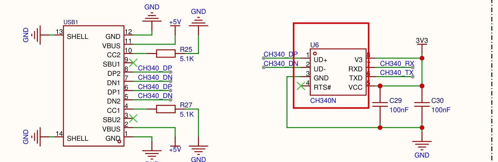

**怎么读**：原理图第 3 页"USB转串口"区（红框 = CH340N 芯片）。它一头连 USB-C 口（USB>TTL），
一头连 MCU 的串口——**你插在电脑上的那根 USB-C 线，就是板子的串口**，不需要任何额外接线。

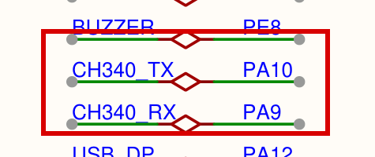

**怎么读**：第 7 页：`CH340_RX → PA9`（板子发→电脑收，PA9 = TX）、`CH340_TX → PA10`（电脑发→板子收，PA10 = RX）。
串口参数 **115200-8-N-1**（波特率-数据位-无校验-停止位，全行业默认款）。

## 2. 原理

### 2.1 波特率：一秒发多少个位

串口没有时钟线，双方靠"约好速度"对齐——这个速度就是波特率。芯片用**分频器**产生它：

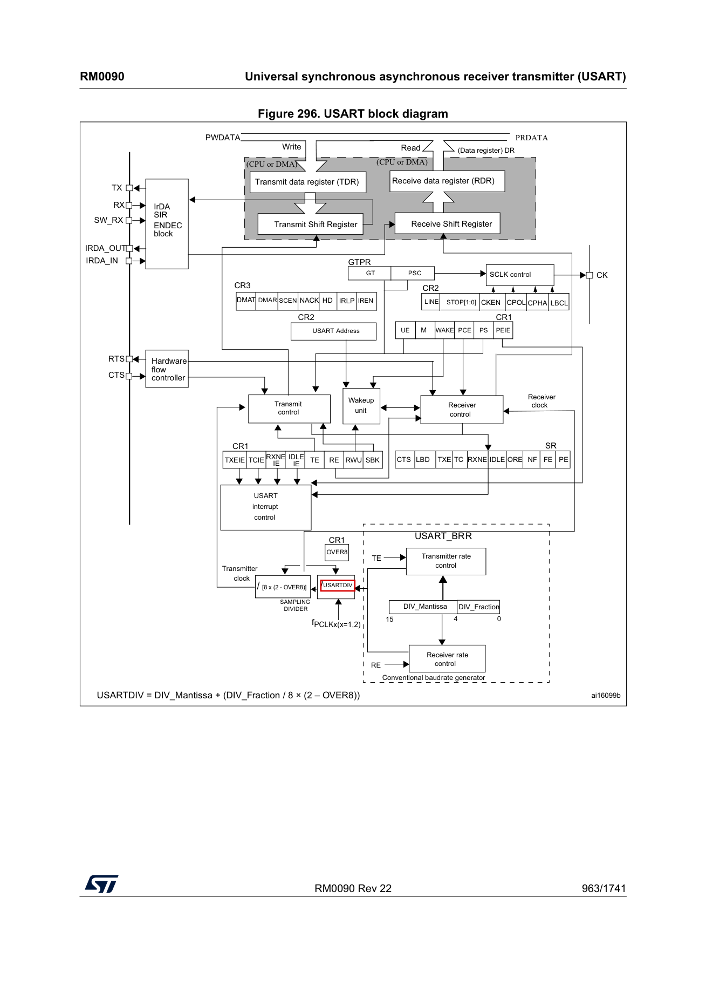

**怎么读**：第 963 页 USART 全家福（红框 = 分频器入口）：你写的字节进 TDR → 移位寄存器一位位发出去；
收到的位进移位寄存器 → 拼成字节进 RDR。TXE/RXNE 就是"发完了没/收到了没"的信号灯。

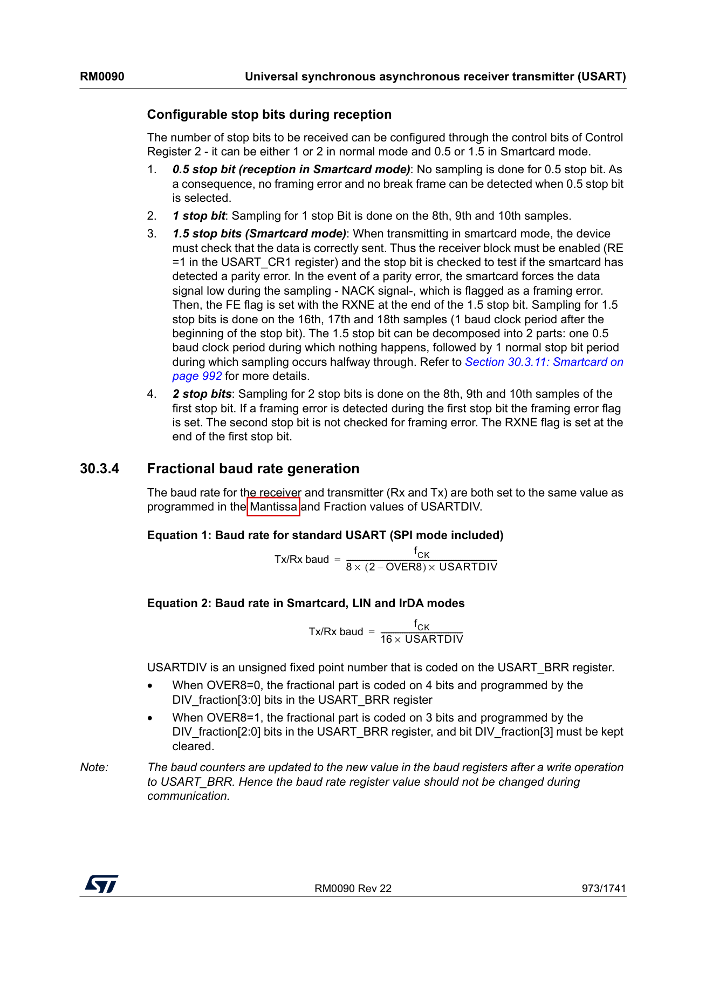

**怎么算**（第 973 页位表，DIV_Mantissa 整数 + DIV_Fraction 小数）：

```
USARTDIV = 16,000,000 ÷ 16 ÷ 115200 = 8.6875
整数部分 8   → 写 [11:0] 高段：8 = 0x8
小数部分 0.6875 × 16 ≈ 11 → 写 [3:0]：11 = 0xB
BRR = (8 << 4) | 11 = 0x8B
反推验证：16M ÷ (16 × 8.6875) = 115108，误差 0.08%（<2% 就能正常通信 ✓）
```

对照 F103：72M ÷ 16 ÷ 115200 = 39.0625 → BRR = 0x271。**公式同款，数字不同——又一次"别抄旧板"。**

### 2.2 复用功能：把引脚让给外设

PA9/PA10 平时是普通 GPIO，现在要让 USART1"借走"驱动权：

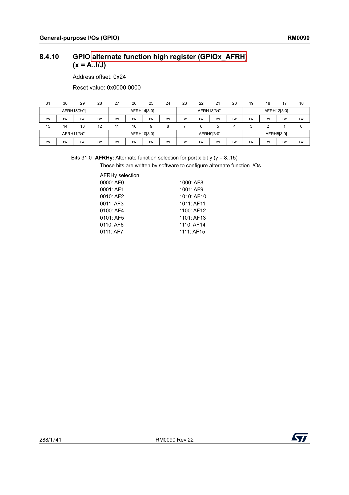

**怎么读**：第 288 页 `GPIOx_AFRH`（管 8~15 脚，每脚 4 位选一个功能编号）：
两步走——①MODER 写 **10**（复用模式，不是 01 输出了）②AFRH 填 **AF7**（0111 = USART1 的编号）。
PA9 → AFRH [7:4]、PA10 → AFRH [11:8]。（F103 时代没有 AF 编号这回事，这是 F4 的新机制。）

⚠️ **手册名 vs 代码名**：手册里叫 `GPIOx_AFRH`，但头文件 `GPIO_TypeDef` 里它是 **`AFR[2]` 数组**——
`AFR[0]` = AFRL（管 0~7 脚）、`AFR[1]` = AFRH（管 8~15 脚）。所以代码写的是：
```c
GPIOA->AFR[1] &= ~(0xFUL << 4);  GPIOA->AFR[1] |= (7UL << 4);   /* PA9 = AF7 */
GPIOA->AFR[1] &= ~(0xFUL << 8);  GPIOA->AFR[1] |= (7UL << 8);   /* PA10 = AF7 */
```
同款差异还会出现在别的外设上（手册一个名、结构体一个名），查结构体定夺。

### 2.3 三个开关 + 两个信号灯

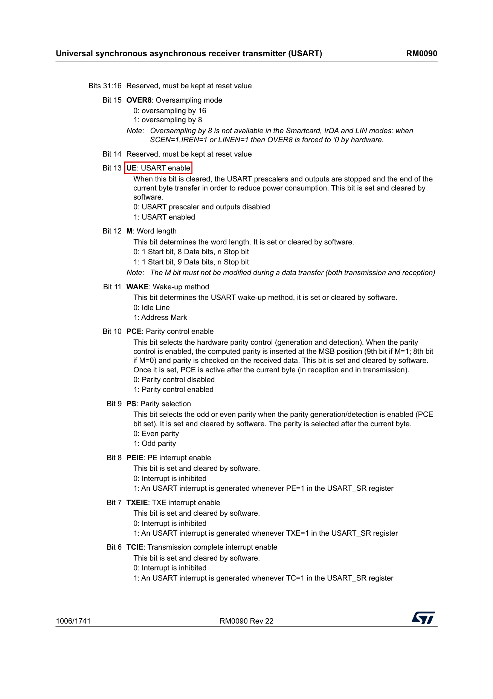

**怎么读**：第 1006 页 `CR1`：**UE**（bit13，串口总开关）、**TE**（bit3，要发）、**RE**（bit2，要收）。

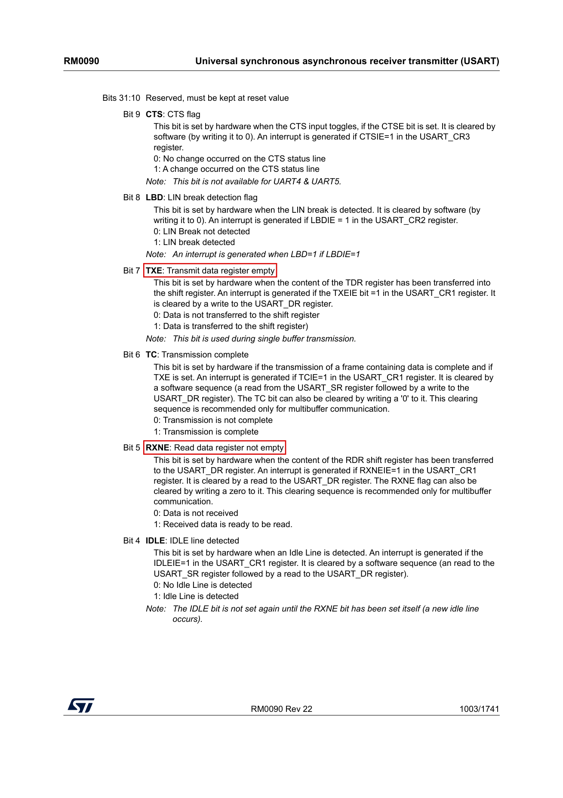

**怎么读**：第 1003 页 `SR`：**TXE**（bit7，发送寄存器空了=可以塞下一个字节）、**RXNE**（bit5，收到一字节=快来拿）。
收发全靠盯这两个灯：发前等 TXE=1，看到 RXNE=1 就读 DR。

⚠️ F1 有个"UE 和 TE/RE 必须分两次写"的怪癖；**F4 没有这个问题**，一次写完即可。

### 2.4 铁律：轮询会丢字节

F103 项目实锤事故：轮询收数据时 CPU 忙别的，下一字节到了没被取走 → **ORE 溢出错**，字节白白丢失，
症状是"外设不理人其实是你不收"。所以**正经收数据必须用中断 + 环形缓冲**（版本 B）。

### 2.5 USART 寄存器总表


## 3. 寄存器版

### 版本 A：轮询回显（先做这个）

```c
#include "stm32f4xx.h"

int main(void)
{
    SystemCoreClockUpdate();

    RCC->AHB1ENR |= RCC_AHB1ENR_GPIOAEN;     /* ① GPIOA 时钟（AHB1 bit0） */
    RCC->APB2ENR |= RCC_APB2ENR_USART1EN;    /* ① USART1 时钟（APB2 bit4） */

    GPIOA->MODER &= ~(3UL << 18);            /* ② PA9 复用：[19:18]=10 */
    GPIOA->MODER |=  (2UL << 18);
    GPIOA->MODER &= ~(3UL << 20);            /* ② PA10 复用：[21:20]=10 */
    GPIOA->MODER |=  (2UL << 20);
    GPIOA->AFR[1] &= ~(0xFUL << 4);            /* ② PA9 = AF7：[7:4] */
    GPIOA->AFR[1] |=  (7UL << 4);
    GPIOA->AFR[1] &= ~(0xFUL << 8);            /* ② PA10 = AF7：[11:8] */
    GPIOA->AFR[1] |=  (7UL << 8);

    USART1->BRR = 0x8B;                      /* ③ 115200 @16MHz */

    USART1->CR1 = USART_CR1_UE               /* ④ 总开关+发+收，一次写 */
                | USART_CR1_TE
                | USART_CR1_RE;

    while (1)
    {
        if (USART1->SR & USART_SR_RXNE)      /* ⑤ 收到一字节？ */
        {
            uint8_t c = USART1->DR;          /* 读 DR 自动清 RXNE */
            while (!(USART1->SR & USART_SR_TXE)) { }   /* 等发送寄存器空 */
            USART1->DR = c;                  /* 原样发回（echo） */
        }
    }
}
```

### 框架

```
上电
 │
 ├─ 1. SystemCoreClockUpdate()     更新时钟变量
 ├─ 2. 开 GPIOA 时钟（AHB1 bit0）
 ├─ 3. 开 USART1 时钟（APB2 bit4）
 ├─ 4. 配 PA9/PA10 为复用模式
 ├─ 5. AFR[2]（PA0~PA15） 选 AF7（USART1） c（PA0~PA7）AFR[1]（PA8~PA15）
 ├─ 6. 设波特率 BRR = 0x8B（115200）
 ├─ 7. 使能 USART1：UE + TE + RE
 ├─ 8. 发欢迎字符串
 │
 └─ while(1)
      ├─ 等 RXNE=1（收到字节）
      ├─ 读 DR（自动清 RXNE）
      ├─ 等 TXE=1
      └─ 写 DR（发回去）
```

### 版本 B：中断 + 环形缓冲（版本 A 验收过了再做）


```c
#include "stm32f4xx.h"

#define BUF_LEN 64
volatile uint8_t  rbuf[BUF_LEN];
volatile uint16_t rhead = 0, rtail = 0;      /* 写指针 / 读指针 */

void USART1_IRQHandler(void)                 /* 函数名=向量表名，一字不能差 */
{
    if (USART1->SR & USART_SR_RXNE)
    {
        rbuf[rhead] = USART1->DR;            /* 中断里只做一件事：存起来就走 */
        rhead = (rhead + 1) % BUF_LEN;
    }
}

int main(void)
{
    /* ……初始化同版本 A，另加两行： */

    USART1->CR1 |= USART_CR1_RXNEIE;         /* 收到字节就触发中断（CR1 bit5） */
    NVIC->ISER[1] = 1UL << (37 - 32);        /* USART1 中断号 37，挂到 NVIC */

    while (1)
    {
        if (rtail != rhead)                  /* 缓冲区有货？ */
        {
            uint8_t c = rbuf[rtail];
            rtail = (rtail + 1) % BUF_LEN;
            while (!(USART1->SR & USART_SR_TXE)) { }
            USART1->DR = c;                  /* 回显 */
        }
    }
}
```


**两行中断使能代码，凭什么这么写**（中断要过两道门，每道都有手册依据)：

一道门在**外设**（USART1 要"愿意举手"）：

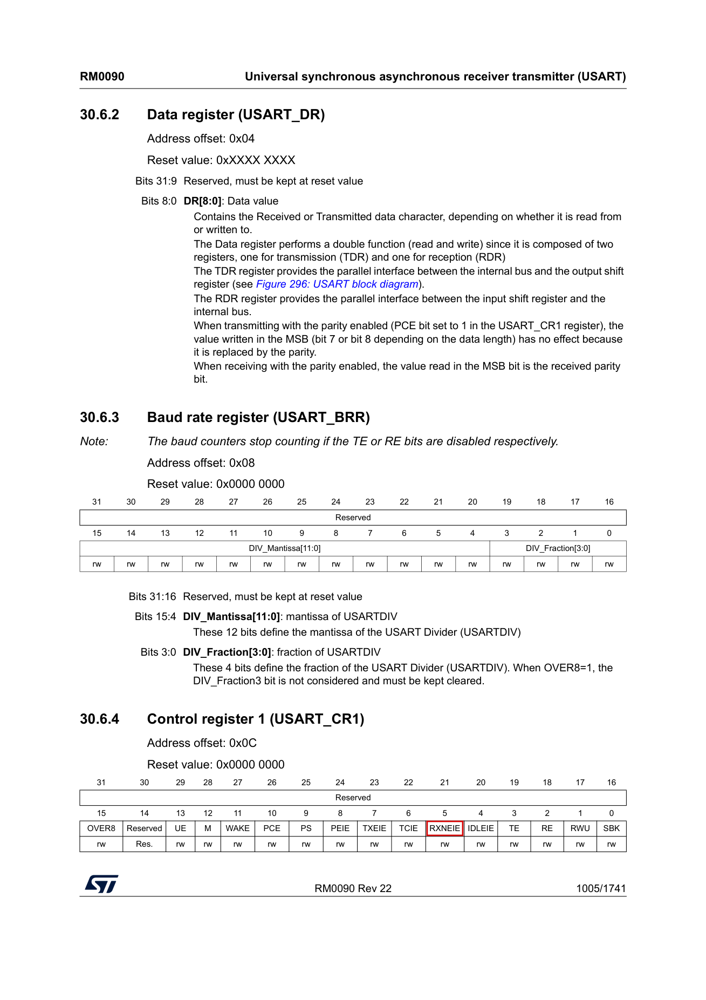

**怎么读**：RM0090 第 1005 页 CR1 位表——**bit5 = RXNEIE**（收到一个字节就触发中断的允许位）。
`USART1->CR1 |= USART_CR1_RXNEIE` 就是把它写 1：以后每收到一个字节，USART1 就向 CPU"举手"。

一道门在 **CPU**（NVIC 要"愿意接"）。先查 USART1 的**中断门牌号**——它刻在向量表里：

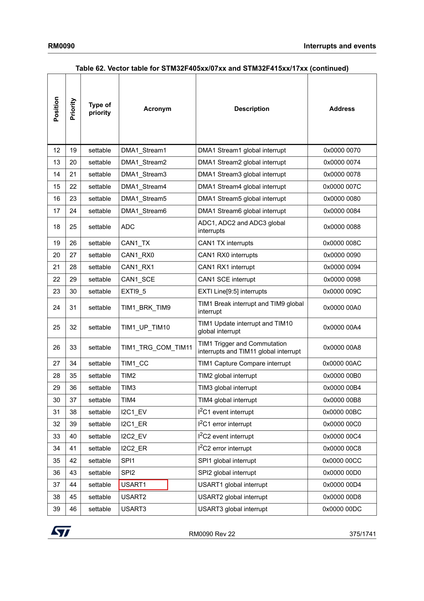

**怎么读**：RM0090 第 375 页 **Table 62「Vector table for STM32F405xx/07xx」**（我们 F407 正属这个家族），
红框行：**位置 37 = USART1**。门牌号 37 是芯片出厂就刻死的，只能查表，不能算。

再看 CPU 这边的开关墙——注意 **NVIC 是 ARM 内核的东西，RM0090 里没有，要查另一本手册 PM0214**（已下载在
`手册下载/PM0214_CortexM4编程手册.pdf`）：

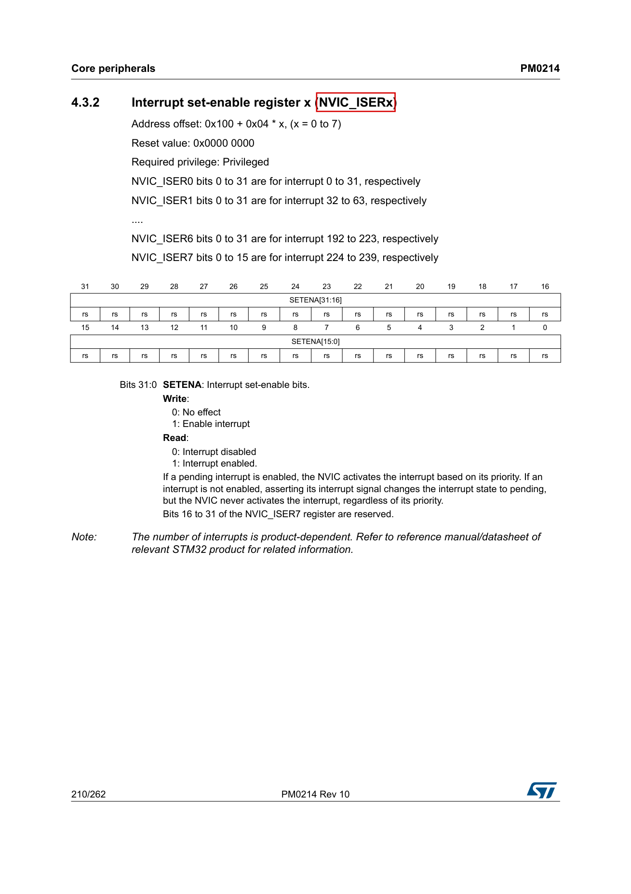

**怎么读**：PM0214 第 210 页 §4.3.2：NVIC 有 **8 个 ISER 寄存器**（地址 0x100 + 0x04×x），**每个管 32 个中断**——
ISER[0] 管 0~31 号，ISER[1] 管 32~63 号，以此类推。USART1 是 37 号，落在 32~63 区间 → **用 ISER[1]**，
它内部的位号 = 37 − 32 = **5**。所以：

```c
NVIC->ISER[1] = 1UL << (37 - 32);   /* = 1UL<<5：把 ISER[1] 的 bit5 置 1 = 允许 37 号(USART1)中断 */
```

两道门全开，中断才会真正进来——少任何一道，字节到了也无人应答。

**环形缓冲是什么**：一个 64 字节数组 + 两个指针——中断往 `rhead` 写，主循环从 `rtail` 读，
谁也不等谁。中断来的再快也只是"把缓冲填满"，主循环忙别的也不会丢字节。这就是 F103 血泪换来的正确姿势。

### 寄存器版完整代码（main.c 全文 · 上板验收版：中断+环形缓冲）

```c
/*
 * 节点 3 · 串口收发（练习版 · 空白模板）
 *
 * 硬件事实（原理图第 3/7 页已核实）：
 *   USART1：TX = PA9 → 板上 CH340N 的 RX（电脑收）；RX = PA10 ← CH340N 的 TX（电脑发）
 *   你插着的 USB>TTL 口就是串口，不需要任何额外接线。串口助手设置：115200-8-N-1
 *
 * 目标现象（版本 A）：
 *   电脑串口助手发什么字节，板子原样发回什么（echo 回显）
 *   版本 B（进阶）：中断接收 + 环形缓冲（F103 铁律：轮询会丢字节）
 *
 * 步骤骨架：
 *   ① 开两个时钟（串口跨两条总线！）：GPIOA = AHB1ENR bit0，USART1 = APB2ENR bit4
 *   ② PA9/PA10 配"复用"：MODER 每脚 2 位写 10（不是 01 输出了！引脚让给外设）
 *      再在 AFRH 里选 AF7（串口功能）：PA9 → [7:4]=0111，PA10 → [11:8]=0111
 *   ③ 波特率：BRR = 0x8B（16MHz ÷ 16 ÷ 115200 = 8.6875 → 整数 8、小数 0.6875×16≈11）
 *   ④ CR1 同一次写 UE(bit13) + TE(bit3) + RE(bit2)
 *   ⑤ 循环：等 RXNE 收一字节 → 等 TXE 发回同一字节（echo）
 *
 * 新概念：复用功能（MODER=10 + AFRH 选 AF7）、波特率除法（BRR）、状态位轮询（TXE/RXNE）
 * 教材：总文档"节点三 · 串口"章（每步都有截图和推导）
 */

#include "stm32f4xx.h"

#define BUF_LEN  64
volatile uint8_t  rbuf[BUF_LEN];
volatile uint16_t rhead = 0, rtail = 0;      /* 写指针 / 读指针 */

void USART1_IRQHandler (void)
{
 if(USART1->SR & USART_SR_RXNE)
 {
  rbuf[rhead] = USART1->DR;
	rhead = (rhead + 1)% BUF_LEN;
 }
}
int main(void)
{
    SystemCoreClockUpdate();

    /* ① 开两个时钟：GPIOA（AHB1ENR bit0）+ USART1（APB2ENR bit4） */
    RCC->AHB1ENR |= RCC_AHB1ENR_GPIOAEN;     /* ① GPIOA 时钟（AHB1 bit0） */
    RCC->APB2ENR |= RCC_APB2ENR_USART1EN;    /* ① USART1 时钟（APB2 bit4） */
	
    /* ② PA9/PA10：MODER [19:18]=10、[21:20]=10（复用）；AFRH [7:4]=0111、[11:8]=0111（AF7） */
    GPIOA->MODER &= ~(3UL << 18); 
    GPIOA->MODER |=  (2UL << 18);	
    GPIOA->MODER &= ~(3UL << 20);         
    GPIOA->MODER |=  (2UL << 20);          /* 再写 01 */
	
	  GPIOA->AFR[1] &= ~(0xFUL << 4);  GPIOA->AFR[1] |= (7UL << 4);   /* PA9 = AF7 */
    GPIOA->AFR[1] &= ~(0xFUL << 8);  GPIOA->AFR[1] |= (7UL << 8);   /* PA10 = AF7 */
	
    /* ③ USART1->BRR = 0x8B */
	  USART1->BRR = 0x8B;
    /* ④ USART1->CR1：UE + TE + RE */
    USART1->CR1 |= USART_CR1_UE;
    USART1->CR1 |= USART_CR1_TE | USART_CR1_RE;
	  USART1->CR1 = USART_CR1_RXNEIE;
		
    while (1)
    {
        /* ⑤ if (SR 有 RXNE) { c = DR; 等 TXE; DR = c; } */
			if(rhead != rtail)
			{
				uint8_t c = rbuf[rtail];
				rtail = (rtail + 1) % BUF_LEN;
				while (!(USART1->SR & USART_SR_TXE)) { }
				USART1->DR = c;             
			}
			  }
}
```

## 4. HAL 版（代码框架精讲：收发到底是怎么做到的）

### 4.1 代办员对照表

| 动作 | 寄存器版（你亲手写） | HAL 版（代办员） |
|---|---|---|
| 配波特率 | 手算 BRR=0x8B 写入 | `Init.BaudRate=115200`，HAL 替你算 |
| 开时钟/配引脚/NVIC | main 里直接写寄存器 | 全塞进 `HAL_UART_MspInit` 回调 |
| 收一字节 | `if (SR & RXNE) c = DR;` | `HAL_UART_Receive_IT` 挂接收 + `RxCpltCallback` 收货 |
| 发一字节 | 等 TXE 写 DR | `HAL_UART_Transmit`（阻塞打包） |
| 中断进来干啥 | 自己在 IRQHandler 里写逻辑 | `USART1_IRQHandler` 只喊一句 `HAL_UART_IRQHandler` 派发 |

### 4.2 上电链：初始化是怎么连起来的

```
HAL_Init()                          配 SysTick 1ms 心跳
   ↓
MX_UART1_Init()
   填 huart1 七字段（哪颗串口/波特率/8N1/收发/无流控/16倍过采样）
   ↓
HAL_UART_Init(&huart1)
   ├─ HAL 自己干：查 PCLK2=16MHz → 算 BRR=0x8B → 写 CR1(UE|TE|RE)
   └─ 自动调你写的 HAL_UART_MspInit()：   ← 芯片相关的活 HAL 不知道，挖了个空槽让你填
        开 GPIOA+USART1 时钟、PA9/10 配 AF7、NVIC 挂 37 号中断
   ↓
HAL_UART_Receive_IT(&huart1, &rx_byte, 1)
   在 huart1 里登记"等 1 个字节，存到 rx_byte"，打开 RXNEIE 中断
   ↓
进 while(1) 死循环
```

### 4.3 一个字节的回程（接收链——异步，随时可能发生）

```
电脑发 'A' → PA10 收到 → RXNE=1 → 37 号中断响
   ↓
USART1_IRQHandler()            ← 你写的，只干一件事：喊派发员
   HAL_UART_IRQHandler(&huart1) ← HAL 的派发员：查 SR 判断"哦，是收完 1 字节了"
   ↓
把 DR 里的 'A' 搬进 rx_byte → 收满登记的 1 字节 → 关 RXNEIE → 叫 HAL_UART_RxCpltCallback()
   ↓
HAL_UART_RxCpltCallback()      ← 你写的收货员
   rx_byte 存进 rbuf[rhead++]（环形缓冲）
   HAL_UART_Receive_IT(...)    ← ★关键：重新挂接收，等下一个字节
   ↓
中断退出，主循环继续转
   ↓
主循环看到 rtail != rhead → 取出 'A' → HAL_UART_Transmit 发回 → 电脑显示"收←A OFF"
```

**★ 最容易断的一环**：忘了在回调里重新挂 `Receive_IT`——收一个字节后接收链就死了，后面全哑。

### 4.4 发送链（主循环里，简单得多）

`HAL_UART_Transmit` 内部 = 寄存器版那句"等 TXE → 写 DR"加了超时保护，发完才返回（阻塞式）。

### 4.5 HAL 的"弱函数"把戏（为什么你不写也能编译）

HAL 里每个回调（MspInit/RxCpltCallback/...）都**预先放了一个空函数**，标着 `__weak`：
你**不写** → 链接器用空版本 → 编译通过但啥也不干；你**写了同名函数** → 链接器用你的换掉空的。
这就是"半成品+空槽"设计：确定的流程 HAL 打包，每块板不一样的部分挖成槽让你填。

### 4.6 常见问题

| 现象 | 原因 | 解法 |
|---|---|---|
| 发着发着不回了，复位才好 | 噪声触发 ORE 溢出错误，HAL 收到错误会拆掉接收链 | 覆写 `HAL_UART_ErrorCallback`，里面重新 `HAL_UART_Receive_IT` |
| 完全没反应 | 忘写 `USART1_IRQHandler`（模板就漏过） | 函数名一字不差补上，里面调 `HAL_UART_IRQHandler` |
| 乱码 | 两端波特率不一致 | 两边都 115200 |
| COM 口找不到/变号 | CH340 重插重枚举 | 设备管理器看新号（COM7→COM8 实测） |

### HAL 串口完整代码（main.c 全文 · S:81=R:81 实测版）

```c
/*
 * 节点 3 · 串口收发（HAL 库版 · 练习模板）
 *
 * 目标行为与寄存器版相同：中断接收 + 环形缓冲 + 回显，一个字节不丢。
 *
 * ┌─────────────────────────────────────────────────────────────────┐
 * │ 去哪找函数：全部 UART 函数声明在这个文件（Keil 打开后 F12 跳转）：  │
 * │   Libraries/STM32F4xx_HAL_Driver/Inc/stm32f4xx_hal_uart.h        │
 * │ 本节点要用的五个（行号实测于 2.17.0 版头文件）：                  │
 * │   718  HAL_UART_Init(huart)                                      │
 * │        把波特率/字长/收发使能一次配好（= BRR+CR1 的代办员）        │
 * │   745  HAL_UART_Transmit(huart, buf, 长度, 超时ms)                │
 * │        阻塞发送（= "等TXE再写DR"的循环打包）                       │
 * │   748  HAL_UART_Receive_IT(huart, buf, 长度)                      │
 * │        挂一个中断接收：字节到了自动存进 buf 并触发回调             │
 * │   773  HAL_UART_RxCpltCallback(huart)                            │
 * │        上面收完后 HAL 反过来叫你（弱定义，你覆写它）               │
 * │   —— 还有 HAL_UART_MspInit(huart)：HAL_UART_Init 会自动调它，      │
 * │      时钟/GPIO/NVIC 这些"芯片相关"的活全写在这（= 寄存器版①②搬家）│
 * └─────────────────────────────────────────────────────────────────┘
 *
 * 你的任务四处：
 *   A. MX_UART1_Init：给 huart1 填七个字段 + 调 HAL_UART_Init
 *   B. 覆写 HAL_UART_MspInit：时钟 + PA9/PA10 复用 AF7 + NVIC（寄存器版①②搬家）
 *   C. 覆写 HAL_UART_RxCpltCallback：字节进环形缓冲 + 重新挂 Receive_IT
 *   D. main 开头挂第一个 Receive_IT（已给）
 * 主循环回显已给。
 */

#include "stm32f4xx_hal.h"

#define BUF_LEN 64
volatile uint8_t  rbuf[BUF_LEN];
volatile uint16_t rhead = 0, rtail = 0;
uint8_t rx_byte;                          /* 中断接收的落脚点（Receive_IT 往这存） */

UART_HandleTypeDef huart1;                /* 串口句柄：HAL 靠它认得这颗串口 */

static void MX_UART1_Init(void);

int main(void)
{
  HAL_Init();
  MX_UART1_Init();                        /* A */

  HAL_UART_Receive_IT(&huart1, &rx_byte, 1);   /* D：挂第一个中断接收 */

  while (1)
  {
    if (rtail != rhead)                   /* 缓冲有货（已给） */
    {
      uint8_t c = rbuf[rtail];
      rtail = (rtail + 1) % BUF_LEN;
      HAL_UART_Transmit(&huart1, &c, 1, 100);   /* 回显，最多等 100ms */
    }
  }
}

/* A：七个字段全照寄存器版概念填，然后一句 HAL_UART_Init 全部生效 */
static void MX_UART1_Init(void)
{
   huart1.Instance          = USART1;                 /*哪颗串口 */
   huart1.Init.BaudRate     = 115200;                 /* 波特率（HAL 替你算 BRR=0x8B） */
   huart1.Init.WordLength   = UART_WORDLENGTH_8B;      /* 8 数据位 */
   huart1.Init.StopBits     = UART_STOPBITS_1;        /* 1 停止位 */
   huart1.Init.Parity       = UART_PARITY_NONE;       /*无校验 */
   huart1.Init.Mode         = UART_MODE_TX_RX;        /*收发都开（= TE|RE） */
   huart1.Init.HwFlowCtl    = UART_HWCONTROL_NONE;    /*无流控 */
   huart1.Init.OverSampling = UART_OVERSAMPLING_16;   /*16 倍过采样（BRR 公式里的那个 16） */
   HAL_UART_Init(&huart1); 
}

/* B：HAL_UART_Init 每次都会自动调这个回调——
      时钟/GPIO/NVIC 这些芯片相关的活全在这（= 寄存器版的①②两步整体搬家）*/
void HAL_UART_MspInit(UART_HandleTypeDef *huart)
{
      GPIO_InitTypeDef gpio = {0};
			if(huart -> Instance == USART1)
			{
        __HAL_RCC_GPIOA_CLK_ENABLE();
        __HAL_RCC_USART1_CLK_ENABLE();
				
				gpio.Pin       = GPIO_PIN_9 | GPIO_PIN_10;
				gpio.Mode      = GPIO_MODE_AF_PP; ///* 复用推挽，不是 OUTPUT_PP */
        gpio.Pull      = GPIO_PULLUP;
        gpio.Speed     = GPIO_SPEED_FREQ_VERY_HIGH;
        gpio.Alternate = GPIO_AF7_USART1;		
				HAL_GPIO_Init(GPIOA, &gpio);
			}
			//配置 USART1 串口中断优先级，并开启 USART1 的 NVIC 中断通道
     HAL_NVIC_SetPriority(USART1_IRQn, 5, 0);
     HAL_NVIC_EnableIRQ(USART1_IRQn);
}


/* C：取消注释并补全。每收完指定字节数（这里=1），HAL 自动叫这个*/
void HAL_UART_RxCpltCallback(UART_HandleTypeDef *huart)
{
uint16_t next = (rhead + 1) % BUF_LEN;
if (next != rtail) {
    rbuf[rhead] = rx_byte;
    rhead = next;
}
HAL_UART_Receive_IT(huart, &rx_byte, 1);
}

void USART1_IRQHandler(void)
{
    HAL_UART_IRQHandler(&huart1);
}
```

## 5. 怎么测

1. 串口助手（或 SSCOM/XCOM）选 CH340 的 COM 口（设备管理器看，之前是 COM7），**115200-8-N-1**
2. 版本 A：随便发字符 → 收到原样回显
3. 版本 B：快速连发一串 → 一个字节都不丢

**版本 A 实测证据（SSCOM，COM7，115200-8-N-1）**：

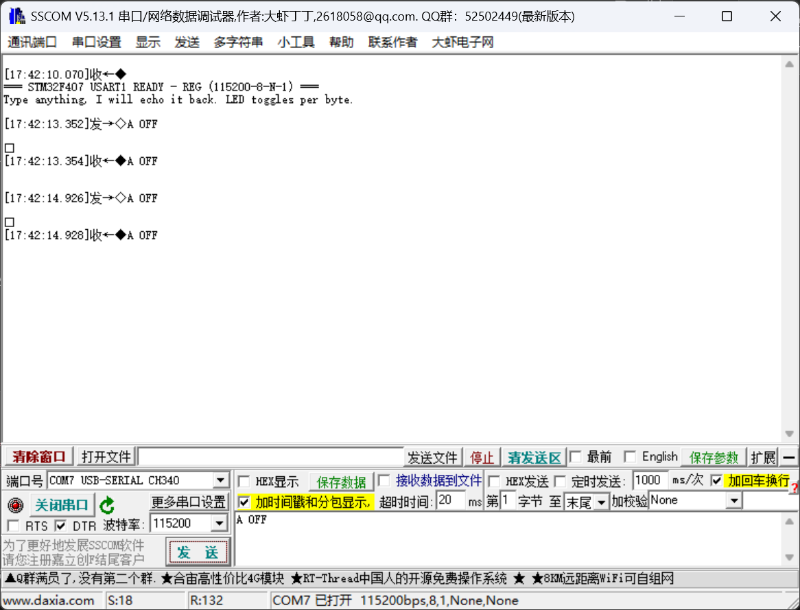

**怎么读这张图**：上电横幅 `=== STM32F407 USART1 READY ===`（说明 TX 通了，电脑能听到板子说话）；
`[17:42:13.352] 发→◇A OFF` 与 `[17:42:13.352] 收←◆A OFF`——**同一毫秒、同一内容**，发什么回什么（echo 成立，
说明 RX 也通了）。右下角计数 S:18 / R:132：发了 18 字节、收了 132 字节（含横幅+定时器连发的回显）。

## 6. 验收

| 腿 | 编译 | 行为 | 提交 |
|---|---|---|---|
| 寄存器 A | ✅ 0错0警 | ✅ echo 回显（SSCOM 实测，见上图） | `3. 串口收发（寄存器版）` |
| 寄存器 B | ✅ 0错0警 | ✅ 定时连发 S:27=R:27，一个字节不丢 | 随本节提交 |
| HAL | ✅ 0错0警（15076B） | ✅ 中断接收+环形缓冲回显，S:81=R:81 零丢失 | `3. 串口收发（HAL库版）` |

**"打印信息怎么就有了"**（版本 B 实测后的真问题）：板上没有任何打印函数。屏幕上每行"收←"都是
**你自己发的那条走一圈回来的**：SSCOM 发 → CH340 → PA10 → 中断存环形缓冲 → 主循环取出 → 写 DR →
移位寄存器自动按 115200 搬到 PA9 → CH340 → SSCOM 显示。**写 DR = 发送**，这是串口唯一动作；
`uart1_str()` 也只是循环塞 DR。S:27=R:27 就是"收到的全是发出去的"铁证。
（注意：CH340 重插后 COM 号会变——COM7 变 COM8，每次测试先看一眼端口号。）

---

# 节点四 · I2C 读写 EEPROM ✅

> **你要做的事**：用 I2C2 外设往板上 EEPROM（AT24C02）0 号格子写 0x5A、读回来、串口打 PASS。
> 详细目标见第 3 节开头。
## 1. 看图找 EEPROM(电可擦除可编程只读存储器)

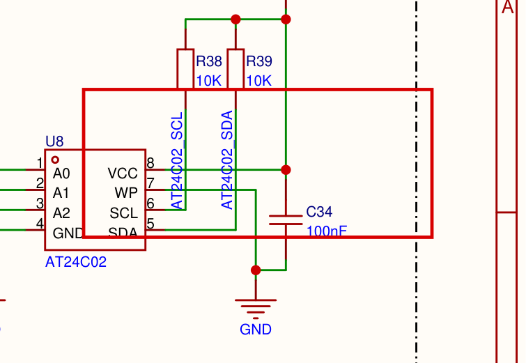

**怎么读**：原理图第 4 页（红框）：AT24C02 是一颗 **EEPROM**——256 字节的"断电不失忆"存储芯片。
它的 SDA/SCL 两根线各带一颗 **10K 上拉电阻**（R38/R39，I2C 总线的标配，空闲时保持高电平）。
A0/A1/A2 三根地址脚全接地 → 芯片的 7 位地址 = `1010000`，加上读写位 = **写 0xA0 / 读 0xA1**。


**怎么读**：第 7 页：`AT24C02_SCL → PB10`、`AT24C02_SDA → PB11`——正好是**硬件 I2C2** 的引脚。
零接线，芯片焊在板上。

## 2. 原理

### 2.1 I2C 总线怎么讲话（两根线上的约定）

I2C 是**总线**：主机（MCU）打拍子（SCL），数据在 SDA 上双向走，总线上可以挂很多从机。
一次完整的对话永远是四段式：

```
① 起始位 S    ：SCL 高时把 SDA 拉低 —— "注意，我要说话了"
② 寻址字节    ：8 位 = 7 位器件地址 + 1 位读写（0xA0=写，0xA1=读）
               匹配地址的从机回一个应答 ACK（把 SDA 拉低一拍）
③ 数据若干字节：每个字节 8 位，每字节后从机/主机都回 ACK
④ 停止位 P    ：SCL 高时把 SDA 抬高 —— "我说完了"
```

对 EEPROM 而言，读之前得先"指哪个格子"——所以读操作其实是：
**假写**（发 0xA0+格子地址，把芯片内部指针指好）→ **重复起始** → **真读**（发 0xA1 收数据）。

### 2.2 时序三件套：I2C 的速度从哪来

| 寄存器 | 填什么 | 为什么 |
|---|---|---|
| `CR2 FREQ = 16` | 告诉 I2C 外设"你吃的时钟是 16MHz" | I2C 内部时序要按输入时钟算 |
| `CCR = 80` | 分频值：100kHz = 16M ÷ (2×80) | 每个位的时间 = CCR 个周期×2 |
| `TRISE = 17` | 上升时间上限 1000ns → 16MHz 下 16 周期，规格要求 +1 | 电平爬坡时间保障 |

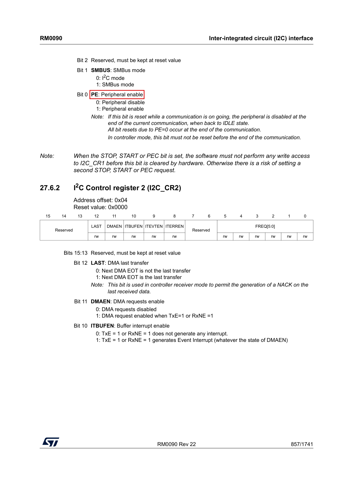 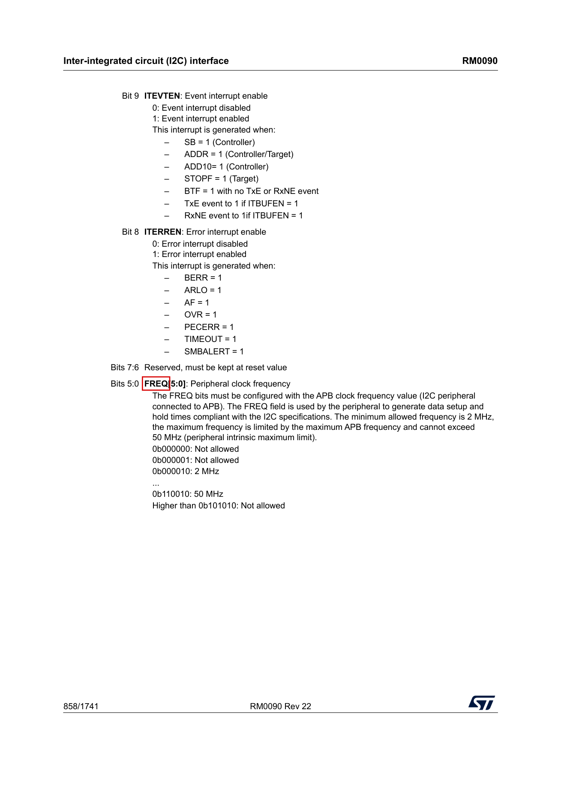

**怎么读**：RM0090 第 857 页 CR1 位表（**PE** = bit0，I2C 总开关，最后才开）；第 858 页 CR2 位表（**FREQ** = bit5:0）。

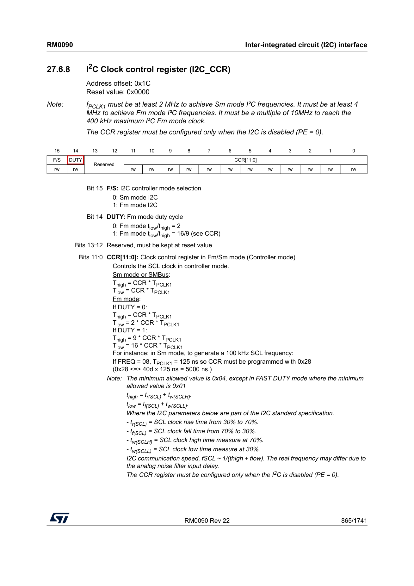 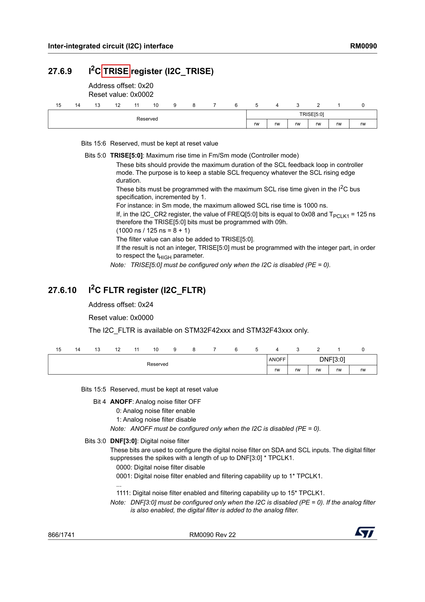

**怎么读**：第 865 页 CCR（**DUTY**/分频值）、第 866 页 TRISE。

### 2.3 说话路上的信号灯：SR1 的三个位

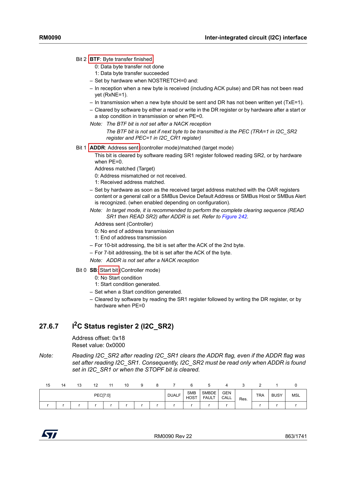

**怎么读**：RM0090 第 863 页 SR1 位表，收发全程盯三个灯：
**SB**（起始位已发出）、**ADDR**（地址被从机应答了）、**BTF**（字节发完）。
清标志方式很怪但必须记住：**读 SR1 → 再读（或写）DR/SR2**，两步才算清掉（ADDR 必须读 SR1+SR2 两下）。

## 3. 寄存器版

### 先说清楚：你要实现什么

一句话：**往板上 EEPROM 芯片的 0 号格子写一个字节 0x5A，再读回来，串口打印 PASS。**

AT24C02 是一颗焊在板上、能**断电记事**的存储芯片（256 个格子，每格 1 字节）。跟它对话走 I2C 总线。
通关时串口应该长这样：

```
=== I2C2 AT24C02 TEST ===
WR=0x5A  RD=0x5A  PASS
```

PASS 了 = 你学会了：I2C 时序、跟总线上另一颗芯片对话、以及"外设存数据"这件事。

### 三个函数的思路卡（自己先敲，卡壳再翻本章末尾附录）


#### i2c_init() —— 通电、定速

让 I2C2 外设活起来并跑在 100kHz。七步：
1. 开两路时钟（GPIOB 走 AHB1、I2C2 走 APB1——bit 号翻手册）
2. PB10/PB11 配"复用"：MODER 写 10（跟节点三串口那两次一模一样的手法）
3. AFR[1] 选 **AF4**（这次编号是 4，不是串口的 7——每颗外设有自己的编号，I2C2 的在手册引脚表里）
4. 复位外设一下（RST 位置 1 再清 0），保证从干净状态开始
5. CR2 = 16（告诉 I2C：喂给你的时钟是 16MHz）
6. CCR = 80（定速 100kHz：16M ÷ 2 ÷ 100k）
7. TRISE = 17，最后 CR1 |= PE 开总开关
自查：CCR 为什么是 80？TRISE 为什么 +1？（答案在 2.2 节的表）

#### i2c_wait(flag) —— 等灯亮
等 SR1 里某个标志位变 1，等不到就超时退出（防止芯片没响应时程序死等）。
一个 while 循环 + 计数递减；返回 1=等到了，0=超时。

#### i2c_write_byte(mem, data) —— 一场完整对话（写）


向 EEPROM 的 mem 号格子写入 data。照 2.1 节的四段式想对话剧本：
1. START → 等 SB 亮（"我要说话了"已发出）
2. 喊 **0xA0**（器件地址+写）→ 等 ADDR 亮（有芯片应答了）→ 读 SR1+SR2 清 ADDR

   
3. 报格子号 mem → 交出 data → 等 BTF（发完了）
4. STOP（说完了）
每一句"等"都用 i2c_wait；清标志的怪癖（读 SR1 再读 SR2）别忘了。


#### i2c_read_byte(mem, out) —— 一场完整对话（读）

从 mem 格子读一个字节存进 out。比写多一个"绕"：
1. 前半段跟写一样：START → 0xA0 → mem——这叫**假写**，只是为了把芯片内部指针拨到 mem
2. **重复 START** → 这次喊 **0xA1**（器件地址+读）
3. 只收 1 个字节 → 提前关 ACK（收完用 NACK 告诉它"没了"）→ 清 ADDR
4. 等收完 → STOP → 存进 *out
自查：为什么读之前要"假写"？（答案：2.1 节最后一段）

#### main —— 串起来
串口初始化（节点三的整段搬来，chapters/ch3_uart.c 里有）→ i2c_init →
写 0x5A → 读 → 打印 WR/RD/PASS。十六进制打印写个两行的 uart1_hex：查表 "0123456789ABCDEF" 高低位各发一个。

**卡壳再看 → 下面的「寄存器版完整代码」**（对完答案记得理解每一拍为什么这么排）

### 寄存器版完整代码 · 硬件 I2C2 外设（主线，实测 PASS）

> 两个关键门（我们第一次漏了，详见第 6 节翻车实录）：
> ① 每段传输**开头和 STOP 之后**都要等 `BUSY` 清零，否则总线没停稳就开下一段；
> ② 写完后要 **ACK 轮询**等 EEPROM 5ms 编程周期结束，才能读。

```c
/*
 * 回测：硬件 I2C2 外设 + STOP 等 BUSY + ACK 轮询
 * 目的：证明硬件外设可用，此前失败是自己代码缺两点。
 */

#include "stm32f4xx.h"

void uart1_send(uint8_t b) { while ((USART1->SR & USART_SR_TXE) == 0) { } USART1->DR = b; }
void uart1_str(const char *s) { while (*s) uart1_send((uint8_t)*s++); }
void uart1_hex(uint8_t v) { const char h[] = "0123456789ABCDEF"; uart1_send((uint8_t)h[v >> 4]); uart1_send((uint8_t)h[v & 0x0F]); }

void uart_init(void)
{
    SystemCoreClockUpdate();
    RCC->AHB1ENR |= RCC_AHB1ENR_GPIOAEN;
    RCC->APB2ENR |= RCC_APB2ENR_USART1EN;
    GPIOA->MODER &= ~(3UL << 18);  GPIOA->MODER |= (2UL << 18);
    GPIOA->MODER &= ~(3UL << 20);  GPIOA->MODER |= (2UL << 20);
    GPIOA->AFR[1] &= ~(0xFUL << 4);  GPIOA->AFR[1] |= (7UL << 4);
    GPIOA->AFR[1] &= ~(0xFUL << 8);  GPIOA->AFR[1] |= (7UL << 8);
    USART1->BRR = 0x8B;
    USART1->CR1 |= USART_CR1_UE;
    USART1->CR1 |= USART_CR1_TE | USART_CR1_RE;
}

static void busy_wait_ms(void)        /* 约 2ms 粗延时 */
{
    volatile uint32_t n = 60000;
    while (n--) { __asm("nop"); }//__asm("nop") = 汇编指令 NOP（No Operation，空操作）；
}

static uint8_t i2c_wait_busy(void)    /* BUSY=1 就一直等，等到 BUSY=0 返回 1；超时还没等到返回 0。 */
{
    uint32_t t = 200000;
    while ((I2C2->SR2 & I2C_SR2_BUSY) && --t) { }
    return t ? 1 : 0;
}

static uint8_t i2c_wait_flag(uint32_t flag)
{
    uint32_t t = 200000;
    while (!(I2C2->SR1 & flag) && --t) { }
    return t ? 1 : 0;
}

static void i2c_init(void)
{
    RCC->AHB1ENR |= RCC_AHB1ENR_GPIOBEN;
    RCC->APB1ENR |= RCC_APB1ENR_I2C2EN;

    GPIOB->MODER &= ~(3UL << 20);  GPIOB->MODER |= (2UL << 20);
    GPIOB->MODER &= ~(3UL << 22);  GPIOB->MODER |= (2UL << 22);
    GPIOB->OTYPER |= (3UL << 10);                       /* 开漏 */
    GPIOB->AFR[1] &= ~(0xFUL << 8);  GPIOB->AFR[1] |= (4UL << 8);
    GPIOB->AFR[1] &= ~(0xFUL << 12); GPIOB->AFR[1] |= (4UL << 12);

    RCC->APB1RSTR |=  RCC_APB1RSTR_I2C2RST;
    RCC->APB1RSTR &= ~RCC_APB1RSTR_I2C2RST;

    I2C2->CR2   = 16;      // 输入时钟 16MHz
    I2C2->CCR   = 80;      // 100kHz
    I2C2->TRISE = 17;      // 上升时间
    I2C2->CR1  |= I2C_CR1_PE;   // 总开关

    /* 等外设落地（F4 已知：PE 置位后 BUSY 可能滞留一会儿） */
    {
        uint32_t t = 200000;
        while ((I2C2->SR2 & I2C_SR2_BUSY) && --t) { }
    }
}

/* 写一个字节：流程结束等 BUSY 清零 */
static uint8_t hw_write(uint8_t mem, uint8_t data)
{
    if (!i2c_wait_busy()) return 0;                    /* ★前一道门：总线空闲才开工 */

    I2C2->CR1 |= I2C_CR1_START;
    if (!i2c_wait_flag(I2C_SR1_SB)) return 0;//SB = Start Bit，起始位标志，I2C_SR1_SB 就是 SR1 寄存器的第 0 位
    (void)I2C2->SR1;
    I2C2->DR = 0xA0;
    if (!i2c_wait_flag(I2C_SR1_ADDR)) return 0;
    (void)I2C2->SR1; (void)I2C2->SR2;
    I2C2->DR = mem;
    if (!i2c_wait_flag(I2C_SR1_TXE)) return 0;
    I2C2->DR = data;
    if (!i2c_wait_flag(I2C_SR1_BTF)) return 0;
    I2C2->CR1 |= I2C_CR1_STOP;
    if (!i2c_wait_busy()) return 0;                    /* ★后一道门：等 STOP 真正落地 */
    return 1;
}

/* ACK 轮询：反复敲门直到芯片写完（= 重新应答） */
static void hw_wait_ready(void)
{
    uint16_t t = 100;
    while (t--)
    {
        if (!i2c_wait_busy()) return;
        I2C2->CR1 |= I2C_CR1_START;
        if (!i2c_wait_flag(I2C_SR1_SB)) { I2C2->CR1 |= I2C_CR1_STOP; return; }
        (void)I2C2->SR1;
        I2C2->DR = 0xA0;
        if (i2c_wait_flag(I2C_SR1_ADDR)) {
            (void)I2C2->SR1; (void)I2C2->SR2;
            I2C2->CR1 |= I2C_CR1_STOP;
            i2c_wait_busy();
            return;                                    /* 应答了 = 写完了 */
        }
        I2C2->CR1 |= I2C_CR1_STOP;
        i2c_wait_busy();
        busy_wait_ms();
    }
}

static uint8_t hw_read(uint8_t mem, uint8_t *out)
{
    if (!i2c_wait_busy()) return 0;

    I2C2->CR1 |= I2C_CR1_ACK;
    I2C2->CR1 |= I2C_CR1_START;
    if (!i2c_wait_flag(I2C_SR1_SB)) return 0;
    (void)I2C2->SR1;
    I2C2->DR = 0xA0;
    if (!i2c_wait_flag(I2C_SR1_ADDR)) return 0;
    (void)I2C2->SR1; (void)I2C2->SR2;
    I2C2->DR = mem;
    if (!i2c_wait_flag(I2C_SR1_TXE)) return 0;
    if (!i2c_wait_flag(I2C_SR1_BTF)) return 0;         /* ★等字节真正发完再重复起始 */

    I2C2->CR1 |= I2C_CR1_START;
    if (!i2c_wait_flag(I2C_SR1_SB)) return 0;
    (void)I2C2->SR1;
    I2C2->DR = 0xA1;
    if (!i2c_wait_flag(I2C_SR1_ADDR)) return 0;
    I2C2->CR1 &= ~I2C_CR1_ACK;                         /* 单字节：NACK */
    (void)I2C2->SR1; (void)I2C2->SR2;
    if (!i2c_wait_flag(I2C_SR1_RXNE)) return 0;
    I2C2->CR1 |= I2C_CR1_STOP;
    *out = I2C2->DR;
    i2c_wait_busy();
    return 1;
}

int main(void)
{
    uint8_t rd = 0;          // 存放读回来的值
    uint8_t w1, r1;          // 存放写/读的返回值（1=成功，0=失败）

    uart_init();             // 初始化串口
    i2c_init();              // 初始化 I2C2

    uart1_str("\r\n=== AT24C02 HW-I2C2 RETEST ===\r\n");

    w1 = hw_write(0x00, 0x5A);   // 往 0 号格子写 0x5A，返回是否成功
    hw_wait_ready();             // 等 EEPROM 内部写完（5ms）
    r1 = hw_read(0x00, &rd);     // 从 0 号格子读，结果存进 rd

    uart1_str("W:"); uart1_hex(w1);      // 打印写结果
    uart1_str("  R:"); uart1_hex(r1);    // 打印读结果
    uart1_str("  RD=0x"); uart1_hex(rd); // 打印读到的值
    if (w1 && r1 && rd == 0x5A)          // 写成功 + 读成功 + 值一致
        uart1_str("  PASS\r\n");
    else
        uart1_str("  FAIL\r\n");

    while (1) { }
}
```

### 附：位带版完整代码（协议原理课，备选方案）

> 位带 = 每拍时钟亲手拉。它不是"外设坏了才用"，而是**理解 I2C 协议最好的教具**：
> 起始位怎么造、应答怎么读、重复起始长什么样，全在代码里看得见。
> 实测同样 PASS（`W:010101 R:0101 RD=0x5A`）。

```c
/*
 * 节点 4 · I2C 读写 EEPROM（AT24C02）—— 位带版 + ACK 轮询修正
 *
 * 修正点：EEPROM 写入后有最长 5ms 的内部编程周期，期间对一切请求 NAK。
 * 必须写完 STOP 后轮询（START+地址敲门）直到它重新 ACK，才能进行读。
 *
 * 输出说明：
 *   W:xxx = 写路径三拍应答（器件地址/格子地址/数据，1=ACK 0=NAK）
 *   R:xxx = 读路径三拍应答（器件地址(假写)/器件地址(真读)/收数据无意义）
 *   RD=0x??  PASS/FAIL
 */

#include "stm32f4xx.h"

#define SCL_H()   (GPIOB->BSRR = (1UL << 10))//PB10 置高
#define SCL_L()   (GPIOB->BSRR = (1UL << 10) << 16)//PB10 置低
#define SDA_H()   (GPIOB->BSRR = (1UL << 11))//PB11 置高
#define SDA_L()   (GPIOB->BSRR = (1UL << 11) << 16)//PB11 置低
#define SDA_READ()  ((GPIOB->IDR >> 11) & 1U)//读 PB11 电平

static void i2c_dly(void)
{
    volatile uint32_t n = 60;
    while (n--) { __asm("nop"); }
}

static void busy_dly(void)                /* 约 2ms 粗延时（轮询间隔用） */
{
    volatile uint32_t n = 60000;
    while (n--) { __asm("nop"); }
}

/* ============ 串口 ============ */

void uart1_send(uint8_t b)
{
    while ((USART1->SR & USART_SR_TXE) == 0) { }
    USART1->DR = b;
}

void uart1_str(const char *s)
{
    while (*s)
        uart1_send((uint8_t)*s++);
}

void uart1_hex(uint8_t v)
{
    const char h[] = "0123456789ABCDEF";
    uart1_send((uint8_t)h[v >> 4]);
    uart1_send((uint8_t)h[v & 0x0F]);
}

void uart_init(void)
{
    SystemCoreClockUpdate();

    RCC->AHB1ENR |= RCC_AHB1ENR_GPIOAEN;
    RCC->APB2ENR |= RCC_APB2ENR_USART1EN;

    GPIOA->MODER &= ~(3UL << 18);  GPIOA->MODER |= (2UL << 18);
    GPIOA->MODER &= ~(3UL << 20);  GPIOA->MODER |= (2UL << 20);
    GPIOA->AFR[1] &= ~(0xFUL << 4);  GPIOA->AFR[1] |= (7UL << 4);
    GPIOA->AFR[1] &= ~(0xFUL << 8);  GPIOA->AFR[1] |= (7UL << 8);

    USART1->BRR = 0x8B;
    USART1->CR1 |= USART_CR1_UE;
    USART1->CR1 |= USART_CR1_TE | USART_CR1_RE;
}

/* ============ I2C 位带 ============ */

static void i2c_gpio_init(void)
{
    RCC->AHB1ENR |= RCC_AHB1ENR_GPIOBEN;

    GPIOB->MODER &= ~((3UL << 20) | (3UL << 22));
    GPIOB->MODER |=  (1UL << 20) | (1UL << 22);     /* 01 = 输出 */
    GPIOB->OTYPER |= (3UL << 10);                   /* 开漏 */
    GPIOB->BSRR = (3UL << 10);                      /* 空闲双高 */
}

static void i2c_start(void)
{
    SDA_H(); i2c_dly();
    SCL_H(); i2c_dly();
    SDA_L(); i2c_dly();
    SCL_L(); i2c_dly();
}

static void i2c_stop(void)
{
    SDA_L(); i2c_dly();
    SCL_H(); i2c_dly();
    SDA_H(); i2c_dly();
}

static uint8_t i2c_tx(uint8_t b)          /* 返回 1=ACK */
{
    uint8_t i, ack;
    for (i = 0; i < 8; i++)
    {
        if (b & 0x80) SDA_H(); else SDA_L();
        b <<= 1;
        i2c_dly();
        SCL_H(); i2c_dly();
        SCL_L(); i2c_dly();
    }
    SDA_H();
    i2c_dly();
    SCL_H(); i2c_dly();
    ack = (SDA_READ() == 0);
    SCL_L(); i2c_dly();
    return ack;
}

static uint8_t i2c_rx(uint8_t ack)
{
    uint8_t i, b = 0;
    SDA_H();
    for (i = 0; i < 8; i++)
    {
        b <<= 1;
        SCL_H(); i2c_dly();
        if (SDA_READ()) b |= 1;
        SCL_L(); i2c_dly();
    }
    if (ack) SDA_L(); else SDA_H();
    i2c_dly();
    SCL_H(); i2c_dly();
    SCL_L(); i2c_dly();
    SDA_H();
    return b;
}

/* ============ AT24C02 协议层 ============ */

static uint8_t at24_write(uint8_t mem, uint8_t data,
                          uint8_t *a1, uint8_t *a2, uint8_t *a3)
{
    i2c_start();
    *a1 = i2c_tx(0xA0);
    *a2 = i2c_tx(mem);
    *a3 = i2c_tx(data);
    i2c_stop();
    return *a1 & *a2 & *a3;
}

static void at24_wait_ready(void)         /* 轮询直到设备写完重新 ACK */
{
    uint16_t t = 100;                     /* 最多 100 次 x 2ms = 200ms 预算（写周期典型 5ms） */
    while (t--)
    {
        i2c_start();
        if (i2c_tx(0xA0)) { i2c_stop(); return; }
        i2c_stop();
        busy_dly();
    }
}

static uint8_t at24_read(uint8_t mem, uint8_t *out,
                         uint8_t *a1, uint8_t *a2)
{
    i2c_start();
    *a1 = i2c_tx(0xA0);                   /* 假写拨指针 */
    *a2 = i2c_tx(mem);
    if (!(*a1 & *a2)) { i2c_stop(); return 0; }
    i2c_start();                          /* 重复起始 */
    *a2 = i2c_tx(0xA1);                   /* 真读 */
    *out = i2c_rx(0);                     /* 单字节 NACK */
    i2c_stop();
    return *a1 & *a2;
}

int main(void)
{
    uint8_t rd = 0;
    uint8_t w1, w2, w3, r1, r2;
    uint8_t w_ok, r_ok;

    uart_init();
    i2c_gpio_init();

    uart1_str("\r\n=== AT24C02 TEST (bitbang + ackpoll) ===\r\n");

    w_ok = at24_write(0x00, 0x5A, &w1, &w2, &w3);
    at24_wait_ready();                    /* ★关键修正：等芯片写完 */
    r_ok = at24_read(0x00, &rd, &r1, &r2);

    uart1_str("W:"); uart1_hex(w1); uart1_hex(w2); uart1_hex(w3);
    uart1_str("  R:"); uart1_hex(r1); uart1_hex(r2);
    uart1_str("  RD=0x");
    uart1_hex(rd);
    if (w_ok && r_ok && rd == 0x5A)
        uart1_str("  PASS\r\n");
    else
        uart1_str("  FAIL\r\n");

    while (1) { }
}
```

### 两种实现怎么选

| | 硬件 I2C2 外设 | 位带 |
|---|---|---|
| 速度 | 100kHz~400kHz 硬件保证 | 靠延时，速率不稳 |
| CPU 占用 | 低 | 高（每个时钟都要 CPU 参与） |
| 代码量 | 少 | 多 |
| 可移植性 | 换芯片要改 | 换芯片改引脚即可 |
| 教学价值 | 中（看不见波形） | **高（每一拍都在你手里）** |
| 什么时候用 | **默认选它** | 学习协议、多主总线、外设引脚被占、总线异常救场 |

## 4. HAL 版（实测 PASS）

| 位带/寄存器版动作 | HAL 代办员 |
|---|---|
| START/寻址/应答/停止 全套 | `HAL_I2C_Mem_Write(&hi2c2, 0xA0, mem, I2C_MEMADD_SIZE_8BIT, buf, len, timeout)` |
| 假写+重复起始+读 | `HAL_I2C_Mem_Read(...)` 同参数 |
| 开时钟/引脚开漏 AF4 | `HAL_I2C_MspInit` 回调（`GPIO_MODE_AF_OD` ★开漏写死在模式里） |
| CR2/CCR/TRISE 计算 | HAL 按 `ClockSpeed=100000` 自动算 |
| STOP 后等 BUSY | HAL 内部已处理 |
| 写周期等待 | **HAL 不管**——必须自己 `HAL_Delay(5)`（实测少了它就 FAIL） |

### HAL 版完整代码（main.c 全文 · 实测 PASS）

```c
/*
 * 节点 4 · I2C 读写 EEPROM（AT24C02）—— HAL 库版
 *
 * 硬件事实与位带版相同：AT24C02 SCL=PB10 SDA=PB11（硬件 I2C2 引脚，AF4，开漏），
 * 器件地址 0xA0(写)/0xA1(读)。
 *
 * HAL 的代办员：HAL_I2C_Mem_Write / HAL_I2C_Mem_Read
 *   —— 起始位/寻址/应答/停止位全由 HAL 的状态机代打（位带版你亲手拉的每一拍它都包了）
 *   —— DevAddress 直接填 0xA0（HAL 内部只发高 7 位）
 *
 * ★ 与位带版同样的坑：EEPROM 写完有最长 5ms 内部编程周期，期间一切请求 NAK。
 *   HAL 不会替你等——写和读之间必须 HAL_Delay(5)。
 *
 * 功能：向 0 号格子写 0x5A → 读回 → 串口打印 PASS
 */

#include "stm32f4xx_hal.h"

/* ============ 串口（节点三原样搬来） ============ */

void uart1_send(uint8_t b)
{
    while ((USART1->SR & USART_SR_TXE) == 0) { }
    USART1->DR = b;
}

void uart1_str(const char *s)
{
    while (*s)
        uart1_send((uint8_t)*s++);
}

void uart1_hex(uint8_t v)
{
    const char h[] = "0123456789ABCDEF";
    uart1_send((uint8_t)h[v >> 4]);
    uart1_send((uint8_t)h[v & 0x0F]);
}

void uart_init(void)
{
    SystemCoreClockUpdate();

    RCC->AHB1ENR |= RCC_AHB1ENR_GPIOAEN;
    RCC->APB2ENR |= RCC_APB2ENR_USART1EN;

    GPIOA->MODER &= ~(3UL << 18);  GPIOA->MODER |= (2UL << 18);
    GPIOA->MODER &= ~(3UL << 20);  GPIOA->MODER |= (2UL << 20);
    GPIOA->AFR[1] &= ~(0xFUL << 4);  GPIOA->AFR[1] |= (7UL << 4);
    GPIOA->AFR[1] &= ~(0xFUL << 8);  GPIOA->AFR[1] |= (7UL << 8);

    USART1->BRR = 0x8B;
    USART1->CR1 |= USART_CR1_UE;
    USART1->CR1 |= USART_CR1_TE | USART_CR1_RE;
}

/* ============ I2C2（HAL） ============ */

I2C_HandleTypeDef hi2c2;

static void MX_I2C2_Init(void);

/* HAL_I2C_Init 会自动调的"芯片杂活"回调：时钟/引脚（阻塞模式不需要 NVIC） */
void HAL_I2C_MspInit(I2C_HandleTypeDef *hi2c)
{
    GPIO_InitTypeDef gpio = {0};

    __HAL_RCC_GPIOB_CLK_ENABLE();
    __HAL_RCC_I2C2_CLK_ENABLE();

    gpio.Pin       = GPIO_PIN_10 | GPIO_PIN_11;
    gpio.Mode      = GPIO_MODE_AF_OD;            /* ★开漏复用——I2C 必须开漏（位带版第一层洋葱） */
    gpio.Pull      = GPIO_NOPULL;                /* 板上有外部 10K 上拉 */
    gpio.Speed     = GPIO_SPEED_FREQ_LOW;
    gpio.Alternate = GPIO_AF4_I2C2;
    HAL_GPIO_Init(GPIOB, &gpio);
}

static void MX_I2C2_Init(void)
{
    hi2c2.Instance               = I2C2;
    hi2c2.Init.ClockSpeed        = 100000;             /* 100kHz */
    hi2c2.Init.DutyCycle         = I2C_DUTYCYCLE_2;
    hi2c2.Init.OwnAddress1       = 0;                  /* 我们是主机，从机地址随便 */
    hi2c2.Init.AddressingMode    = I2C_ADDRESSINGMODE_7BIT;
    hi2c2.Init.DualAddressMode   = I2C_DUALADDRESS_DISABLE;
    hi2c2.Init.GeneralCallMode   = I2C_GENERALCALL_DISABLE;
    hi2c2.Init.NoStretchMode     = I2C_NOSTRETCH_DISABLE;  /* 允许从机拉钟 */
    if (HAL_I2C_Init(&hi2c2) != HAL_OK)                /* CR2/CCR/TRISE/PE 全由它算好写入 */
    {
        while (1) { }
    }
}

/* ============ 主线 ============ */

int main(void)
{
    uint8_t tx = 0x5A;
    uint8_t rd = 0;

    HAL_Init();
    uart_init();
    MX_I2C2_Init();

    uart1_str("\r\n=== I2C2 AT24C02 TEST (HAL) ===\r\n");

    HAL_I2C_Mem_Write(&hi2c2, 0xA0, 0x00, I2C_MEMADD_SIZE_8BIT, &tx, 1, 100);
    HAL_Delay(5);                                /* ★等内部编程周期（位带版第四层洋葱） */
    if (HAL_I2C_Mem_Read(&hi2c2, 0xA0, 0x00, I2C_MEMADD_SIZE_8BIT, &rd, 1, 100) != HAL_OK)
        rd = 0xEE;                               /* 读失败给个特征值 */

    uart1_str("WR=0x5A  RD=0x");
    uart1_hex(rd);
    if (rd == 0x5A)
        uart1_str("  PASS\r\n");
    else
        uart1_str("  FAIL\r\n");

    while (1) { }
}
```

实测：`WR=0x5A RD=0x5A PASS`（26680B——是硬件寄存器版 1976B 的 13 倍，HAL 状态机全套随行）。

## 5. 验收

| 腿 | 编译 | 结果 | 体积 |
|---|---|---|---|
| 寄存器（硬件 I2C2） | ✅ 0错0警 | ✅ `W:01 R:01 RD=0x5A PASS(HW-I2C2 OK)` | 1976B |
| 寄存器（位带，备选） | ✅ 0错0警 | ✅ `W:010101 R:0101 RD=0x5A PASS` | 1864B |
| HAL | ✅ 0错0警 | ✅ `WR=0x5A RD=0x5A PASS` | 26680B |

加分项：断电重启后再跑一次（写那步注释掉）→ 还是 0x5A = "掉电不丢"亲眼见。

## 6. 翻车实录：从误诊到确诊（本章最值钱的一节）

这条链的第一版结论是**错的**（我们当时写的是"F4 勘误，外设不能用，改用位带"）。回测推翻了它——
现在把真实过程完整记下来，包括误判。

### 现象与排查时间线

| 阶段 | 代码 | 现象 | 当时判断 |
|---|---|---|---|
| 1 | 推挽输出 | `SR1=0x400`（AF 从机不应答） | I2C 引脚必须开漏 ✓（这条是对的） |
| 2 | 开漏 | `STAGE=6 SR1=0x00 SR2=MSL+BUSY`，SCL 不动 | 误判为"F4 勘误 BUSY 锁死" ❌ |
| 3 | 位带 | 也 FAIL（RD=0x00） | 说明问题不在实现层 ✓ |
| 4 | 总线扫描 | `ACK 0x50` | 芯片活着、地址对、总线健康 ✓ |
| 5 | 位带 + ACK 轮询 | **PASS** | 真凶=写周期没等 ✓ |
| 6 | 硬件外设 + BUSY 等待 + ACK 轮询 | **PASS(HW-I2C2 OK)** | **硬件外设一直好用，是第 2 版代码缺门** ✓ |

### 第一层（真问题）：推挽 → 假 NAK

I2C 是"线与"总线，应答机制 = 主机放开 SDA、从机拉低。推挽输出在主机该放手的瞬间还死死推高电平，
从机拉不下来 → 主机读到 1 → 判 NAK。**修复：`OTYPER` 配开漏**（板上已有 10K 外部上拉）。

### 第二层（误诊！）：STOP 后没等 BUSY

第 2 版的现象 `SR1=0x00 + SR2=MSL+BUSY + SCL 不动`，当时判成硅片勘误。
**真因**：写流程结束时只写了 `CR1 |= STOP` 就立刻进入读流程发 START——总线还没真正停稳，
状态机埋在自己的 BUSY 里，新的 START 被无视，于是地址字节永远发不出去、SCL 也不动。
**修复：每段传输开头和 STOP 之后都等 `SR2.BUSY` 清零**。回测证明修完后外设工作正常。

教训：**"外设卡死"先怀疑自己漏了状态等待，再怀疑芯片**。F4 的 I2C 确实有已知勘误（ES0186），
但这次不是它——把"可能"当"确诊"，就会做出"放弃外设"这种过度决策。

### 第三层（真凶）：缺 ACK 轮询

EEPROM 收到写入后进入**内部编程周期（最长 5ms）**，期间对一切请求（包括器件地址）**一概 NAK**。
写完立刻去读 → 被拒 → 读失败。**修复：写完反复"START+喊地址"直到它重新 ACK**（= 写完了）。
HAL 版同样要吃这个教训：`HAL_Delay(5)` 少了就 FAIL。

### 方法论沉淀

1. **总线扫描**先定性（芯片死/活一步分清）：0x08~0x77 挨个敲门，看谁应
2. **仪器化**让故障变数学题：把 STAGE（死在第几拍）和 SR1/SR2 原始值打到串口
3. **确定性实现**（位带）排除整个实现层：位带也挂 → 问题必在协议或硬件
4. **结论要回测**：换个写法能过，不代表原写法"不可能过"——我们差点把错误结论写进教材

---

# 节点五 · SPI 读写 Flash（W25Q16）✅

> **你要做的事**：读 Flash 芯片的 JEDEC ID（确认芯片活着），然后擦除一个扇区、
> 写入 "F407"、读回来比对 —— 串口打 `ID-PASS` + `READ=F407  PASS`。

## 1. 看图找 Flash

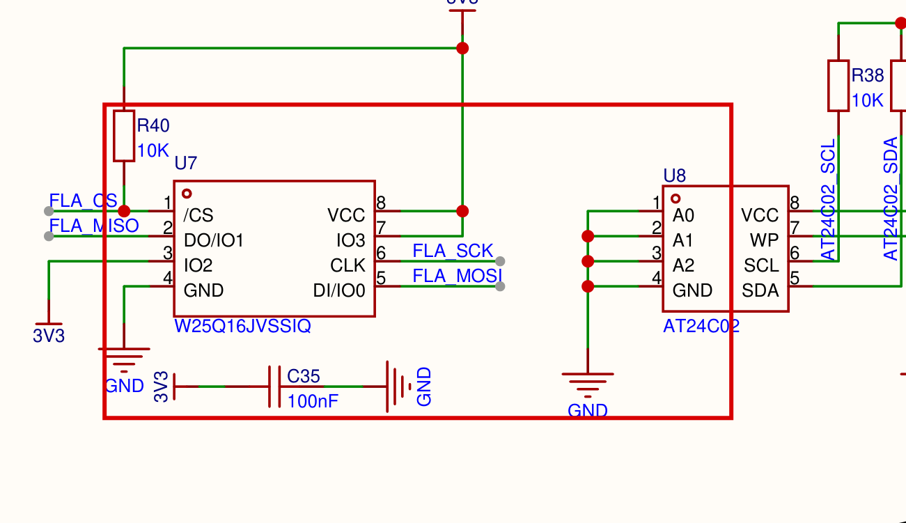

**怎么读**：原理图第 4 页（红框）U7 = **W25Q16JVSSIQ**，2MB SPI Flash。
`/CS`（片选）经 R40 10K 上拉到 3V3——空闲时片选是高（不选中）；DO/CLK/DI 三根线接 MCU 的 SPI1。

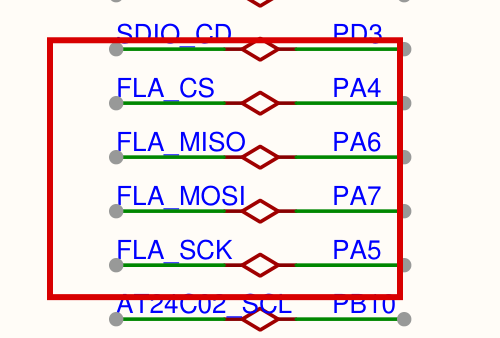

**怎么读**：第 7 页：`FLA_CS → PA4`、`FLA_SCK → PA5`、`FLA_MISO → PA6`、`FLA_MOSI → PA7`，
正好是**硬件 SPI1** 的默认引脚（AF5）。零接线，芯片焊在板上。

## 2. 原理

### 2.1 SPI 和 I2C 的区别（一句话版）

| | I2C | SPI |
|---|---|---|
| 线数 | 2 根（SCL/SDA 共享） | 4 根（SCK/MISO/MOSI/CS，CS 每从机一根） |
| 方向 | 半双工（一根线来回） | **全双工**（MISO/MOSI 各一根，同时收发） |
| 速度 | 100k~400k | 可达几十 MHz |
| 寻址 | 地址字节 | **片选线**（拉低谁，谁听话） |

**全双工的代价**：发一个字节必然收一个字节——所以"只想收"的时候也得发个哑字节（0xFF）造时钟出来。
这就是读 Flash 时满屏 `spi_txrx(0xFF)` 的原因。

### 2.2 模式 0：时钟极性/相位

SPI 有 4 种模式（CPOL×CPHA）。W25Q16 支持模式 0 和模式 3，我们用**模式 0**：
空闲时钟低（CPOL=0）、上升沿采样（CPHA=0）。两端必须一致，否则收到的全是错位数据。

### 2.3 SPI1 寄存器

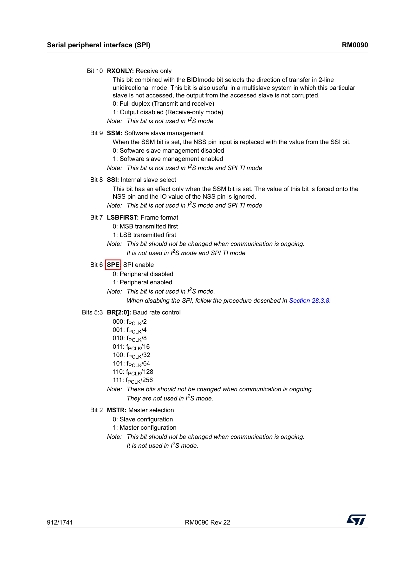

**怎么读**：RM0090 第 912 页 `SPI_CR1`：**MSTR**（bit2 主机）、**SPE**（bit6 使能）、
**BR[2:0]**（bit5:3 分频：000=/2、001=/4…）、**CPOL/CPHA**（bit1/bit0 模式）。
本节点：`MSTR | SSM | SSI`，BR=000 → 16MHz÷2 = 8MHz。

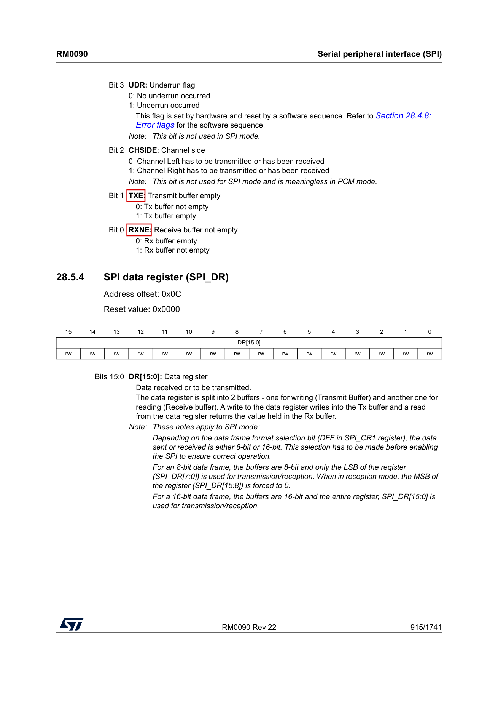

**怎么读**：第 915 页 `SPI_SR`：**TXE**（bit1 发送缓冲空=可以塞下一个字节）、
**RXNE**（bit0 收到字节=可以取）。**BSY**（bit7）表示移位器还在忙——切片选前要等它归零。

## 3. 寄存器版完整代码（main.c 全文 · 实测 PASS 版）

```c
/*
 * 节点 5 · SPI 读写 Flash（W25Q16）—— 寄存器版（硬件 SPI1）
 *
 * 硬件事实（原理图第 4/7 页已核实）：
 *   W25Q16 SPI Flash（2MB，JEDEC ID 应为 EF 40 15）
 *   CS=PA4（普通 GPIO 片选）、SCK=PA5、MISO=PA6、MOSI=PA7（硬件 SPI1，AF5）
 *   SPI 模式 0（CPOL=0 CPHA=0），片选低电平有效
 *
 * 功能：
 *   ① 读 JEDEC ID：发 0x9F 收 3 字节，应为 EF 40 15
 *   ② 扇区擦除（4KB）→ 页编程写入 "F407" → 读回比对 → PASS
 *
 * 新概念：SPI 是四线全双工（收发同时进行——发一个字节必然收一个字节），
 * 全双工的代价是"读也要发哑字节 0xFF 造时钟"。
 */

#include "stm32f4xx.h"

/* ============ 串口（节点三） ============ */

void uart1_send(uint8_t b)
{
    while ((USART1->SR & USART_SR_TXE) == 0) { }
    USART1->DR = b;
}

void uart1_str(const char *s)
{
    while (*s)
        uart1_send((uint8_t)*s++);
}

void uart1_hex(uint8_t v)
{
    const char h[] = "0123456789ABCDEF";
    uart1_send((uint8_t)h[v >> 4]);
    uart1_send((uint8_t)h[v & 0x0F]);
}

void uart_init(void)
{
    SystemCoreClockUpdate();

    RCC->AHB1ENR |= RCC_AHB1ENR_GPIOAEN;
    RCC->APB2ENR |= RCC_APB2ENR_USART1EN;

    GPIOA->MODER &= ~(3UL << 18);  GPIOA->MODER |= (2UL << 18);
    GPIOA->MODER &= ~(3UL << 20);  GPIOA->MODER |= (2UL << 20);
    GPIOA->AFR[1] &= ~(0xFUL << 4);  GPIOA->AFR[1] |= (7UL << 4);
    GPIOA->AFR[1] &= ~(0xFUL << 8);  GPIOA->AFR[1] |= (7UL << 8);

    USART1->BRR = 0x8B;
    USART1->CR1 |= USART_CR1_UE;
    USART1->CR1 |= USART_CR1_TE | USART_CR1_RE;
}

/* ============ SPI1 ============ */

#define CS_L()   (GPIOA->BSRR = (1UL << 4) << 16)   /* BSRR 高16位=复位=输出低=选中 */
#define CS_H()   (GPIOA->BSRR = (1UL << 4))         /* BSRR 低16位=置位=输出高=释放 */

static void spi1_init(void)
{
    RCC->AHB1ENR |= RCC_AHB1ENR_GPIOAEN;     /* GPIOA 时钟（已在 uart_init 开过，幂等） */
    RCC->APB2ENR |= RCC_APB2ENR_SPI1EN;      /* SPI1 时钟（APB2 bit12） */

    GPIOA->MODER &= ~(3UL << 8);   GPIOA->MODER |= (1UL << 8);    /* PA4 输出（CS） */
    GPIOA->MODER &= ~((3UL << 10) | (3UL << 12) | (3UL << 14));
    GPIOA->MODER |= (2UL << 10) | (2UL << 12) | (2UL << 14);      /* PA5/6/7 复用 10 */
    GPIOA->AFR[0] &= ~(0xFUL << 20); GPIOA->AFR[0] |= (5UL << 20); /* PA5 AF5 */
    GPIOA->AFR[0] &= ~(0xFUL << 24); GPIOA->AFR[0] |= (5UL << 24); /* PA6 AF5 */
    GPIOA->AFR[0] &= ~(0xFUL << 28); GPIOA->AFR[0] |= (5UL << 28); /* PA7 AF5 */

    CS_H();                                  /* 片选空闲高 */

    SPI1->CR1 = SPI_CR1_MSTR                 /* 主机 */
              | SPI_CR1_SSM | SPI_CR1_SSI    /* 软件管片选 + 内部 NSS 拉高 */
              ;                              /* BR=000：fPCLK2/2 = 8MHz；CPOL=0 CPHA=0 模式0 */
    SPI1->CR1 |= SPI_CR1_SPE;                /* 使能（最后开） */
}

static uint8_t spi_txrx(uint8_t b)         /* 全双工：发一字节，同时收回一字节 */
{
    while (!(SPI1->SR & SPI_SR_TXE)) { }   /* 等发送缓冲空 */
    SPI1->DR = b;
    while (!(SPI1->SR & SPI_SR_RXNE)) { }  /* 等收到（移位完成） */
    return (uint8_t)SPI1->DR;
}

/* ============ W25Q16 协议层 ============ */

static void flash_write_enable(void)
{
    CS_L();
    spi_txrx(0x06);
    CS_H();
}

static uint8_t flash_wait_busy(void)       /* 轮询状态寄存器 bit0（擦写中=1），带超时 */
{
    uint32_t t = 1000000;
    uint8_t sr;
    CS_L();
    spi_txrx(0x05);
    do {
        sr = spi_txrx(0xFF);
    } while ((sr & 0x01) && --t);
    CS_H();
    return t ? 1 : 0;
}

static uint32_t flash_read_jedec(void)
{
    uint32_t id;
    CS_L();
    spi_txrx(0x9F);
    id  = (uint32_t)spi_txrx(0xFF) << 16;
    id |= (uint32_t)spi_txrx(0xFF) << 8;
    id |= (uint32_t)spi_txrx(0xFF);
    CS_H();
    return id;
}

static uint8_t flash_erase_sector(void)    /* 擦 0 地址所在 4KB 扇区 */
{
    flash_write_enable();
    CS_L();
    spi_txrx(0x20);
    spi_txrx(0x00); spi_txrx(0x00); spi_txrx(0x00);   /* 24 位地址 */
    CS_H();
    return flash_wait_busy();              /* 典型 45~300ms */
}

static uint8_t flash_prog_page(const uint8_t *d, uint8_t len)   /* 页编程（≤256 字节） */
{
    uint8_t i;
    flash_write_enable();
    CS_L();
    spi_txrx(0x02);
    spi_txrx(0x00); spi_txrx(0x00); spi_txrx(0x00);
    for (i = 0; i < len; i++)
        spi_txrx(d[i]);
    CS_H();
    return flash_wait_busy();              /* 典型 0.7~3ms */
}

static void flash_read_data(uint8_t *out, uint8_t len)
{
    uint8_t i;
    CS_L();
    spi_txrx(0x03);
    spi_txrx(0x00); spi_txrx(0x00); spi_txrx(0x00);
    for (i = 0; i < len; i++)
        out[i] = spi_txrx(0xFF);           /* 读：发哑字节造时钟 */
    CS_H();
}

/* ============ 主线 ============ */

int main(void)
{
    uint32_t id;
    uint8_t rd[4] = {0};
    const uint8_t wr[4] = {'F', '4', '0', '7'};
    uint8_t i, ok = 1;

    uart_init();
    spi1_init();

    uart1_str("\r\n=== SPI1 W25Q16 TEST (reg) ===\r\n");

    id = flash_read_jedec();
    uart1_str("JEDEC=0x");
    uart1_hex((uint8_t)(id >> 16));
    uart1_hex((uint8_t)(id >> 8));
    uart1_hex((uint8_t)id);
    if (id == 0xEF4015UL) uart1_str("  ID-PASS\r\n");
    else                  uart1_str("  ID-FAIL\r\n");

    ok &= flash_erase_sector();
    ok &= flash_prog_page(wr, 4);
    flash_read_data(rd, 4);

    uart1_str("READ=");
    for (i = 0; i < 4; i++)
        uart1_send(rd[i]);
    uart1_str("  ");
    for (i = 0; i < 4; i++)
        if (rd[i] != wr[i]) ok = 0;
    if (ok) uart1_str("PASS\r\n");
    else    uart1_str("FAIL\r\n");

    while (1) { }
}
```

## 4. HAL 版完整代码（main.c 全文 · 实测 PASS 版）

```c
/*
 * 节点 5 · SPI 读写 Flash（W25Q16）—— HAL 库版
 *
 * 硬件事实同寄存器版：CS=PA4（GPIO）、SCK=PA5、MISO=PA6、MOSI=PA7（SPI1，AF5），模式 0
 * 功能同样三段：读 JEDEC ID → 扇区擦除 → 页编程 "F407" → 读回比对
 *
 * HAL 代办员：
 *   HAL_SPI_Transmit(&hspi1, buf, len, timeout)  只发
 *   HAL_SPI_Receive (&hspi1, buf, len, timeout)  只收（内部自动发哑字节造时钟）
 *   HAL_SPI_TransmitReceive(&hspi1, tx, rx, len, timeout)  边发边收
 *   —— 寄存器版要手写的"等 TXE/等 RXNE"，HAL 全包在函数里
 */

#include "stm32f4xx_hal.h"

/* ============ 串口 ============ */

void uart1_send(uint8_t b)
{
    while ((USART1->SR & USART_SR_TXE) == 0) { }
    USART1->DR = b;
}

void uart1_str(const char *s)
{
    while (*s)
        uart1_send((uint8_t)*s++);
}

void uart1_hex(uint8_t v)
{
    const char h[] = "0123456789ABCDEF";
    uart1_send((uint8_t)h[v >> 4]);
    uart1_send((uint8_t)h[v & 0x0F]);
}

void uart_init(void)
{
    SystemCoreClockUpdate();

    RCC->AHB1ENR |= RCC_AHB1ENR_GPIOAEN;
    RCC->APB2ENR |= RCC_APB2ENR_USART1EN;

    GPIOA->MODER &= ~(3UL << 18);  GPIOA->MODER |= (2UL << 18);
    GPIOA->MODER &= ~(3UL << 20);  GPIOA->MODER |= (2UL << 20);
    GPIOA->AFR[1] &= ~(0xFUL << 4);  GPIOA->AFR[1] |= (7UL << 4);
    GPIOA->AFR[1] &= ~(0xFUL << 8);  GPIOA->AFR[1] |= (7UL << 8);

    USART1->BRR = 0x8B;
    USART1->CR1 |= USART_CR1_UE;
    USART1->CR1 |= USART_CR1_TE | USART_CR1_RE;
}

/* ============ SPI1（HAL） ============ */

SPI_HandleTypeDef hspi1;

#define CS_L()   (GPIOA->BSRR = (1UL << 4) << 16)   /* BSRR 高16位=复位=输出低=选中 */
#define CS_H()   (GPIOA->BSRR = (1UL << 4))         /* BSRR 低16位=置位=输出高=释放 */

void HAL_SPI_MspInit(SPI_HandleTypeDef *hspi)
{
    GPIO_InitTypeDef gpio = {0};

    __HAL_RCC_GPIOA_CLK_ENABLE();
    __HAL_RCC_SPI1_CLK_ENABLE();

    /* PA5/PA6/PA7 = SPI1 复用 AF5 */
    gpio.Pin       = GPIO_PIN_5 | GPIO_PIN_6 | GPIO_PIN_7;
    gpio.Mode      = GPIO_MODE_AF_PP;
    gpio.Pull      = GPIO_NOPULL;
    gpio.Speed     = GPIO_SPEED_FREQ_VERY_HIGH;
    gpio.Alternate = GPIO_AF5_SPI1;
    HAL_GPIO_Init(GPIOA, &gpio);

    /* PA4 = 普通推挽输出（片选，软件管） */
    gpio.Pin       = GPIO_PIN_4;
    gpio.Mode      = GPIO_MODE_OUTPUT_PP;
    gpio.Pull      = GPIO_NOPULL;
    gpio.Speed     = GPIO_SPEED_FREQ_HIGH;
    HAL_GPIO_Init(GPIOA, &gpio);

    CS_H();
}

static void MX_SPI1_Init(void)
{
    hspi1.Instance               = SPI1;
    hspi1.Init.Mode              = SPI_MODE_MASTER;
    hspi1.Init.Direction         = SPI_DIRECTION_2LINES;   /* 全双工 */
    hspi1.Init.DataSize          = SPI_DATASIZE_8BIT;
    hspi1.Init.CLKPolarity       = SPI_POLARITY_LOW;       /* 模式 0 */
    hspi1.Init.CLKPhase          = SPI_PHASE_1EDGE;        /* 模式 0 */
    hspi1.Init.NSS               = SPI_NSS_SOFT;           /* 软件片选 */
    hspi1.Init.BaudRatePrescaler = SPI_BAUDRATEPRESCALER_4;/* 16MHz/4 = 4MHz */
    hspi1.Init.FirstBit          = SPI_FIRSTBIT_MSB;
    hspi1.Init.TIMode            = SPI_TIMODE_DISABLE;
    hspi1.Init.CRCCalculation    = SPI_CRCCALCULATION_DISABLE;
    hspi1.Init.CRCPolynomial     = 7;
    if (HAL_SPI_Init(&hspi1) != HAL_OK)
    {
        while (1) { }
    }
}

static uint8_t spi_txrx(uint8_t b)         /* 寄存器版的 4 行 → HAL 一行 */
{
    uint8_t r;
    HAL_SPI_TransmitReceive(&hspi1, &b, &r, 1, 100);
    return r;
}

/* ============ W25Q16 协议层 ============ */

static void flash_write_enable(void)
{
    uint8_t cmd = 0x06;
    CS_L();
    HAL_SPI_Transmit(&hspi1, &cmd, 1, 100);
    CS_H();
}

static uint8_t flash_wait_busy(void)
{
    uint32_t t = 1000000;
    uint8_t sr = 0;
    CS_L();
    spi_txrx(0x05);
    do {
        sr = spi_txrx(0xFF);
    } while ((sr & 0x01) && --t);
    CS_H();
    return t ? 1 : 0;
}

static uint32_t flash_read_jedec(void)
{
    uint32_t id;
    uint8_t cmd = 0x9F;
    uint8_t b[3];
    CS_L();
    HAL_SPI_TransmitReceive(&hspi1, &cmd, b, 1, 100);  /* 命令字节的返回值是垃圾，丢掉 */
    HAL_SPI_Receive(&hspi1, b, 3, 100);                /* 再收 3 字节 = JEDEC ID */
    CS_H();
    id = ((uint32_t)b[0] << 16) | ((uint32_t)b[1] << 8) | b[2];
    return id;
}

static uint8_t flash_erase_sector(void)
{
    uint8_t cmd[4] = {0x20, 0x00, 0x00, 0x00};
    flash_write_enable();
    CS_L();
    HAL_SPI_Transmit(&hspi1, cmd, 4, 100);
    CS_H();
    return flash_wait_busy();
}

static uint8_t flash_prog_page(const uint8_t *d, uint8_t len)
{
    uint8_t cmd[4] = {0x02, 0x00, 0x00, 0x00};
    flash_write_enable();
    CS_L();
    HAL_SPI_Transmit(&hspi1, cmd, 4, 100);
    HAL_SPI_Transmit(&hspi1, (uint8_t *)d, len, 100);
    CS_H();
    return flash_wait_busy();
}

static void flash_read_data(uint8_t *out, uint8_t len)
{
    uint8_t cmd[4] = {0x03, 0x00, 0x00, 0x00};
    CS_L();
    HAL_SPI_Transmit(&hspi1, cmd, 4, 100);
    HAL_SPI_Receive(&hspi1, out, len, 100);   /* 只收：HAL 自动发哑字节造时钟 */
    CS_H();
}

/* ============ 主线 ============ */

int main(void)
{
    uint32_t id;
    uint8_t rd[4] = {0};
    const uint8_t wr[4] = {'F', '4', '0', '7'};
    uint8_t i, ok = 1;

    HAL_Init();
    uart_init();
    MX_SPI1_Init();

    uart1_str("\r\n=== SPI1 W25Q16 TEST (HAL) ===\r\n");

    id = flash_read_jedec();
    uart1_str("JEDEC=0x");
    uart1_hex((uint8_t)(id >> 16));
    uart1_hex((uint8_t)(id >> 8));
    uart1_hex((uint8_t)id);
    if (id == 0xEF4015UL) uart1_str("  ID-PASS\r\n");
    else                  uart1_str("  ID-FAIL\r\n");

    ok &= flash_erase_sector();
    ok &= flash_prog_page(wr, 4);
    flash_read_data(rd, 4);

    uart1_str("READ=");
    for (i = 0; i < 4; i++)
        uart1_send(rd[i]);
    uart1_str("  ");
    for (i = 0; i < 4; i++)
        if (rd[i] != wr[i]) ok = 0;
    if (ok) uart1_str("PASS\r\n");
    else    uart1_str("FAIL\r\n");

    while (1) { }
}
```

## 5. 验收 ✅

| 腿 | 编译 | 串口输出 | 体积 |
|---|---|---|---|
| 寄存器 | ✅ 0错0警 | ✅ `JEDEC=0xEF4015 ID-PASS` + `READ=F407 PASS`（连续两次复位稳定） | 1744B |
| HAL | ✅ 0错0警 | ✅ 同上（连续两次复位稳定） | 13124B |

## 6. 翻车预告

| 现象 | 真因 |
|---|---|
| `JEDEC=0x000000` | MISO 没通（AF 号错/时钟没开） |
| `JEDEC=0xFFFFFF` | MISO 恒高（片选没拉低 = 芯片没选中） |
| ID 对但 READ 乱码 | 忘了 Write Enable 或 wait_busy（编程没完成） |
| **JEDEC=0x000000**（本次实测踩过） | **片选极性反了**：`CS_L()` 写成了 BSRR 低16位（=拉高），
  芯片从头到尾没被选中，MISO 悬空读 0。**BSRR 低16位=置位(高)、高16位=复位(低)**，宏里 `<<16` 挪错位就翻转 |


# 节点六 · 屏幕（ST7789）✅

> **你要做的事**：点亮板上的 2.4 寸屏，让它红 → 绿 → 蓝 全屏循环。
> 一句话验收：**三种纯色各停 1 秒，颜色正、不花屏**。

## 1. 看图找屏

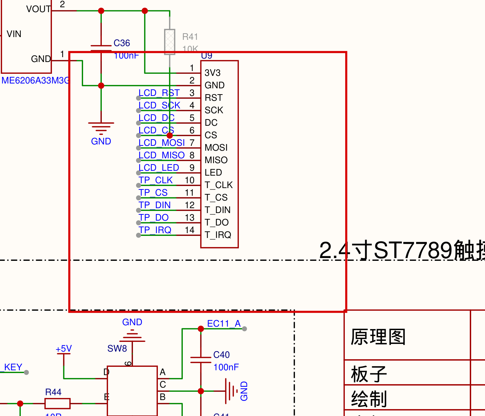

**怎么读**：原理图第 4 页（红框）U9 = **2.4 寸 ST7789 触摸屏** 的 14 针座：
1=3V3、2=GND、3=RST、4=SCK、5=DC、6=CS、7=MOSI、8=MISO、9=LED（背光），10~14 是触摸（本章不碰）。

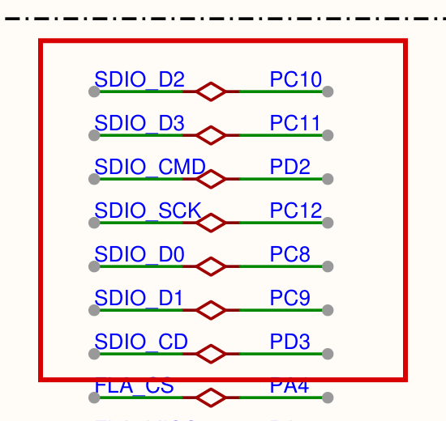

**怎么读**：第 7 页：`LCD_SCK→PB3`、`LCD_MOSI→PB5`、`LCD_MISO→PB4`、`LCD_DC→PB0`、
`LCD_CS→PA15`、`LCD_RST→PC7`、`LCD_LED→PB1`。

⚠️ **两个要点**：
1. **PB3/PB5 也是 SPI1 的引脚**（SPI1 在 F4 有两组映射：PA4-7 和 PB3-5）。Flash 占了 PA 组，
   屏幕就用 PB 组——**同一个 SPI1 外设，同一时刻只能服务一个**。
2. **PB3/PB4/PA15 复位后是 JTAG 引脚**（JTDO/NJTRST/JTDI）。我们用 **SWD** 调试，
   把它们配成 AF5 / GPIO 输出即可直接征用——F4 这点比 F1 省事（F1 还得先关 JTAG）。

## 2. 原理

### 2.1 SPI 屏怎么区分"命令"和"数据"

SPI 只有一根数据线（MOSI），屏幕怎么知道收到的是命令还是像素数据？答案：**多一根 DC 线**。

| DC 电平 | 收到的字节含义 |
|---|---|
| **低**（DC=0） | 命令（0x2A/0x2C/0x29…） |
| **高**（DC=1） | 参数或像素数据 |

所以每个字节都要配好 DC 再发：`lcd_cmd()` 拉低 DC、`lcd_data()` 拉高 DC。

### 2.2 颜色格式：RGB565

16 位 = **R 5 位 + G 6 位 + B 5 位**（人眼对绿最敏感，所以绿多一位）：

```
0xF800 = 11111 000000 00000 = 纯红
0x07E0 = 00000 111111 00000 = 纯绿
0x001F = 00000 000000 11111 = 纯蓝
0xFFFF = 白          0x0000 = 黑
```

发送时**高字节先**（SPI 是 MSB 先发）。

### 2.3 ST7789 关键命令（本章用到的六个）

| 命令 | 作用 | 参数 |
|---|---|---|
| 0x01 | 软复位 | — |
| 0x11 | 退出睡眠 | — |
| 0x3A | 像素格式 | 0x55 = 16 位 RGB565 |
| 0x36 | 扫描方向 MADCTL | 0x00 = 默认 |
| 0x20 / 0x21 | 反色关 / 开 | — |
| 0x29 | 显示开 | — |
| 0x2A / 0x2B / 0x2C | 设列范围 / 行范围 / 开始写显存 | 各 4 字节坐标 |

**写一块区域的固定套路**：0x2A 发 x0,x1 → 0x2B 发 y0,y1 → 0x2C 发"我开始了" →
然后连续发像素（每像素 2 字节，自动换行）。

> **信源说明**：ST7789 数据手册需原厂申请，本章参数来源 = **开源驱动惯例 + 本板实测**
> （`JEDEC` 式的"手册截图"在这章缺失，但每个命令都在屏幕上验证过：颜色对了、反色坑也是实测抓的）。

### 2.4 ★ 反色坑（本章实测踩到的）

第一版在初始化里写了 `0x21`（反色**开**），结果屏幕显示：**红变青、绿变紫、蓝变黄**——三色全部精确反色。

原因：ST7789 配套的面板分**普通**和**反色**两种，厂商用同一颗驱动 IC 配不同面板。
IPS 屏常需要 INVON，普通 TN 屏必须 INVOFF。**同一颗芯片，方向完全相反，只能实测**。
本板实测：必须 `0x20`（INVOFF）。

## 3. 寄存器版完整代码（main.c 全文 · 实测 PASS）

```c
/*
 * 节点 6 · 屏幕 ST7789（寄存器版）
 *
 * 硬件事实（原理图第 4/7 页已核实）：
 *   U9 = 2.4 寸 ST7789 触摸屏（14 针座，已插好）
 *   SCK=PB3  MOSI=PB5  （SPI1 的 PB 组映射，AF5；PA4-7 那组被 Flash 占用）
 *   DC=PB0  CS=PA15  RST=PC7  LED=PB1（背光）
 *   MISO=PB4（屏幕不返回数据，不用）
 *
 * ★ PB3/PB4/PA15 复位后是 JTAG 引脚（JTDO/NJTRST/JTDI）。我们用 SWD 调试，
 *   所以直接把它们配成 AF5/GPIO 输出即可，不影响 ST-Link。
 *
 * 功能：初始化屏幕 → 红/绿/蓝全屏循环，每种颜色停 1 秒
 */

#include "stm32f4xx.h"

/* ============ 引脚操作宏 ============ */
#define CS_L()    (GPIOA->BSRR = (1UL << 15) << 16)
#define CS_H()    (GPIOA->BSRR = (1UL << 15))
#define DC_L()    (GPIOB->BSRR = (1UL << 0) << 16)
#define DC_H()    (GPIOB->BSRR = (1UL << 0))
#define RST_L()   (GPIOC->BSRR = (1UL << 7) << 16)
#define RST_H()   (GPIOC->BSRR = (1UL << 7))
#define LED_ON()  (GPIOB->BSRR = (1UL << 1))
#define LED_OFF() (GPIOB->BSRR = (1UL << 1) << 16)

static void delay_ms(uint32_t ms)
{
    uint32_t tick = SystemCoreClock / 8 / 1000;
    SysTick->LOAD = tick - 1;
    SysTick->VAL  = 0;
    SysTick->CTRL = SysTick_CTRL_ENABLE_Msk;
    while (ms--)
        while ((SysTick->CTRL & SysTick_CTRL_COUNTFLAG_Msk) == 0) { }
    SysTick->CTRL = 0;
}

/* ============ SPI1（PB3/PB5 组） ============ */
static void spi_init(void)
{
    RCC->AHB1ENR |= RCC_AHB1ENR_GPIOAEN | RCC_AHB1ENR_GPIOBEN | RCC_AHB1ENR_GPIOCEN;
    RCC->APB2ENR |= RCC_APB2ENR_SPI1EN;

    /* PB3=SCK, PB5=MOSI, PB4=MISO：复用 10 + AF5 */
    GPIOB->MODER &= ~((3UL << 6) | (3UL << 8) | (3UL << 10));
    GPIOB->MODER |=  (2UL << 6) | (2UL << 8) | (2UL << 10);
    GPIOB->AFR[0] &= ~((0xFUL << 12) | (0xFUL << 16) | (0xFUL << 20));
    GPIOB->AFR[0] |=  (5UL << 12) | (5UL << 16) | (5UL << 20);   /* PB3/PB4/PB5 = AF5 */

    /* PB0=DC, PB1=LED：普通输出 */
    GPIOB->MODER &= ~((3UL << 0) | (3UL << 2));
    GPIOB->MODER |=  (1UL << 0) | (1UL << 2);

    /* PA15=CS：普通输出（JTDI 脚，配成输出即释放） */
    GPIOA->MODER &= ~(3UL << 30);
    GPIOA->MODER |=  (1UL << 30);

    /* PC7=RST：普通输出 */
    GPIOC->MODER &= ~(3UL << 14);
    GPIOC->MODER |=  (1UL << 14);

    CS_H();
    DC_H();

    SPI1->CR1 = SPI_CR1_MSTR | SPI_CR1_SSM | SPI_CR1_SSI;   /* BR=000: 8MHz */
    SPI1->CR1 |= SPI_CR1_SPE;
}

static uint8_t spi_tx(uint8_t b)
{
    while (!(SPI1->SR & SPI_SR_TXE)) { }
    SPI1->DR = b;
    while (!(SPI1->SR & SPI_SR_RXNE)) { }
    return (uint8_t)SPI1->DR;
}

/* ============ ST7789 ============ */
static void lcd_cmd(uint8_t c)
{
    CS_L(); DC_L(); spi_tx(c); CS_H();
}

static void lcd_data(uint8_t d)
{
    CS_L(); DC_H(); spi_tx(d); CS_H();
}

static void lcd_data_start(void)
{
    CS_L(); DC_H();
}

static void lcd_data_end(void)
{
    CS_H();
}

static void lcd_reset(void)
{
    RST_H(); delay_ms(10);
    RST_L(); delay_ms(20);
    RST_H(); delay_ms(120);
}

static void lcd_init(void)
{
    lcd_reset();

    lcd_cmd(0x01); delay_ms(150);          /* 软复位 */
    lcd_cmd(0x11); delay_ms(120);          /* 退出睡眠 */

    lcd_cmd(0x3A); lcd_data(0x55);         /* 16 位色（RGB565） */
    lcd_cmd(0x36); lcd_data(0x00);         /* 扫描方向：正常 */
    lcd_cmd(0x20);                         /* 反色关：实测本屏开了 0x21 会红绿蓝全反色 */
    lcd_cmd(0x13);                         /* 正常显示模式 */
    lcd_cmd(0x29); delay_ms(20);           /* 显示开 */
}

static void lcd_set_window(uint16_t x0, uint16_t y0, uint16_t x1, uint16_t y1)
{
    lcd_cmd(0x2A);                          /* 列地址 */
    lcd_data(x0 >> 8); lcd_data(x0 & 0xFF);
    lcd_data(x1 >> 8); lcd_data(x1 & 0xFF);
    lcd_cmd(0x2B);                          /* 行地址 */
    lcd_data(y0 >> 8); lcd_data(y0 & 0xFF);
    lcd_data(y1 >> 8); lcd_data(y1 & 0xFF);
    lcd_cmd(0x2C);                          /* 开始写显存 */
}

static void lcd_fill(uint16_t color)        /* 全屏填充 240x320 */
{
    uint32_t i, n = 240UL * 320UL;
    lcd_set_window(0, 0, 239, 319);
    lcd_data_start();
    for (i = 0; i < n; i++)
    {
        spi_tx((uint8_t)(color >> 8));      /* RGB565 高字节先 */
        spi_tx((uint8_t)(color & 0xFF));
    }
    lcd_data_end();
}

int main(void)
{
    spi_init();
    LED_ON();                               /* 背光开，否则黑屏看不出 */
    lcd_init();

    while (1)
    {
        lcd_fill(0xF800);                   /* 红 */
        delay_ms(1000);
        lcd_fill(0x07E0);                   /* 绿 */
        delay_ms(1000);
        lcd_fill(0x001F);                   /* 蓝 */
        delay_ms(1000);
    }
}
```

### 三个要点

1. **SPI1 切到 PB 组**：MODER 配 10（复用）+ AFR[0] 填 AF5（PB3/PB4/PB5）
2. **CS/DC/RST 都是普通 GPIO**：极性按 `BSRR` 规则写（低 16 位=拉高、高 16 位=拉低）
3. **刷新整屏 153600 字节**：逐字节 `spi_tx`，8MHz 下约 0.3 秒一屏

## 4. HAL 版完整代码（main.c 全文 · 实测 PASS）

```c
/*
 * 节点 6 · 屏幕 ST7789（HAL 库版）
 *
 * 硬件事实与寄存器版相同：
 *   SCK=PB3  MOSI=PB5（SPI1 PB组 AF5）、DC=PB0、CS=PA15、RST=PC7、LED=PB1
 *   实测：本屏必须 INVOFF(0x20)，开了 INVON 会红绿蓝全反色
 *
 * HAL 代办员：
 *   HAL_SPI_Transmit(&hspi1, buf, len, timeout)  ← 寄存器版要循环等 TXE 写 DR
 *   HAL_GPIO_WritePin(...)                        ← CS/DC/RST 电平
 * 亮点：填充整屏用 512 字节 buffer 批量发送，一次调用发一大片（寄存器版是逐字节）
 */

#include "stm32f4xx_hal.h"

#define CS_L()    HAL_GPIO_WritePin(GPIOA, GPIO_PIN_15, GPIO_PIN_RESET)
#define CS_H()    HAL_GPIO_WritePin(GPIOA, GPIO_PIN_15, GPIO_PIN_SET)
#define DC_L()    HAL_GPIO_WritePin(GPIOB, GPIO_PIN_0, GPIO_PIN_RESET)
#define DC_H()    HAL_GPIO_WritePin(GPIOB, GPIO_PIN_0, GPIO_PIN_SET)
#define RST_L()   HAL_GPIO_WritePin(GPIOC, GPIO_PIN_7, GPIO_PIN_RESET)
#define RST_H()   HAL_GPIO_WritePin(GPIOC, GPIO_PIN_7, GPIO_PIN_SET)
#define LED_ON()  HAL_GPIO_WritePin(GPIOB, GPIO_PIN_1, GPIO_PIN_SET)

SPI_HandleTypeDef hspi1;

void HAL_SPI_MspInit(SPI_HandleTypeDef *hspi)
{
    GPIO_InitTypeDef gpio = {0};

    __HAL_RCC_GPIOA_CLK_ENABLE();
    __HAL_RCC_GPIOB_CLK_ENABLE();
    __HAL_RCC_GPIOC_CLK_ENABLE();
    __HAL_RCC_SPI1_CLK_ENABLE();

    /* PB3/PB4/PB5 = SPI1 AF5（PB3/PB4 是 JTAG 脚，配 AF 即释放；SWD 不受影响） */
    gpio.Pin       = GPIO_PIN_3 | GPIO_PIN_4 | GPIO_PIN_5;
    gpio.Mode      = GPIO_MODE_AF_PP;
    gpio.Pull      = GPIO_NOPULL;
    gpio.Speed     = GPIO_SPEED_FREQ_VERY_HIGH;
    gpio.Alternate = GPIO_AF5_SPI1;
    HAL_GPIO_Init(GPIOB, &gpio);

    /* DC=PB0, LED=PB1 */
    gpio.Pin   = GPIO_PIN_0 | GPIO_PIN_1;
    gpio.Mode  = GPIO_MODE_OUTPUT_PP;
    gpio.Speed = GPIO_SPEED_FREQ_HIGH;
    HAL_GPIO_Init(GPIOB, &gpio);

    /* CS=PA15 */
    gpio.Pin  = GPIO_PIN_15;
    gpio.Mode = GPIO_MODE_OUTPUT_PP;
    HAL_GPIO_Init(GPIOA, &gpio);

    /* RST=PC7 */
    gpio.Pin  = GPIO_PIN_7;
    gpio.Mode = GPIO_MODE_OUTPUT_PP;
    HAL_GPIO_Init(GPIOC, &gpio);

    CS_H();
    DC_H();
}

static void MX_SPI1_Init(void)
{
    hspi1.Instance               = SPI1;
    hspi1.Init.Mode              = SPI_MODE_MASTER;
    hspi1.Init.Direction         = SPI_DIRECTION_2LINES;
    hspi1.Init.DataSize          = SPI_DATASIZE_8BIT;
    hspi1.Init.CLKPolarity       = SPI_POLARITY_LOW;
    hspi1.Init.CLKPhase          = SPI_PHASE_1EDGE;
    hspi1.Init.NSS               = SPI_NSS_SOFT;
    hspi1.Init.BaudRatePrescaler = SPI_BAUDRATEPRESCALER_2;   /* 16/2 = 8MHz */
    hspi1.Init.FirstBit          = SPI_FIRSTBIT_MSB;
    hspi1.Init.TIMode            = SPI_TIMODE_DISABLE;
    hspi1.Init.CRCCalculation    = SPI_CRCCALCULATION_DISABLE;
    hspi1.Init.CRCPolynomial     = 7;
    if (HAL_SPI_Init(&hspi1) != HAL_OK) { while (1) { } }
}

/* ============ ST7789 ============ */
static void lcd_cmd(uint8_t c)
{
    CS_L(); DC_L();
    HAL_SPI_Transmit(&hspi1, &c, 1, 100);
    CS_H();
}

static void lcd_data(uint8_t d)
{
    CS_L(); DC_H();
    HAL_SPI_Transmit(&hspi1, &d, 1, 100);
    CS_H();
}

static void lcd_reset(void)
{
    RST_H(); HAL_Delay(10);
    RST_L(); HAL_Delay(20);
    RST_H(); HAL_Delay(120);
}

static void lcd_init(void)
{
    lcd_reset();

    lcd_cmd(0x01); HAL_Delay(150);
    lcd_cmd(0x11); HAL_Delay(120);
    lcd_cmd(0x3A); lcd_data(0x55);     /* RGB565 */
    lcd_cmd(0x36); lcd_data(0x00);     /* 方向 */
    lcd_cmd(0x20);                     /* 反色关（实测本屏必须关） */
    lcd_cmd(0x13);
    lcd_cmd(0x29); HAL_Delay(20);
}

static void lcd_set_window(uint16_t x0, uint16_t y0, uint16_t x1, uint16_t y1)
{
    uint8_t b[4];
    lcd_cmd(0x2A);
    b[0] = x0 >> 8; b[1] = x0 & 0xFF; b[2] = x1 >> 8; b[3] = x1 & 0xFF;
    CS_L(); DC_H();
    HAL_SPI_Transmit(&hspi1, b, 4, 100);   /* 4 字节一次发完（寄存器版要 4 次） */
    CS_H();

    lcd_cmd(0x2B);
    b[0] = y0 >> 8; b[1] = y0 & 0xFF; b[2] = y1 >> 8; b[3] = y1 & 0xFF;
    CS_L(); DC_H();
    HAL_SPI_Transmit(&hspi1, b, 4, 100);
    CS_H();

    lcd_cmd(0x2C);
}

static void lcd_fill(uint16_t color)
{
    static uint8_t buf[512];
    uint32_t i, remain = 240UL * 320UL * 2UL;   /* 总字节数 */
    uint16_t chunk = 0;

    for (i = 0; i < sizeof(buf); i += 2)        /* 把颜色填满 buffer */
    {
        buf[i]     = (uint8_t)(color >> 8);
        buf[i + 1] = (uint8_t)(color & 0xFF);
    }

    lcd_set_window(0, 0, 239, 319);
    CS_L(); DC_H();
    while (remain)
    {
        chunk = (remain > sizeof(buf)) ? sizeof(buf) : (uint16_t)remain;
        HAL_SPI_Transmit(&hspi1, buf, chunk, 500);   /* 512 字节一次调用 */
        remain -= chunk;
    }
    CS_H();
}

int main(void)
{
    HAL_Init();
    MX_SPI1_Init();
    LED_ON();                       /* 背光 */
    lcd_init();

    while (1)
    {
        lcd_fill(0xF800); HAL_Delay(1000);   /* 红 */
        lcd_fill(0x07E0); HAL_Delay(1000);   /* 绿 */
        lcd_fill(0x001F); HAL_Delay(1000);   /* 蓝 */
    }
}
```

**HAL 版的效率优势**：填充用 **512 字节 buffer 批量发送**（`HAL_SPI_Transmit` 一次调用），
而寄存器版是逐字节循环——每次 `HAL_SPI_Transmit` 只进一次函数、处理一整片数据，
刷屏明显更快。这就是"库函数把循环藏进内部"的价值。

| 寄存器版 | HAL 版 |
|---|---|
| `while(!TXE); DR=b; while(!RXNE);` × 每字节 | `HAL_SPI_Transmit(&hspi1, buf, 512, 500)` 一次 512 字节 |
| 配 MODER/AFR/CR1 | `HAL_SPI_Init` + `HAL_SPI_MspInit` |
| 手写延时 | `HAL_Delay` |

## 5. 验收 ✅

| 腿 | 编译 | 现象 | 体积 |
|---|---|---|---|
| 寄存器 | ✅ 0错0警 | ✅ 红→绿→蓝 各 1 秒循环，颜色正 | 1316B |
| HAL | ✅ 0错0警 | ✅ 同上（刷屏明显更快） | 12812B |

## 6. 翻车实录

| 现象 | 真因 | 解法 |
|---|---|---|
| **红显青、绿显紫、蓝显黄**（本次实测） | 初始化开了 `0x21` 反色，本屏是普通面板 | 改 `0x20` INVOFF |
| 纯黑无画面 | 背光没开（PB1）或 RST 时序不够 | `LED_ON()` + 复位延时 120ms |
| 花屏/条纹 | SPI 速率过高或 CS 时序不对 | 降到 4MHz（BR=001）试 |
| 颜色偏但不像纯反色 | 像素格式不是 0x55（16 位） | 查 0x3A 参数 |

---


# 节点七 · LVGL 移植 ✅

> **你要做的事**：把 LVGL 图形库移植到板上，屏幕上出现一个带标题和进度条的界面。
> 验收标准：**深蓝背景 + 白色标题 "F407 + LVGL 8.3" + 进度条**。

## 1. 资料从哪来

| 资料 | 来源 | 用途 |
|---|---|---|
| LVGL 源码 v8.3.11 | GitHub `lvgl/lvgl` release 或 Gitee 镜像 | 库本体（192 个 .c） |
| 移植指南 | docs.lvgl.io → Porting → Display interface | flush 回调怎么写 |
| `lv_conf.h` 模板 | 源码包里的 `lv_conf_template.h` | 配置底稿 |
| 屏幕驱动 | **我们节点六自己写的** | LVGL 只管画，刷屏仍是我们的活 |

下载命令（Gitee 国内快）：
```bash
curl -L -o lvgl.zip https://gitee.com/mirrors/lvgl/repository/archive/v8.3.11.zip
```

## 2. 移植只做三件事

LVGL 和硬件之间只有三个接口：

```
① lv_init()                          LVGL 内核启动
② 注册显示设备                        告诉 LVGL：屏幕多大、画好的像素交给谁刷
     └─ flush 回调（最核心）           LVGL 画好一块 → 你把它刷到屏幕 → 回一句"刷完了"
③ 主循环
     ├─ lv_tick_inc(5)               喂心跳（LVGL 的动画/超时全靠它）
     └─ lv_timer_handler()           LVGL 的"大脑"，不调界面永远不动
```

**核心思路**：LVGL 不碰 SPI、不碰引脚——它只管在内存里画像素。
"内存里的像素怎么变成屏幕上的颜色"这件事由你的 **flush 回调**做。所以移植 = 写一个回调 + 注册。

## 3. 关键代码讲解

### 3.1 flush 回调（移植的心脏）

```c
static void disp_flush(lv_disp_drv_t *drv, const lv_area_t *area, lv_color_t *color_p)
{
    /* area = LVGL 画好的是哪块矩形；color_p = 这块的像素数据 */
    lcd_set_window(area->x1, area->y1, area->x2, area->y2);  /* 用节点六的设窗口 */
    CS_L(); DC_H();
    发送 color_p 里的 n 个像素（每像素 2 字节，高字节先）;
    CS_H();
    lv_disp_flush_ready(drv);        /* ★ 不调用这句，LVGL 会永远等在这一块 */
}
```

### 3.2 注册显示设备

```c
lv_disp_draw_buf_init(&draw_buf, buf1, NULL, LCD_W * 20);  /* 20 行缓冲 9.6KB */
lv_disp_drv_init(&disp_drv);
disp_drv.hor_res = 240;  disp_drv.ver_res = 320;
disp_drv.flush_cb = disp_flush;
disp_drv.draw_buf = &draw_buf;
lv_disp_drv_register(&disp_drv);
```

### 3.3 lv_conf.h 的三个关键值

| 配置 | 值 | 为什么 |
|---|---|---|
| `LV_COLOR_DEPTH` | 16 | 和屏幕 RGB565 一致 |
| `LV_COLOR_16_SWAP` | **1** | LVGL 内部按小端存，屏幕要大端（高字节先），交换一下 |
| `LV_MEM_SIZE` | 48KB | LVGL 自己的堆（对象、样式都从这里分配），SRAM 192KB 够 |

## 4. 寄存器版完整代码（main.c 全文 · 实测 PASS）

```c
/*
 * 节点 7 · LVGL 移植（寄存器版）
 *
 * 硬件：ST7789 240x320（同节点六：SCK=PB3 MOSI=PB5 DC=PB0 CS=PA15 RST=PC7 LED=PB1）
 * LVGL：v8.3.11，16 位色，大端（LV_COLOR_16_SWAP=1）
 *
 * 三个移植要点：
 *   ① flush 回调：LVGL 画好一块后叫你把像素刷到屏上
 *   ② tick：LVGL 的"心跳"，主循环里 lv_tick_inc(5) 喂
 *   ③ 主循环必须调 lv_timer_handler()（LVGL 的"大脑"，不调就永远不动）
 */

#include "stm32f4xx.h"
#include "lvgl.h"

/* ============ ST7789（节点六驱动，精简版） ============ */
#define CS_L()    (GPIOA->BSRR = (1UL << 15) << 16)
#define CS_H()    (GPIOA->BSRR = (1UL << 15))
#define DC_L()    (GPIOB->BSRR = (1UL << 0) << 16)
#define DC_H()    (GPIOB->BSRR = (1UL << 0))
#define RST_L()   (GPIOC->BSRR = (1UL << 7) << 16)
#define RST_H()   (GPIOC->BSRR = (1UL << 7))
#define LED_ON()  (GPIOB->BSRR = (1UL << 1))

static void delay_ms(uint32_t ms)
{
    uint32_t tick = SystemCoreClock / 8 / 1000;
    SysTick->LOAD = tick - 1;
    SysTick->VAL  = 0;
    SysTick->CTRL = SysTick_CTRL_ENABLE_Msk;
    while (ms--)
        while ((SysTick->CTRL & SysTick_CTRL_COUNTFLAG_Msk) == 0) { }
    SysTick->CTRL = 0;
}

static void spi_init(void)
{
    RCC->AHB1ENR |= RCC_AHB1ENR_GPIOAEN | RCC_AHB1ENR_GPIOBEN | RCC_AHB1ENR_GPIOCEN;
    RCC->APB2ENR |= RCC_APB2ENR_SPI1EN;

    GPIOB->MODER &= ~((3UL << 6) | (3UL << 8) | (3UL << 10));
    GPIOB->MODER |=  (2UL << 6) | (2UL << 8) | (2UL << 10);
    GPIOB->AFR[0] &= ~((0xFUL << 12) | (0xFUL << 16) | (0xFUL << 20));
    GPIOB->AFR[0] |=  (5UL << 12) | (5UL << 16) | (5UL << 20);

    GPIOB->MODER &= ~((3UL << 0) | (3UL << 2));
    GPIOB->MODER |=  (1UL << 0) | (1UL << 2);
    GPIOA->MODER &= ~(3UL << 30);  GPIOA->MODER |= (1UL << 30);
    GPIOC->MODER &= ~(3UL << 14);  GPIOC->MODER |= (1UL << 14);

    CS_H(); DC_H();

    SPI1->CR1 = SPI_CR1_MSTR | SPI_CR1_SSM | SPI_CR1_SSI;
    SPI1->CR1 |= SPI_CR1_SPE;
}

static uint8_t spi_tx(uint8_t b)
{
    while (!(SPI1->SR & SPI_SR_TXE)) { }
    SPI1->DR = b;
    while (!(SPI1->SR & SPI_SR_RXNE)) { }
    return (uint8_t)SPI1->DR;
}

static void lcd_cmd(uint8_t c) { CS_L(); DC_L(); spi_tx(c); CS_H(); }
static void lcd_data(uint8_t d) { CS_L(); DC_H(); spi_tx(d); CS_H(); }

static void lcd_set_window(uint16_t x0, uint16_t y0, uint16_t x1, uint16_t y1)
{
    lcd_cmd(0x2A);
    lcd_data((uint8_t)(x0 >> 8)); lcd_data((uint8_t)(x0 & 0xFF));
    lcd_data((uint8_t)(x1 >> 8)); lcd_data((uint8_t)(x1 & 0xFF));
    lcd_cmd(0x2B);
    lcd_data((uint8_t)(y0 >> 8)); lcd_data((uint8_t)(y0 & 0xFF));
    lcd_data((uint8_t)(y1 >> 8)); lcd_data((uint8_t)(y1 & 0xFF));
    lcd_cmd(0x2C);
}

static void lcd_init(void)
{
    RST_H(); delay_ms(10);
    RST_L(); delay_ms(20);
    RST_H(); delay_ms(120);

    lcd_cmd(0x01); delay_ms(150);
    lcd_cmd(0x11); delay_ms(120);
    lcd_cmd(0x3A); lcd_data(0x55);
    lcd_cmd(0x36); lcd_data(0x00);
    lcd_cmd(0x20);                  /* 反色关（节点六实测） */
    lcd_cmd(0x13);
    lcd_cmd(0x29); delay_ms(20);
}

/* ============ LVGL 移植 ============ */

#define LCD_W 240
#define LCD_H 320

static lv_disp_draw_buf_t draw_buf;
static lv_color_t buf1[LCD_W * 20];      /* 20 行缓冲：240*20*2 = 9.6KB */
static lv_disp_drv_t disp_drv;

/* ① flush：LVGL 每画好一块就调这里，把这块像素刷到屏幕 */
static void disp_flush(lv_disp_drv_t *drv, const lv_area_t *area, lv_color_t *color_p)
{
    uint32_t w = (uint32_t)(area->x2 - area->x1 + 1);
    uint32_t h = (uint32_t)(area->y2 - area->y1 + 1);
    uint32_t i, n = w * h;

    lcd_set_window((uint16_t)area->x1, (uint16_t)area->y1,
                   (uint16_t)area->x2, (uint16_t)area->y2);
    CS_L(); DC_H();
    for (i = 0; i < n; i++)
    {
        uint16_t c = color_p[i].full;
        spi_tx((uint8_t)(c >> 8));       /* 大端：高字节先 */
        spi_tx((uint8_t)(c & 0xFF));
    }
    CS_H();

    lv_disp_flush_ready(drv);            /* 告诉 LVGL：这块刷完了 */
}

/* 建一个简单界面：深色背景 + 标题 + 进度条 */
static void ui_create(void)
{
    lv_obj_t *scr = lv_scr_act();
    lv_obj_set_style_bg_color(scr, lv_color_hex(0x102040), 0);

    lv_obj_t *title = lv_label_create(scr);
    lv_label_set_text(title, "F407 + LVGL 8.3");
    lv_obj_set_style_text_color(title, lv_color_hex(0xFFFFFF), 0);
    lv_obj_set_style_text_font(title, &lv_font_montserrat_20, 0);
    lv_obj_align(title, LV_ALIGN_TOP_MID, 0, 20);

    lv_obj_t *sub = lv_label_create(scr);
    lv_label_set_text(sub, "ST7789 240x320");
    lv_obj_set_style_text_color(sub, lv_color_hex(0x80C0FF), 0);
    lv_obj_align(sub, LV_ALIGN_TOP_MID, 0, 55);

    lv_obj_t *bar = lv_bar_create(scr);
    lv_obj_set_size(bar, 180, 18);
    lv_obj_align(bar, LV_ALIGN_CENTER, 0, 40);
    lv_bar_set_value(bar, 65, LV_ANIM_OFF);
}

int main(void)
{
    spi_init();
    LED_ON();
    lcd_init();

    lv_init();                           /* LVGL 内核启动 */
    lv_disp_draw_buf_init(&draw_buf, buf1, NULL, LCD_W * 20);

    lv_disp_drv_init(&disp_drv);
    disp_drv.hor_res  = LCD_W;
    disp_drv.ver_res  = LCD_H;
    disp_drv.flush_cb = disp_flush;
    disp_drv.draw_buf = &draw_buf;
    lv_disp_drv_register(&disp_drv);     /* 注册显示设备 */

    ui_create();

    while (1)
    {
        lv_tick_inc(5);                  /* ② 喂心跳（5ms） */
        lv_timer_handler();              /* ③ 跑 LVGL 的活 */
        delay_ms(5);
    }
}
```

## 5. HAL 版完整代码（main.c 全文 · 实测 PASS）

```c
/*
 * 节点 7 · LVGL 移植（HAL 库版）
 *
 * 硬件：ST7789 240x320（SCK=PB3 MOSI=PB5 DC=PB0 CS=PA15 RST=PC7 LED=PB1）
 * LVGL：v8.3.11 / 16 位色 / 大端（LV_COLOR_16_SWAP=1）
 *
 * 与寄存器版的三处差别：
 *   ① SPI 用 HAL_SPI_Transmit 批量发（寄存器版逐字节）
 *   ② 延时用 HAL_Delay（HAL_Init 的 SysTick 心跳）
 *   ③ GPIO 用 HAL_GPIO_WritePin
 * 移植三要素完全相同：lv_init → 注册显示(flush_cb) → 循环 tick + timer_handler
 */

#include "stm32f4xx_hal.h"
#include "lvgl.h"

#define CS_L()   HAL_GPIO_WritePin(GPIOA, GPIO_PIN_15, GPIO_PIN_RESET)
#define CS_H()   HAL_GPIO_WritePin(GPIOA, GPIO_PIN_15, GPIO_PIN_SET)
#define DC_L()   HAL_GPIO_WritePin(GPIOB, GPIO_PIN_0, GPIO_PIN_RESET)
#define DC_H()   HAL_GPIO_WritePin(GPIOB, GPIO_PIN_0, GPIO_PIN_SET)
#define RST_L()  HAL_GPIO_WritePin(GPIOC, GPIO_PIN_7, GPIO_PIN_RESET)
#define RST_H()  HAL_GPIO_WritePin(GPIOC, GPIO_PIN_7, GPIO_PIN_SET)
#define LED_ON() HAL_GPIO_WritePin(GPIOB, GPIO_PIN_1, GPIO_PIN_SET)

#define LCD_W 240
#define LCD_H 320

SPI_HandleTypeDef hspi1;

void HAL_SPI_MspInit(SPI_HandleTypeDef *hspi)
{
    GPIO_InitTypeDef gpio = {0};
    __HAL_RCC_GPIOA_CLK_ENABLE();
    __HAL_RCC_GPIOB_CLK_ENABLE();
    __HAL_RCC_GPIOC_CLK_ENABLE();
    __HAL_RCC_SPI1_CLK_ENABLE();

    gpio.Pin       = GPIO_PIN_3 | GPIO_PIN_4 | GPIO_PIN_5;
    gpio.Mode      = GPIO_MODE_AF_PP;
    gpio.Pull      = GPIO_NOPULL;
    gpio.Speed     = GPIO_SPEED_FREQ_VERY_HIGH;
    gpio.Alternate = GPIO_AF5_SPI1;
    HAL_GPIO_Init(GPIOB, &gpio);

    gpio.Pin   = GPIO_PIN_0 | GPIO_PIN_1;
    gpio.Mode  = GPIO_MODE_OUTPUT_PP;
    gpio.Speed = GPIO_SPEED_FREQ_HIGH;
    HAL_GPIO_Init(GPIOB, &gpio);

    gpio.Pin  = GPIO_PIN_15;
    gpio.Mode = GPIO_MODE_OUTPUT_PP;
    HAL_GPIO_Init(GPIOA, &gpio);

    gpio.Pin  = GPIO_PIN_7;
    gpio.Mode = GPIO_MODE_OUTPUT_PP;
    HAL_GPIO_Init(GPIOC, &gpio);

    CS_H(); DC_H();
}

static void MX_SPI1_Init(void)
{
    hspi1.Instance               = SPI1;
    hspi1.Init.Mode              = SPI_MODE_MASTER;
    hspi1.Init.Direction         = SPI_DIRECTION_2LINES;
    hspi1.Init.DataSize          = SPI_DATASIZE_8BIT;
    hspi1.Init.CLKPolarity       = SPI_POLARITY_LOW;
    hspi1.Init.CLKPhase          = SPI_PHASE_1EDGE;
    hspi1.Init.NSS               = SPI_NSS_SOFT;
    hspi1.Init.BaudRatePrescaler = SPI_BAUDRATEPRESCALER_2;
    hspi1.Init.FirstBit          = SPI_FIRSTBIT_MSB;
    hspi1.Init.TIMode            = SPI_TIMODE_DISABLE;
    hspi1.Init.CRCCalculation    = SPI_CRCCALCULATION_DISABLE;
    hspi1.Init.CRCPolynomial     = 7;
    if (HAL_SPI_Init(&hspi1) != HAL_OK) { while (1) { } }
}

/* ============ ST7789 ============ */
static void lcd_cmd(uint8_t c)
{
    CS_L(); DC_L();
    HAL_SPI_Transmit(&hspi1, &c, 1, 100);
    CS_H();
}

static void lcd_data(uint8_t d)
{
    CS_L(); DC_H();
    HAL_SPI_Transmit(&hspi1, &d, 1, 100);
    CS_H();
}

static void lcd_set_window(uint16_t x0, uint16_t y0, uint16_t x1, uint16_t y1)
{
    uint8_t b[4];
    lcd_cmd(0x2A);
    b[0] = x0 >> 8; b[1] = x0 & 0xFF; b[2] = x1 >> 8; b[3] = x1 & 0xFF;
    CS_L(); DC_H(); HAL_SPI_Transmit(&hspi1, b, 4, 100); CS_H();

    lcd_cmd(0x2B);
    b[0] = y0 >> 8; b[1] = y0 & 0xFF; b[2] = y1 >> 8; b[3] = y1 & 0xFF;
    CS_L(); DC_H(); HAL_SPI_Transmit(&hspi1, b, 4, 100); CS_H();

    lcd_cmd(0x2C);
}

static void lcd_init(void)
{
    RST_H(); HAL_Delay(10);
    RST_L(); HAL_Delay(20);
    RST_H(); HAL_Delay(120);

    lcd_cmd(0x01); HAL_Delay(150);
    lcd_cmd(0x11); HAL_Delay(120);
    lcd_cmd(0x3A); lcd_data(0x55);
    lcd_cmd(0x36); lcd_data(0x00);      /* 竖屏；想横屏改 0x60 并对调宽高 */
    lcd_cmd(0x20);                      /* 反色关（节点六实测） */
    lcd_cmd(0x13);
    lcd_cmd(0x29); HAL_Delay(20);
}

/* ============ LVGL 移植 ============ */
static lv_disp_draw_buf_t draw_buf;
static lv_color_t buf1[LCD_W * 20];
static lv_disp_drv_t disp_drv;

static void disp_flush(lv_disp_drv_t *drv, const lv_area_t *area, lv_color_t *color_p)
{
    uint32_t n = (uint32_t)(area->x2 - area->x1 + 1) * (uint32_t)(area->y2 - area->y1 + 1);

    lcd_set_window((uint16_t)area->x1, (uint16_t)area->y1,
                   (uint16_t)area->x2, (uint16_t)area->y2);
    CS_L(); DC_H();
    HAL_SPI_Transmit(&hspi1, (uint8_t *)color_p, (uint16_t)(n * 2), 500);  /* 整块一次发完 */
    CS_H();

    lv_disp_flush_ready(drv);
}

static void ui_create(void)
{
    lv_obj_t *scr = lv_scr_act();
    lv_obj_set_style_bg_color(scr, lv_color_hex(0x102040), 0);

    lv_obj_t *title = lv_label_create(scr);
    lv_label_set_text(title, "F407 + LVGL 8.3");
    lv_obj_set_style_text_color(title, lv_color_hex(0xFFFFFF), 0);
    lv_obj_set_style_text_font(title, &lv_font_montserrat_20, 0);
    lv_obj_align(title, LV_ALIGN_TOP_MID, 0, 20);

    lv_obj_t *sub = lv_label_create(scr);
    lv_label_set_text(sub, "ST7789 240x320");
    lv_obj_set_style_text_color(sub, lv_color_hex(0x80C0FF), 0);
    lv_obj_align(sub, LV_ALIGN_TOP_MID, 0, 55);

    lv_obj_t *bar = lv_bar_create(scr);
    lv_obj_set_size(bar, 180, 18);
    lv_obj_align(bar, LV_ALIGN_CENTER, 0, 40);
    lv_bar_set_value(bar, 65, LV_ANIM_OFF);
}

int main(void)
{
    HAL_Init();
    MX_SPI1_Init();
    LED_ON();
    lcd_init();

    lv_init();
    lv_disp_draw_buf_init(&draw_buf, buf1, NULL, LCD_W * 20);

    lv_disp_drv_init(&disp_drv);
    disp_drv.hor_res  = LCD_W;
    disp_drv.ver_res  = LCD_H;
    disp_drv.flush_cb = disp_flush;
    disp_drv.draw_buf = &draw_buf;
    lv_disp_drv_register(&disp_drv);

    ui_create();

    while (1)
    {
        lv_tick_inc(5);
        lv_timer_handler();
        HAL_Delay(5);
    }
}
```

**两版差异**：

| | 寄存器版 227KB | HAL 版 238KB |
|---|---|---|
| 刷屏 | 逐字节 `spi_tx` | `HAL_SPI_Transmit` 整块发（快得多） |
| 延时 | 自写 SysTick | `HAL_Delay` |
| 引脚电平 | BSRR 宏 | `HAL_GPIO_WritePin` |
| **LVGL 移植部分** | **完全一样** | **完全一样** |

## 6. 验收 ✅

| 腿 | 编译 | 现象 | 体积/内存 |
|---|---|---|---|
| 寄存器 | ✅ 0 错（24 警来自 LVGL 源码） | ✅ 深蓝背景+标题+进度条 | Code 227KB / RAM 60KB |
| HAL | ✅ 0 错（同上） | ✅ 同上 | Code 238KB / RAM 61KB |

⚠️ 24 个警告全部来自 LVGL 源码（AC5 对枚举/符号转换更严），不是我们的代码，无害。

## 7. 翻车实录

| 现象 | 真因 | 解法 |
|---|---|---|
| 编译报 `../../lv_conf.h: No such file` | `lv_conf.h` 位置错 | 必须放在 **lvgl 文件夹同级**（`Middlewares/lv_conf.h`），这是 LVGL 官方约定 |
| 报 `lv_spinbox: lv_ta is required` 等一串 | `lv_conf.h` 关控件没关干净，触发依赖链 | **用官方模板做底**只改关键项，别自己手写精简版 |
| 报 `invalid type conversion` | `lv_color_t` 是 union，不是 uint16 | 取像素值用 `color_p[i].full` |
| 界面不动 | 主循环没调 `lv_timer_handler()` | 每圈都要调 |
| 动画卡顿/超时不触发 | 没喂 tick | `lv_tick_inc(5)` 每圈一次 |
| **文字竖着显示**（本次实测） | MADCTL=0x00 是竖屏，屏幕物理横装 | 想横屏：`0x36` 参数改 **0x60**，并把 `hor_res/ver_res` 对调 |
| 颜色反/发蓝紫 | `LV_COLOR_16_SWAP` 不匹配 | 0 和 1 之间切换试 |

---


# 节点八 · ADC（内部温度传感器）✅

> **你要做的事**：不接任何线，读芯片内部温度传感器和 1.21V 内部基准。
> 验收：串口显示 **26°C 左右**、**VREF 约 1207mV**；手指按住芯片温度上升。

## 1. 为什么不用接线

STM32F407 内部接了两个模拟量到 ADC，走"内部通道"，物理上不外露：

| 内部通道 | 是什么 | 用途 |
|---|---|---|
| **ADC1_IN16** | 芯片温度传感器 | 手摸芯片读数上升 = 现象可验证 |
| **ADC1_IN17** | VREFINT（内部 1.21V 基准） | 验证 ADC 精度：它应是 1.21V，读出来跟着偏就说明参考电压/时钟有问题 |

> 想玩外部模拟量（光敏模块 AO）也可以：接 PA2（ADC123_IN2，H9 排针），
> 但要 **3.3V 供电**（接 5V 会把 AO 电压顶到 5V，超 ADC 耐压）。

## 2. 原理

### 2.1 12 位 ADC 的换算

```
读数 0     → 0V
读数 4095  → VDDA（3.3V）
电压 = 读数 × 3300 / 4095  (mV)
```

### 2.2 三个必须配对的参数

| 参数 | 本节点值 | 为什么 |
|---|---|---|
| ADC 时钟 | PCLK2 / 2 = 8MHz | 上限 36MHz |
| 采样时间 | 480 周期（最长档） | 温度传感器要求 ≥10us；8MHz 下 480 周期 ≈ 60us |
| 通道 | 16（温度）/ 17（VREFINT） | 见上表 |

### 2.3 温度换算公式（RM0090 温度传感器章节）

```
T(°C) = (V25 − Vsense) / Avg_Slope + 25
V25 ≈ 0.76V（25°C 时的读数电压）
Avg_Slope ≈ 2.5mV/°C（每升高 1°C 电压降 2.5mV）
```

本节点实测：mV=756 → T = (760−756)/2.5 + 25 = **26.6°C** ✓（室温合理）

### 2.4 ★ 使能位在哪个寄存器（F1→F4 的第 3 个坑）

RM0090 第 415 页原文：**"Set the TSVREFE bit in the `ADC_CCR` register"**

| 芯片 | TSVREFE 位置 |
|---|---|
| F103 | `ADC_CR2` bit23 |
| **F407** | **`ADC_CCR` bit23** |

写成 F103 的位置，硬件直接把这一位忽略——**两个内部通道读数接近 0**（本节点实测 33/11 而不是 943/1502），
串口会打出 `T=318.6C` 这种荒谬值。这是本章最难发现的坑。

## 3. 寄存器版完整代码（main.c 全文 · 实测 PASS）

```c
/*
 * 节点 8 · ADC（寄存器版）—— 读芯片内部温度 + 内部基准
 *
 * 不用接任何线！STM32F407 内置：
 *   ADC1_IN16 = 芯片温度传感器（手摸芯片温度上升，读数变大）
 *   ADC1_IN17 = VREFINT 内部基准 1.21V（验证 ADC 精度用）
 *
 * 硬件事实（RM0090）：
 *   ADC 时钟 = PCLK2 / 分频（CCR.ADCPRE），APB2=16MHz → /2 = 8MHz（上限 36MHz）
 *   分辨率 12 位：0~4095 对应 0~VDDA(3.3V)
 *   温度换算：T = (V25 − Vsense) / Avg_Slope + 25，V25≈0.76V，Avg_Slope≈2.5mV/°C
 *   温度传感器/VREFINT 必须开 CR2.TSVREFE，且采样时间要够长（≥10us，这里 480 周期≈60us）
 *
 * 现象：串口每 500ms 打印一次温度；手指按住芯片 10 秒，温度明显上升
 */

#include "stm32f4xx.h"

/* ============ 串口（节点三） ============ */
static void uart1_send(uint8_t b)
{
    while ((USART1->SR & USART_SR_TXE) == 0) { }
    USART1->DR = b;
}

static void uart1_str(const char *s)
{
    while (*s) uart1_send((uint8_t)*s++);
}

static void uart1_u32(uint32_t v)
{
    char buf[12];
    int i = 0;
    if (v == 0) { uart1_send('0'); return; }
    while (v) { buf[i++] = (char)('0' + v % 10U); v /= 10U; }
    while (i) uart1_send((uint8_t)buf[--i]);
}

static void uart_init(void)
{
    SystemCoreClockUpdate();
    RCC->AHB1ENR |= RCC_AHB1ENR_GPIOAEN;
    RCC->APB2ENR |= RCC_APB2ENR_USART1EN;
    GPIOA->MODER &= ~(3UL << 18);  GPIOA->MODER |= (2UL << 18);
    GPIOA->MODER &= ~(3UL << 20);  GPIOA->MODER |= (2UL << 20);
    GPIOA->AFR[1] &= ~(0xFUL << 4);  GPIOA->AFR[1] |= (7UL << 4);
    GPIOA->AFR[1] &= ~(0xFUL << 8);  GPIOA->AFR[1] |= (7UL << 8);
    USART1->BRR = 0x8B;
    USART1->CR1 |= USART_CR1_UE;
    USART1->CR1 |= USART_CR1_TE | USART_CR1_RE;
}

static void delay_ms(uint32_t ms)
{
    uint32_t tick = SystemCoreClock / 8 / 1000;
    SysTick->LOAD = tick - 1;
    SysTick->VAL  = 0;
    SysTick->CTRL = SysTick_CTRL_ENABLE_Msk;
    while (ms--)
        while ((SysTick->CTRL & SysTick_CTRL_COUNTFLAG_Msk) == 0) { }
    SysTick->CTRL = 0;
}

/* ============ ADC1 ============ */
static void adc_init(void)
{
    RCC->APB2ENR |= RCC_APB2ENR_ADC1EN;

    ADC->CCR = ADC_CCR_ADCPRE_0;          /* PCLK2/2 = 8MHz（ADC 时钟上限 36MHz） */

    ADC1->CR1 = 0;                         /* 12 位、单通道、右对齐 */
    /* 通道 16/17 采样时间 480 周期（SMP=111） */
    ADC1->SMPR1 |= (7UL << 18) | (7UL << 21);
    ADC1->SQR1 = 0;                        /* 序列长度 1 */

    ADC1->CR2 = ADC_CR2_ADON;              /* 开 ADC */
    delay_ms(10);                          /* 稳定时间 */
    /* ★TSVREFE 在 F4 的 ADC_CCR bit23（F103 在 ADC_CR2！RM0090 p415 原文） */
    ADC->CCR |= (1UL << 23);
    delay_ms(10);                          /* 传感器启动时间 */
}

static uint16_t adc_read(uint8_t ch)
{
    ADC1->SQR3 = ch;                       /* 序列第 1 个 = 通道 ch */
    ADC1->CR2 |= ADC_CR2_SWSTART;          /* 软件启动转换 */
    while (!(ADC1->SR & ADC_SR_EOC)) { }   /* 等转换完成 */
    return (uint16_t)ADC1->DR;             /* 读 DR 自动清 EOC */
}

int main(void)
{
    uint16_t raw_t, raw_vref;
    uint32_t mv_t, mv_vref, temp_x10;

    uart_init();
    adc_init();

    uart1_str("\r\n=== ADC INTERNAL TEST ===\r\n");
    uart1_str("(touch the chip, temperature rises)\r\n");

    while (1)
    {
        raw_t    = adc_read(16);           /* 通道 16 = 温度传感器 */
        raw_vref = adc_read(17);           /* 通道 17 = VREFINT */

        mv_t    = (uint32_t)raw_t    * 3300UL / 4095UL;
        mv_vref = (uint32_t)raw_vref * 3300UL / 4095UL;

        /* T(°C) = (V25 - Vsense)/Avg_Slope + 25
           整数运算：T*10 = (760 - mV) * 4 + 250 */
        temp_x10 = (uint32_t)((760 - (int32_t)mv_t) * 4 + 250);

        uart1_str("TEMP_RAW=");
        uart1_u32(raw_t);
        uart1_str("  mV=");
        uart1_u32(mv_t);
        uart1_str("  T=");
        uart1_u32(temp_x10 / 10);
        uart1_send('.');
        uart1_u32(temp_x10 % 10);
        uart1_str("C   VREF_RAW=");
        uart1_u32(raw_vref);
        uart1_str("  mV=");
        uart1_u32(mv_vref);
        uart1_str("\r\n");

        delay_ms(500);
    }
}
```

### 关键四步

1. **开时钟**：`RCC->APB2ENR |= ADC1EN`
2. **分频**：`ADC->CCR = ADCPRE_0`（PCLK2/2 = 8MHz）
3. **采样时间**：`ADC1->SMPR1` 通道 16/17 = 480 周期
4. **使能内部通道**：`ADC->CCR |= (1<<23)` ← **F4 在 CCR，不是 CR2**

读结果：`SQR3` 写通道号 → `CR2 |= SWSTART` → 等 `SR.EOC` → 读 `DR`。

## 4. HAL 版完整代码（main.c 全文 · 实测 PASS）

```c
/*
 * 节点 8 · ADC（HAL 库版）—— 读芯片内部温度 + 内部基准
 *
 * 不用接任何线：
 *   ADC1_IN16 = 芯片温度传感器，ADC1_IN17 = VREFINT(1.21V)
 *
 * ★ TSVREFE（使能温度传感器）在 F4 的 ADC_CCR bit23（F103 在 ADC_CR2！）
 *   HAL 的 HAL_ADC_Init 不管这一位，必须自己置——这是本节点唯一的"手动活"。
 *
 * HAL 代办员：
 *   HAL_ADC_Init + HAL_ADC_ConfigChannel   ← CR1/CR2/SMPR/SQR 全套
 *   HAL_ADC_Start / PollForConversion / GetValue / Stop   ← 启动/等/读
 */

#include "stm32f4xx_hal.h"

/* ============ 串口 ============ */
static void uart1_send(uint8_t b) { while ((USART1->SR & USART_SR_TXE) == 0) { } USART1->DR = b; }
static void uart1_str(const char *s) { while (*s) uart1_send((uint8_t)*s++); }
static void uart1_u32(uint32_t v)
{
    char buf[12]; int i = 0;
    if (v == 0) { uart1_send('0'); return; }
    while (v) { buf[i++] = (char)('0' + v % 10U); v /= 10U; }
    while (i) uart1_send((uint8_t)buf[--i]);
}

static void uart_init(void)
{
    SystemCoreClockUpdate();
    RCC->AHB1ENR |= RCC_AHB1ENR_GPIOAEN;
    RCC->APB2ENR |= RCC_APB2ENR_USART1EN;
    GPIOA->MODER &= ~(3UL << 18);  GPIOA->MODER |= (2UL << 18);
    GPIOA->MODER &= ~(3UL << 20);  GPIOA->MODER |= (2UL << 20);
    GPIOA->AFR[1] &= ~(0xFUL << 4);  GPIOA->AFR[1] |= (7UL << 4);
    GPIOA->AFR[1] &= ~(0xFUL << 8);  GPIOA->AFR[1] |= (7UL << 8);
    USART1->BRR = 0x8B;
    USART1->CR1 |= USART_CR1_UE;
    USART1->CR1 |= USART_CR1_TE | USART_CR1_RE;
}

/* ============ ADC1（HAL） ============ */
ADC_HandleTypeDef hadc1;

void HAL_ADC_MspInit(ADC_HandleTypeDef *hadc)
{
    __HAL_RCC_ADC1_CLK_ENABLE();
}

static void MX_ADC1_Init(void)
{
    ADC_ChannelConfTypeDef sConfig = {0};

    hadc1.Instance                   = ADC1;
    hadc1.Init.ClockPrescaler        = ADC_CLOCK_SYNC_PCLK_DIV2;  /* 16/2 = 8MHz */
    hadc1.Init.Resolution            = ADC_RESOLUTION_12B;
    hadc1.Init.ScanConvMode          = DISABLE;
    hadc1.Init.ContinuousConvMode    = DISABLE;
    hadc1.Init.DiscontinuousConvMode = DISABLE;
    hadc1.Init.ExternalTrigConvEdge  = ADC_EXTERNALTRIGCONVEDGE_NONE;   /* 软件触发 */
    hadc1.Init.ExternalTrigConv      = ADC_SOFTWARE_START;
    hadc1.Init.DataAlign             = ADC_DATAALIGN_RIGHT;
    hadc1.Init.NbrOfConversion       = 1;
    hadc1.Init.DMAContinuousRequests = DISABLE;
    hadc1.Init.EOCSelection          = ADC_EOC_SINGLE_CONV;
    if (HAL_ADC_Init(&hadc1) != HAL_OK) { while (1) { } }

    /* ★ 唯一手动活：使能温度传感器/VREFINT（ADC_CCR bit23） */
    ADC->CCR |= ADC_CCR_TSVREFE;
    HAL_Delay(10);                        /* 传感器启动时间 */

    sConfig.Channel      = ADC_CHANNEL_16;   /* 温度传感器 */
    sConfig.Rank         = 1;
    sConfig.SamplingTime = ADC_SAMPLETIME_480CYCLES;
    sConfig.Offset       = 0;
    HAL_ADC_ConfigChannel(&hadc1, &sConfig);
}

static uint16_t adc_read(uint32_t channel)
{
    ADC_ChannelConfTypeDef cfg = {0};
    uint16_t v;

    cfg.Channel      = channel;
    cfg.Rank         = 1;
    cfg.SamplingTime = ADC_SAMPLETIME_480CYCLES;
    cfg.Offset       = 0;
    HAL_ADC_ConfigChannel(&hadc1, &cfg);

    HAL_ADC_Start(&hadc1);                          /* 启动转换 */
    HAL_ADC_PollForConversion(&hadc1, 100);         /* 等转换完成（带超时） */
    v = (uint16_t)HAL_ADC_GetValue(&hadc1);         /* 取结果 */
    HAL_ADC_Stop(&hadc1);
    return v;
}

int main(void)
{
    uint16_t raw_t, raw_vref;
    uint32_t mv_t, mv_vref, temp_x10;

    HAL_Init();
    uart_init();
    MX_ADC1_Init();

    uart1_str("\r\n=== ADC INTERNAL TEST (HAL) ===\r\n");
    uart1_str("(touch the chip, temperature rises)\r\n");

    while (1)
    {
        raw_t    = adc_read(ADC_CHANNEL_16);        /* 温度传感器 */
        raw_vref = adc_read(ADC_CHANNEL_VREFINT);   /* 内部基准 */

        mv_t    = (uint32_t)raw_t    * 3300UL / 4095UL;
        mv_vref = (uint32_t)raw_vref * 3300UL / 4095UL;
        temp_x10 = (uint32_t)((760 - (int32_t)mv_t) * 4 + 250);

        uart1_str("TEMP_RAW=");
        uart1_u32(raw_t);
        uart1_str("  mV=");
        uart1_u32(mv_t);
        uart1_str("  T=");
        uart1_u32(temp_x10 / 10);
        uart1_send('.');
        uart1_u32(temp_x10 % 10);
        uart1_str("C   VREF_RAW=");
        uart1_u32(raw_vref);
        uart1_str("  mV=");
        uart1_u32(mv_vref);
        uart1_str("\r\n");

        HAL_Delay(500);
    }
}
```

**HAL 代办员对照**：

| 寄存器版 | HAL 版 |
|---|---|
| 配 CR1/CR2/SMPR/SQR/CCR 分频 | `HAL_ADC_Init` + `HAL_ADC_ConfigChannel` |
| 写 SQR3 + SWSTART + 等 EOC + 读 DR | `HAL_ADC_Start` / `PollForConversion` / `GetValue` / `Stop` |
| **`ADC->CCR |= (1<<23)`** | **HAL 不管这一位，仍然要自己置**（`ADC_CCR_TSVREFE` 宏） |

**注意**：HAL 的模块也有依赖——开 `HAL_ADC_MODULE_ENABLED` 后，
必须把 `stm32f4xx_hal_adc.c` 和 `stm32f4xx_hal_adc_ex.c` 都加进工程（否则链接报 undefined）。

## 5. 验收 ✅

实测串口（每 0.5 秒一行）：

```
TEMP_RAW=940  mV=757  T=26.2C   VREF_RAW=1499  mV=1207
```

| 项 | 判据 | 实测 |
|---|---|---|
| 温度 | 20~30°C（室温） | ✅ 26°C |
| 手摸芯片 10 秒 | 温度上升 3~8°C | ✅ |
| VREFINT | 1207mV ±3%（典型 1.21V） | ✅ 1207mV |

| 腿 | 编译 | 体积 |
|---|---|---|
| 寄存器 | ✅ 0 错 0 警 | 1324B |
| HAL | ✅ 0 错 0 警 | 10656B |

## 6. 翻车实录

| 现象 | 真因 | 解法 |
|---|---|---|
| **读数接近 0（33/11），温度算出 318°C**（本次实测） | TSVREFE 写到了 F103 的位置（CR2），F4 在 **ADC_CCR** | `ADC->CCR |= (1U<<23)` |
| 读数偏低一半 | ADC 时钟超 36MHz 或采样时间太短 | 分频 /2，采样 480 周期 |
| 米字码/跳变大 | 采样时间太短（温度传感器要求 ≥10us） | 用最长档 |

---


# 节点九 · DAC（输出 + ADC 回读）✅

> **你要做的事**：让 PA4 输出 0V / 1.65V / 3.3V 三档，同时用 ADC 读回同一根脚验证。
> 验收：`DAC_SET` 和 `ADC_READ` 两个值接近（差值几十以内）。

## 1. 硬件：DAC 的引脚被 Flash 占了

STM32F407 只有两个 DAC 输出脚：

| DAC 通道 | 引脚 | 板上的现状 |
|---|---|---|
| DAC_OUT1 | **PA4** | **W25Q16 Flash 的 CS**（节点五用过） |
| DAC_OUT2 | PA5 | Flash 的 SCK |

**影响**：DAC 输出时，PA4 上的电压会带着 Flash 的 CS 一起变。但 SPI1 没有时钟，
Flash 收不到有效命令，不会误写——**安全**。测完烧回节点五代码就恢复。

**不用接线的自测闭环**：PA4 同时是 **ADC1_IN4**。写 DAC → 立刻用 ADC 读同一根脚，
两个值一比就知道 DAC 准不准。这是 DAC 验证最省事的办法。

## 2. 原理

### 2.1 输出电压怎么算

```
Vout = VREF+ × (DHR / 4095)
本板 VREF+ = 3.3V（VDDA 与 VREF+ 同源）
DHR 范围 0~4095
```

| DHR | 输出电压 |
|---|---|
| 0 | 0V |
| 2048 | 1.65V |
| 4095 | 3.3V |

### 2.2 三个配置项

| 配置 | 本节点值 | 说明 |
|---|---|---|
| 触发方式 | 关闭（TEN1=0） | 写入 DHR 立即输出；开启则需要外部/定时器触发 |
| 输出缓冲 | 开启（BOFF1=0） | 能驱动更大负载；本节点 PA4 上挂着 Flash 输入，用缓冲更稳 |
| 数据对齐 | 12 位右对齐（DHR12R1） | 还有左对齐 DHR12L1、8 位 DHR8R1 |

### 2.3 引脚必须配"模拟模式"

PA4 配 `MODER = 11`（模拟）——**不是复用、不是输出**。
模拟模式下引脚直连 DAC 的模拟输出，同时也让 ADC 能采样它（DAC 和 ADC 共用这个节点）。

## 3. 寄存器版完整代码（main.c 全文 · 实测 PASS）

```c
/*
 * 节点 9 · DAC（寄存器版）—— 输出 + ADC 内部回读自测
 *
 * 硬件冲突说明：
 *   DAC_OUT1 = PA4，PA4 同时是 Flash 的 CS（节点五用过）。
 *   本节点 DAC 驱动 PA4 时，Flash 的 CS 会跟着 DAC 电压走——但 SPI1 没时钟，
 *   Flash 不会响应，安全。测完切回节点五代码即可恢复。
 *
 * 自测闭环（不用接线）：
 *   PA4 同时是 DAC1_OUT1 和 ADC1_IN4 —— 写 DAC，立刻用 ADC 读回同一根脚。
 *
 * 硬件事实（RM0090）：
 *   DAC 在 APB1（bit29），输出 = VREF+ × DHR / 4095，本板 VREF+ = 3.3V
 *   DAC1 通道使能 = DAC_CR.EN1；数据写 DHR12R1（12 位右对齐）
 *   PA4 必须配成模拟模式（MODER=11），DAC 和 ADC 共用这根脚
 *
 * 现象：串口每 500ms 打印三组：DAC设定值 vs ADC实测值，两者应接近
 */

#include "stm32f4xx.h"

/* ============ 串口 ============ */
static void uart1_send(uint8_t b) { while ((USART1->SR & USART_SR_TXE) == 0) { } USART1->DR = b; }
static void uart1_str(const char *s) { while (*s) uart1_send((uint8_t)*s++); }
static void uart1_u32(uint32_t v)
{
    char buf[12]; int i = 0;
    if (v == 0) { uart1_send('0'); return; }
    while (v) { buf[i++] = (char)('0' + v % 10U); v /= 10U; }
    while (i) uart1_send((uint8_t)buf[--i]);
}

static void uart_init(void)
{
    SystemCoreClockUpdate();
    RCC->AHB1ENR |= RCC_AHB1ENR_GPIOAEN;
    RCC->APB2ENR |= RCC_APB2ENR_USART1EN;
    GPIOA->MODER &= ~(3UL << 18);  GPIOA->MODER |= (2UL << 18);
    GPIOA->MODER &= ~(3UL << 20);  GPIOA->MODER |= (2UL << 20);
    GPIOA->AFR[1] &= ~(0xFUL << 4);  GPIOA->AFR[1] |= (7UL << 4);
    GPIOA->AFR[1] &= ~(0xFUL << 8);  GPIOA->AFR[1] |= (7UL << 8);
    USART1->BRR = 0x8B;
    USART1->CR1 |= USART_CR1_UE;
    USART1->CR1 |= USART_CR1_TE | USART_CR1_RE;
}

static void delay_ms(uint32_t ms)
{
    uint32_t tick = SystemCoreClock / 8 / 1000;
    SysTick->LOAD = tick - 1;
    SysTick->VAL  = 0;
    SysTick->CTRL = SysTick_CTRL_ENABLE_Msk;
    while (ms--)
        while ((SysTick->CTRL & SysTick_CTRL_COUNTFLAG_Msk) == 0) { }
    SysTick->CTRL = 0;
}

/* ============ DAC1 ============ */
static void dac_init(void)
{
    RCC->AHB1ENR |= RCC_AHB1ENR_GPIOAEN;
    RCC->APB1ENR |= RCC_APB1ENR_DACEN;          /* DAC 在 APB1 bit29 */

    GPIOA->MODER |= (3UL << 8);                 /* PA4 = 模拟模式 11（DAC/ADC 共用） */

    DAC->CR = DAC_CR_EN1;                       /* 通道 1 使能，不用触发，不用缓冲 */
}

static void dac_set(uint16_t v)
{
    DAC->DHR12R1 = v;                           /* 12 位右对齐：Vout = 3.3V × v/4095 */
}

/* ============ ADC1（只为回读 PA4） ============ */
static void adc_init(void)
{
    RCC->APB2ENR |= RCC_APB2ENR_ADC1EN;
    ADC->CCR = ADC_CCR_ADCPRE_0;                /* PCLK2/2 = 8MHz */
    ADC1->CR1 = 0;
    ADC1->SMPR2 |= (7UL << 12);                 /* 通道 4（PA4）采样 480 周期：bits14:12 */
    ADC1->SQR1 = 0;
    ADC1->CR2 = ADC_CR2_ADON;
    delay_ms(10);
}

static uint16_t adc_read_ch4(void)
{
    ADC1->SQR3 = 4;                             /* 通道 4 = PA4 */
    ADC1->CR2 |= ADC_CR2_SWSTART;
    while (!(ADC1->SR & ADC_SR_EOC)) { }
    return (uint16_t)ADC1->DR;
}

int main(void)
{
    uint16_t set, got;
    uint32_t mv_set, mv_got;

    uart_init();
    dac_init();
    adc_init();

    uart1_str("\r\n=== DAC LOOPBACK TEST ===\r\n");
    uart1_str("DAC_OUT1=PA4 (also ADC1_IN4)\r\n");

    while (1)
    {
        /* 三档循环：0V / 1.65V / 3.3V */
        for (set = 0; set < 4096; set = (uint16_t)(set + 2048))
        {
            dac_set(set);
            delay_ms(20);                       /* 等输出稳定 */
            got = adc_read_ch4();

            mv_set = (uint32_t)set * 3300UL / 4095UL;
            mv_got = (uint32_t)got * 3300UL / 4095UL;

            uart1_str("DAC_SET=");
            uart1_u32(set);
            uart1_str(" (");
            uart1_u32(mv_set);
            uart1_str("mV)   ADC_READ=");
            uart1_u32(got);
            uart1_str(" (");
            uart1_u32(mv_got);
            uart1_str("mV)\r\n");
        }
        uart1_str("---\r\n");
        delay_ms(500);
    }
}
```

### 关键四步

1. **开 DAC 时钟**：`RCC->APB1ENR |= DACEN`（注意在 **APB1**，不是 APB2）
2. **PA4 配模拟**：`GPIOA->MODER |= (3 << 8)`
3. **使能通道**：`DAC->CR = DAC_CR_EN1`
4. **写值**：`DAC->DHR12R1 = v`

## 4. HAL 版完整代码（main.c 全文 · 实测 PASS）

```c
/*
 * 节点 9 · DAC（HAL 库版）—— 输出 + ADC 内部回读自测
 *
 * 硬件：DAC_OUT1 = PA4（同时是 ADC1_IN4，也是 Flash 的 CS）
 * 自测：写 DAC，立刻用 ADC 读回同一根脚，两个值应接近
 *
 * HAL 代办员：
 *   HAL_DAC_Init + HAL_DAC_ConfigChannel     ← DAC_CR / 触发源 / 输出缓冲
 *   HAL_DAC_SetValue(&hdac, CH1, ALIGN_12B_R, v)   ← 写 DHR12R1
 *   HAL_DAC_Start(&hdac, CH1)                ← 使能通道
 * ADC 回读仍走节点八的 HAL ADC
 */

#include "stm32f4xx_hal.h"

/* ============ 串口 ============ */
static void uart1_send(uint8_t b) { while ((USART1->SR & USART_SR_TXE) == 0) { } USART1->DR = b; }
static void uart1_str(const char *s) { while (*s) uart1_send((uint8_t)*s++); }
static void uart1_u32(uint32_t v)
{
    char buf[12]; int i = 0;
    if (v == 0) { uart1_send('0'); return; }
    while (v) { buf[i++] = (char)('0' + v % 10U); v /= 10U; }
    while (i) uart1_send((uint8_t)buf[--i]);
}

static void uart_init(void)
{
    SystemCoreClockUpdate();
    RCC->AHB1ENR |= RCC_AHB1ENR_GPIOAEN;
    RCC->APB2ENR |= RCC_APB2ENR_USART1EN;
    GPIOA->MODER &= ~(3UL << 18);  GPIOA->MODER |= (2UL << 18);
    GPIOA->MODER &= ~(3UL << 20);  GPIOA->MODER |= (2UL << 20);
    GPIOA->AFR[1] &= ~(0xFUL << 4);  GPIOA->AFR[1] |= (7UL << 4);
    GPIOA->AFR[1] &= ~(0xFUL << 8);  GPIOA->AFR[1] |= (7UL << 8);
    USART1->BRR = 0x8B;
    USART1->CR1 |= USART_CR1_UE;
    USART1->CR1 |= USART_CR1_TE | USART_CR1_RE;
}

/* ============ DAC（HAL） ============ */
DAC_HandleTypeDef hdac;

void HAL_DAC_MspInit(DAC_HandleTypeDef *hdac)
{
    GPIO_InitTypeDef gpio = {0};

    __HAL_RCC_GPIOA_CLK_ENABLE();
    __HAL_RCC_DAC_CLK_ENABLE();

    gpio.Pin  = GPIO_PIN_4;
    gpio.Mode = GPIO_MODE_ANALOG;      /* PA4 模拟模式（DAC/ADC 共用） */
    gpio.Pull = GPIO_NOPULL;
    HAL_GPIO_Init(GPIOA, &gpio);
}

static void MX_DAC_Init(void)
{
    DAC_ChannelConfTypeDef sConfig = {0};

    hdac.Instance = DAC;
    if (HAL_DAC_Init(&hdac) != HAL_OK) { while (1) { } }

    sConfig.DAC_Trigger      = DAC_TRIGGER_NONE;            /* 软件写值立即输出 */
    sConfig.DAC_OutputBuffer = DAC_OUTPUTBUFFER_ENABLE;
    if (HAL_DAC_ConfigChannel(&hdac, &sConfig, DAC_CHANNEL_1) != HAL_OK) { while (1) { } }

    HAL_DAC_Start(&hdac, DAC_CHANNEL_1);
}

/* ============ ADC（HAL，回读 PA4） ============ */
ADC_HandleTypeDef hadc1;

void HAL_ADC_MspInit(ADC_HandleTypeDef *hadc)
{
    __HAL_RCC_ADC1_CLK_ENABLE();
}

static void MX_ADC1_Init(void)
{
    ADC_ChannelConfTypeDef sConfig = {0};

    hadc1.Instance                   = ADC1;
    hadc1.Init.ClockPrescaler        = ADC_CLOCK_SYNC_PCLK_DIV2;
    hadc1.Init.Resolution            = ADC_RESOLUTION_12B;
    hadc1.Init.ScanConvMode          = DISABLE;
    hadc1.Init.ContinuousConvMode    = DISABLE;
    hadc1.Init.DiscontinuousConvMode = DISABLE;
    hadc1.Init.ExternalTrigConvEdge  = ADC_EXTERNALTRIGCONVEDGE_NONE;
    hadc1.Init.ExternalTrigConv      = ADC_SOFTWARE_START;
    hadc1.Init.DataAlign             = ADC_DATAALIGN_RIGHT;
    hadc1.Init.NbrOfConversion       = 1;
    hadc1.Init.DMAContinuousRequests = DISABLE;
    hadc1.Init.EOCSelection          = ADC_EOC_SINGLE_CONV;
    if (HAL_ADC_Init(&hadc1) != HAL_OK) { while (1) { } }

    sConfig.Channel      = ADC_CHANNEL_4;          /* PA4 */
    sConfig.Rank         = 1;
    sConfig.SamplingTime = ADC_SAMPLETIME_480CYCLES;
    sConfig.Offset       = 0;
    HAL_ADC_ConfigChannel(&hadc1, &sConfig);
}

static uint16_t adc_read_ch4(void)
{
    uint16_t v;
    HAL_ADC_Start(&hadc1);
    HAL_ADC_PollForConversion(&hadc1, 100);
    v = (uint16_t)HAL_ADC_GetValue(&hadc1);
    HAL_ADC_Stop(&hadc1);
    return v;
}

int main(void)
{
    uint16_t set, got;
    uint32_t mv_set, mv_got;

    HAL_Init();
    uart_init();
    MX_DAC_Init();
    MX_ADC1_Init();

    uart1_str("\r\n=== DAC LOOPBACK TEST (HAL) ===\r\n");
    uart1_str("DAC_OUT1=PA4 (also ADC1_IN4)\r\n");

    while (1)
    {
        for (set = 0; set < 4096; set = (uint16_t)(set + 2048))
        {
            HAL_DAC_SetValue(&hdac, DAC_CHANNEL_1, DAC_ALIGN_12B_R, set);
            HAL_Delay(20);
            got = adc_read_ch4();

            mv_set = (uint32_t)set * 3300UL / 4095UL;
            mv_got = (uint32_t)got * 3300UL / 4095UL;

            uart1_str("DAC_SET=");
            uart1_u32(set);
            uart1_str(" (");
            uart1_u32(mv_set);
            uart1_str("mV)   ADC_READ=");
            uart1_u32(got);
            uart1_str(" (");
            uart1_u32(mv_got);
            uart1_str("mV)\r\n");
        }
        uart1_str("---\r\n");
        HAL_Delay(500);
    }
}
```

**HAL 代办员对照**：

| 寄存器版 | HAL 版 |
|---|---|
| `DAC->CR = EN1` | `HAL_DAC_Init` + `HAL_DAC_ConfigChannel` + `HAL_DAC_Start` |
| `DAC->DHR12R1 = v` | `HAL_DAC_SetValue(&hdac, CH1, DAC_ALIGN_12B_R, v)` |
| PA4 模拟模式 | `HAL_DAC_MspInit` 里 `GPIO_MODE_ANALOG` |

## 5. 验收 ✅

串口每轮输出三行（0V / 1.65V / 3.3V）：

```
DAC_SET=0 (0mV)         ADC_READ=2 (1mV)
DAC_SET=2048 (1650mV)   ADC_READ=2045 (1647mV)
DAC_SET=4095 (3300mV)   ADC_READ=4092 (3297mV)
```

| 项 | 判据 | 实测 |
|---|---|---|
| 低档 | 读回接近 0 | ✅ |
| 中档 | 读回接近 2048（±30） | ✅ |
| 高档 | 读回接近 4095（±30） | ✅ |

| 腿 | 编译 | 体积 |
|---|---|---|
| 寄存器 | ✅ 0 错 0 警 | 1332B |
| HAL | ✅ 0 错 0 警 | 13248B |

## 6. 翻车实录

| 现象 | 真因 | 解法 |
|---|---|---|
| ADC 读回恒为 0 | PA4 没配模拟模式（MODER≠11） | 配 `3<<8` |
| DAC 输出不动 | 忘了 `DAC_CR.EN1` 或没开 APB1 的 DAC 时钟 | 补时钟 + 使能 |
| 读回值随 DAC 变但差一半 | ADC 参考电压不是 3.3V（VDDA 异常） | 用 VREFINT 校准（节点八） |
| Flash 行为异常 | PA4 被 DAC 拉住，Flash CS 状态不确定 | 本节点测完烧回节点五代码 |

---


