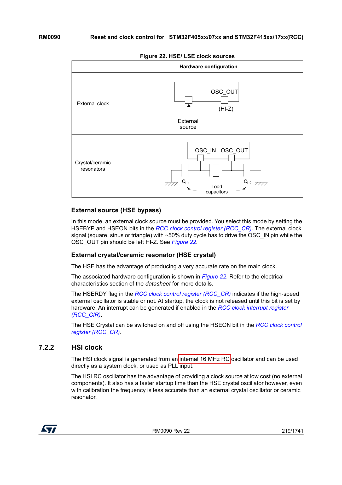

# 节点一 · 点亮 LED 灯

> **练习模式分工**：资料、截图、讲解、编译烧录命令——AI 已全部备好；**代码你手敲**进
> `practice` 分支的 `User/main.c`。`main` 分支的 `main.c` 是参考答案（卡壳 15 分钟以上再看）。
>
> **两库关系一句话**：寄存器版和 HAL 版**思路完全一样**（看图定引脚 → 开时钟 → 配模式 →
> 操作电平 → 看现象），所以第一节、第二节两版共用；第三节是寄存器版专属、第四节是 HAL 版
> 专属，各讲各的不同。**先做寄存器版，通过后再做 HAL 版。**

---

## 一、看图说话：这颗灯是怎么接的？（两版共用）

### 1.1 LED 电路——判断高低电平


**怎么读这张图**：这是原理图第 3 页"用户按键和LED"区域（红框部分）。从左往右读：

```
网络 LED1 ──→ LED（红色） ──→ 电阻 R9（4.7K） ──→ GND
```

信号从 **PD10** 流出，经过 LED，再经 4.7K 电阻进地。**电流方向：PD10 → LED → GND**，
所以 **PD10 输出高电平（3.3V）灯亮，输出低电平（0V）灯灭**。

三个坑提前排掉：
1. **和 F103 板相反**！F103 精英板是 3V3→LED→引脚（低电平亮）。本板是引脚→LED→GND（高电平亮）。一切以原理图为准，不要凭旧经验。
2. 图里元件位号写着 `LED3`，网络名却是 `LED1`——**位号是原理图里的元件编号，网络名是信号名，两码事**。板上丝印是 `LED1`（红灯）。
3. 4.7K 是限流电阻：电流 ≈ (3.3V − 红灯压降约2V) ÷ 4700Ω ≈ 0.3mA。电流小但足够点亮指示灯。

### 1.2 引脚分配表——确认引脚号


**怎么读这张图**：原理图第 7 页"引脚分配"表（红框一行）：**网络 `LED1` → 引脚 `PD10`**。
同列往下：LED2=PD11、LED3=PD12、KEY1/2/3=PD13/14/15（节点二要用，先混个脸熟）。

**节点一结论（已双源核实：坐标提取+视觉读图）**：

| 项目 | 值 |
|---|---|
| 目标灯 | 板上丝印 LED1（红色） |
| 引脚 | **PD10** |
| 点亮电平 | **高电平** |

---

## 二、通用知识：F4 的 GPIO 和 F103 有什么不一样（两版共用）

### 2.1 四步流程不变，寄存器全换了

方法论**原封不动**：**确定引脚 → 开时钟 → 配模式 → 操作电平 → 现象验证**。
但寄存器层面 F4 是另一套，迁移时最容易犯"拿旧地图找新大陆"：

| 步骤 | F103（你学过的） | F407（本板的） |
|---|---|---|
| 开 GPIO 时钟 | `RCC->APB2ENR`（APB2 总线） | `RCC->AHB1ENR`（**换到 AHB1 总线了**） |
| 配输入/输出 | CRL/CRH，每脚挤 4 个位 | **CRL/CRH 不存在了**，改用 4 个独立寄存器：MODER（方向）/ OTYPER（推挽开漏）/ OSPEEDR（速度）/ PUPDR（上下拉） |
| 输出电平 | BSRR / BRR / ODR | BSRR（ODR 也有，读改写用） |

### 2.2 开时钟：AHB1ENR 的第 3 位


**怎么读这张图**：RM0090 中文版 PDF 第 244 页，`RCC_AHB1ENR` 位表（红框处）——
**bit 3 = GPIODEN**（GPIO **D** port clock **EN**able）。写 1 = 给 GPIOD 供电，写 0 = 断电
（断电状态下写 GPIOD 寄存器无效，这是"外设先开时钟"的根本原因）。

**手册依据**：RM0090 中文版 PDF 第 243 页（寄存器表头、地址偏移 0x30）+ 第 244 页（位表）。

### 2.3 配模式：MODER 每脚占两位


**怎么读这张图**：第 283 页 `GPIOx_MODER` 位表（红框处）。**每个引脚占 2 位**：
`00`=输入、`01`=输出、`10`=复用功能、`11`=模拟。PD10 对应 **MODER10，占 bit[21:20]**。

**怎么算 21:20**：脚号 × 2 = 起始位号。10 × 2 = 20，两位就是 [21:20]。
（同 F103 的 CRH 格子公式 (n−8)×4 一个道理，只是 F4 每脚从 4 位减到 2 位。）

**手册依据**：RM0090 中文版 PDF 第 283 页。同族寄存器还有：OTYPER（第 281 页，复位值全 0=推挽，不用改）、OSPEEDR（第 282 页，复位值全 0=低速，够用）、PUPDR（第 282 页，复位值全 0=无上下拉）。**复位默认值恰好就是我们要的推挽低速无拉，所以这三个寄存器本节点不用写**——但要心里有数，不是"不存在"。

### 2.4 操作电平：BSRR 置 1 清 0


**怎么读这张图**：第 286 页 `GPIOx_BSRR` 位表。低 16 位 BS0~BS15（红框左）：写 1 = 该脚输出高；
高 16 位 BR0~BR15（红框右）：写 1 = 该脚输出低。**写 0 无任何作用**，所以置位清零都是"一次写
完成"，不受干扰——这叫原子操作（F103 的 BSRR 同款，用法没变）。

**手册依据**：RM0090 中文版 PDF 第 286 页。

⚠️ **F103 的 BRR 在 F4 上不存在**（实测踩坑：AC5 报 `#136: has no field "BRR"`）。铁证：头文件
`stm32f407xx.h` 第 526~537 行，GPIO_TypeDef 成员只有 MODER/OTYPER/OSPEEDR/PUPDR/IDR/ODR/BSRR/LCKR/AFR。
F4 清零只走 BSRR 高 16 位：`GPIOD->BSRR = GPIO_BSRR_BR10`（BR10=bit26）；置位走低 16 位
`GPIO_BSRR_BS10`（bit10）。头文件里残留的 `GPIO_BRR_BRx` 宏只是兼容别名（指向 BSRR_BRx），别用。

### 2.5 现在芯片跑多快？——延时参数的依据


**怎么读这张图**：第 217 页时钟树。左中位置红框 `16 MHz HSI RC`——内部高速振荡器，出厂固定
16MHz。复位之后 SYSCLK 的选择开关（图中 SW）默认指向 HSI：**上电 8 个周期后芯片就在
16MHz 上跑，任何配置都不用做**（F103 复位默认 8MHz HSI，同理）。



**手册依据**：RM0090 中文版 PDF 第 217 页（时钟树图）、第 219 页 §7.2.2 原话：
"The HSI clock signal is generated from an internal 16 MHz RC oscillator"。

⚠️ 前瞻：本板外部晶振 8MHz（原理图 X1），以后时钟节点会配 PLL 上 168MHz。**但现在先不碰**——
16MHz 点灯绰绰有余，而且不依赖晶振实测（板上丝印还没核实）。延时的换算：**1ms = 16000 个时钟**。

---

## 三、寄存器版

### 3.1 要碰的寄存器全家福

| 寄存器 | 地址（怎么来的） | 干什么 | 写什么 |
|---|---|---|---|
| `RCC->AHB1ENR` | 0x40023830（RCC 基址 0x40023800 + 偏移 0x30） | 开 GPIOD 时钟 | `1<<3`（bit3=GPIODEN） |
| `GPIOD->MODER` | 0x40020C00（GPIOD 基址 + 偏移 0x00） | PD10 配输出 | 先清 `[21:20]` 再写 `1<<20` |
| `GPIOD->BSRR` | 0x40020C18（偏移 0x18） | 亮/灭 | 亮=`1<<10`，灭=`1<<26` |

> GPIOD 基址 0x40020C00 的依据：头文件 `stm32f4xx.h` 中 `#define GPIOD_BASE 0x40020C00U`
> （GPIOA~E = 0x40020000 起每端口 +0x400）。`GPIOD->MODER` 就是编译器替你算的 0x40020C00。

### 3.2 五步骨架（先想清楚再敲）

1. **开时钟**：AHB1ENR 的 bit3 置 1（读-改-写 `|=`，别把别的位冲掉）
2. **配输出**：MODER 的 [21:20] **先清 0 再写 01**（"先清后写"防旧值残留——F103 同款习惯）
3. **延时工具**：SysTick 三寄存器（LOAD/VAL/CTRL），F103 的 delay 原理照搬，**LOAD 填 16000−1**（16MHz÷1000）
4. **主循环**：BSRR 写 `1<<10` → 延时 → 写 `1<<26` → 延时
5. 编译 F7 看 `0 Error, 0 Warning` → 烧录 → **看红灯 500ms 节奏**

### 3.3 delay_ms 逐行讲

```c
static void delay_ms(uint32_t ms)
{
    SysTick->LOAD = 16000U - 1U;   /* 数 16000 个时钟=1ms；-1 因为从"满值"数到 0 含头含尾 */
    SysTick->VAL  = 0U;            /* 当前值清零，强制从 LOAD 开始数 */
    SysTick->CTRL = 5U;            /* bit0=使能、bit2=时钟源选 CPU 时钟(16M)，不开中断 */
    while (ms-- > 0U) {
        while ((SysTick->CTRL & (1U << 16)) == 0U) { }  /* bit16=COUNTFLAG：数到 0 自动置 1，读后自清 */
    }
    SysTick->CTRL = 0U;            /* 关表，省电 */
}
```

### 3.4 完整参考代码

**在 `main` 分支 `User/main.c`（GitHub 网页或 `git show main:User/main.c` 可看）**。
练习规则：不看答案先自己敲，卡壳 15 分钟以上再对照。你敲的是 practice 分支的空模板，
目标编译 `0 Error(s), 0 Warning(s)`，Program Size 约在 **Code=700B** 上下（比这大很多
说明思路跑偏了）。

### 3.5 编译与烧录

编译：Keil 里按 **F7**。烧录（Git Bash，原样可抄）：

```bash
cd C:/Users/26476/Desktop/F407-Lab/reg/f407-reg-lab/MDK-ARM
"C:/Program Files/STMicroelectronics/STM32Cube/STM32CubeProgrammer/bin/STM32_Programmer_CLI.exe" -c port=SWD mode=UR -w Objects/f407-reg-lab.hex -v -rst
```

⚠️ `-rst` 不能省（否则芯片停在暂停态，灯不闪你还会以为代码错了——F103 项目验证过的坑）。

### 3.6 寄存器版验收标准

| 项 | 标准 |
|---|---|
| 编译 | 0 Error 0 Warning |
| 烧录 | CubeProgrammer 报 Verified |
| 现象 | **LED1 红灯 0.5s 亮 0.5s 灭，节奏均匀**（LED2/LED3 不动） |
| 体积 | Code≈700B（多了很多说明 F103 的 CRL/CRH 习惯带进来了） |

---

## 四、HAL 库版（寄存器版通过后再开工）

### 4.1 思路一样，HAL 只是个"代办员"

四步流程不变，只是每步从"你亲手写寄存器"变成"你喊 HAL，它替你写寄存器"。
**对照表（HAL 调用 ↔ 它实际写进的寄存器）**：

| 你写的 HAL 调用 | HAL 替你写进哪个寄存器 |
|---|---|
| `__HAL_RCC_GPIOD_CLK_ENABLE()` | `RCC->AHB1ENR \|= 1<<3`（同 2.2） |
| `HAL_GPIO_Init(GPIOD, &...)` | 按 4 个字段写 `MODER/OTYPER/OSPEEDR/PUPDR` 四连 |
| `HAL_GPIO_WritePin(GPIOD, pin, SET/RESET)` | `BSRR = pin` 或 `BSRR = pin<<16`（同 2.4） |
| `HAL_Delay(500)` | 靠 SysTick **1ms 中断**累计 uwTick 再查差值（寄存器版是轮询 COUNTFLAG，两派原理见 F103 知识卡） |

所以 HAL 版"学什么"？**学两件事**：①初始化用结构体传参的套路（Pin/Mode/Pull/Speed 四字段）
②`HAL_Delay` 为什么依赖 SysTick 中断（顺带明白：**中断里调 HAL_Delay 会死等**——uwTick 不走了）。

### 4.2 工程与练习场

- 工程：`C:\Users\26476\Desktop\F407-Lab\hal\f407-hal-lab\MDK-ARM\f407-hal-lab.uvprojx`
- HAL 仓库同样两分支：`practice`（你敲）+ `main`（参考答案）
- 脚手架已给（`HAL_Init()`、`stm32f4xx_it.c` 的 SysTick 心跳、`MX_GPIO_Init` 空壳）；
  **你要写**：MX_GPIO_Init 里开时钟+结构体四字段+HAL_GPIO_Init，以及主循环亮灭交替

### 4.3 HAL 版验收标准

| 项 | 标准 |
|---|---|
| 编译 | 0 Error 0 Warning |
| 现象 | 与寄存器版**完全一致**（红灯 0.5s 节奏） |
| 体积 | Code≈3196B（参考答案实测）——对比寄存器 700B，体会 HAL 的代价 |

---

## 五、验收总表（节点一完成后填提交号）

| 腿 | 编译 | 现象 | 体积 | 提交 |
|---|---|---|---|---|
| 寄存器 | ☐ 0错0警 | ☐ 红灯500ms | ☐ ≈700B | ☐ `1. 点亮LED灯（寄存器版）` |
| HAL | ☐ 0错0警 | ☐ 红灯500ms | ☐ ≈3196B | ☐ `1. 点亮LED灯（HAL库版）` |

**提交信息格式**（两个仓库各自提交）：`1. 点亮LED灯（寄存器版）` / `1. 点亮LED灯（HAL库版）`
——节点编号开头，这是我们的仓库规矩。

---

## 附：本节踩坑预告（AI 埋雷区，遇到了别慌）

- 灯完全不亮：先查 BSRR 是不是写成了 ODR 的地址（偏移 0x14 vs 0x18）
- 灯常亮不闪：delay 里 COUNTFLAG 位（bit16）没等对，或 CTRL 的 bit2 忘了置（时钟源错）
- 编译器报 `GPIOD` 未定义：头文件必须是 `stm32f4xx.h`，且工程宏 `STM32F407xx`（模板已配好）
- 烧录成功但全无反应：99% 是忘了 `-rst`
